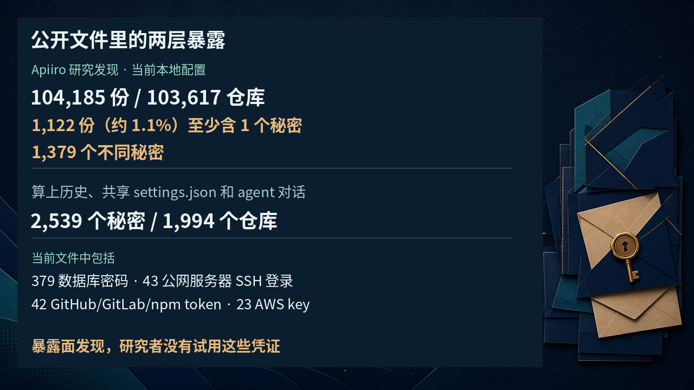

# 点一次「以后别再问」，密码也会留下：公开仓库 1,122 份配置含秘密，研究者没有试用这些凭证

你正在赶一个修复。Claude Code 要跑命令，又弹出确认。看过，没问题，点一下「以后别再问」。终于不用反复打断了。

但如果那条命令里，恰好写着数据库密码呢？

你以为留下的是一句「这个操作可以」。实际留下的，可能是包含密码的整条命令。它被写进项目根目录的 `.claude/settings.local.json`，成了一条以后继续生效的权限规则。

**省掉一次确认，也可能多存下一份秘密。**

软件安全公司 Apiiro 的 Shmulik Cohen 和 Matan Giladi 在 2026 年 11 月 5 日发布[这项研究](https://apiiro.com/blog/coding-agents-leaking-secrets-github-dont-ask-again)。[The Hacker News 的报道](https://thehackernews.com/2026/11/claude-codes-dont-ask-again-file.html)和 [iTWire 的报道](https://itwire.com/business-it-news/security/claude-code-approval-files-found-exposing-company-secrets-on-github-says-apirro-researchers)都在 11 月 7 日刊出。

这不是靠恶意提示词套出密码，而是一个正常授权流程，把不该长期保存的东西一起记住了。

## 你批准的可能不是一类操作，而是一整条命令

Claude Code 默认会在执行大多数 shell 命令前询问。Bash 的「Yes, and don't ask again」，会把允许规则写进本地配置，后续会话匹配上了就不再问。

[官方权限文档](https://code.claude.com/docs/en/permissions)把这个期限写得很清楚：按仓库、按命令永久保留。别和文件修改的免确认混淆，后者只在当前会话有效，不会这样存进文件。

关键在于，弹窗给你的批准范围是什么。

对正在干活的人来说，这两个动作很容易在脑子里合并：允许它把眼前的活干完，和允许它把整条命令存下来。前者是一次执行决定，后者却改变了项目目录里会长期留下什么。下次打开仓库，确认框不再出现，那条带着秘密的规则仍可能在那里。

有时是带通配符的模式，有时是一个精确命令。官方文档说，不带 `*` 的规则匹配一条确切命令。比如 `Bash(npm run lint)`，记住的是这一条，不是所有开发操作。

如果那条确切命令里直接打了密码或 token，保存的规则就把它一字不落地带走，明文落盘。

研究者用 Claude Opus 5.5 和 Claude Fable 5.1 复现了这一保存行为。

这时，权限配置已经不只记录「能做什么」，也记录了「拿什么去做」。

## 1,122 份含秘密的文件，不等于 1,122 次入侵

Apiiro 在 11 月 1 日至 3 日收集公开 GitHub 数据，找到 103,617 个仓库里的 104,185 份本地配置。

其中 **1,122 份，约 1.1%，至少含一个秘密；去重后是 1,379 个不同秘密。**

当前文件里包括 379 个数据库密码、43 个面向公网服务器的 SSH 登录、42 个 GitHub、GitLab 和 npm token，以及 23 个 AWS key。涉及 63 个组织，多数是不同规模的软件公司。这几类不是全部秘密的加总表。

范围再扩到 Git 历史、共享的 `.claude/settings.json` 和保存的 agent 对话，总数变为 **1,994 个仓库、2,539 个秘密**。这和只看当前本地配置，是两种统计范围，不能混着说。共享配置单独看，76,011 份里有 298 份含秘密，多写在允许规则里。

看到一千多份，不必把所有 Claude Code 项目都想成出了事；看到约百分之一，也别觉得只是一个可以忽略的小尾巴。这里每一份被留下的配置，都可能对应一个原本只想把工作做完的开发者。风险不在数字够不够吓人，而在保存秘密这件事是否进入了他的预期。

这些数字来自 Apiiro，不是独立复核后的行业普查。研究流程先识别密钥格式，或公开服务器地址旁的密码和 token，再让 AI 审核候选；iTWire 说，送审前候选值经过遮蔽。

**研究者没有试用这些凭证，也没有验证它们现在是否有效。**

他们在 11 月 2 日和 3 日通知受影响组织，一家公司确认暴露的 key 曾有效。但有效不等于被人用过，更不等于已经发生入侵。

The Hacker News 写到，截至报道所说的周一，每份含秘密的文件仍在仓库默认分支上；一半仓库里，这份文件至少已经待了 217 天。

## 文件叫 local，不代表 Git 会替你守住它

说 Claude Code 默认把秘密往 GitHub 发，也不对。

[官方设置文档](https://code.claude.com/docs/en/settings)写明：在尚未忽略该文件的 Git 仓库里，Claude Code 首次写入它时，会把对应规则加进用户本机的全局 Git excludes。

这道保护是真实存在的。问题是，它属于一个用户的一台电脑，不像提交进仓库的 `.gitignore`，能跟着项目走。Claude Code 不会替你把它加进项目自己的 `.gitignore`。

如果文件是手工创建、Claude Code 还没写过，文档也要求你自己补上忽略规则。

团队有意提交的共享配置叫 `.claude/settings.json`，本地配置则多了一个 `.local`。前者本来就可能用于协作，后者本来想留给个人。两个文件用途不同，却都不能因为名字像配置，就被默认当成没有敏感内容。

还有一个更容易踩的坑：**Git 忽略规则不管已经被跟踪的文件。**

文件先被提交了，后来再有 excludes，也不会自动退出版本控制。「local」描述的是应用怎么使用它，不是 Git 给它加上的禁止外传标签。

研究者回溯的 1,105 个仓库里，有 539 个出现过把 Claude 列为共同作者、并改过该文件的提交。他们据此认为，Claude 常常自己提交这份文件。这并不能证明每一次暴露的凭证，都是它引入或推上去的。

## 删掉今天的文件，也删不掉昨天的密码

研究者在旧版本里，又找到 509 个仓库中的 734 个秘密，它们已不在任何当前副本里，通常是因为文件被删了。还有 74 个仓库的 211 个 fork，带着与原仓库相同的秘密。

所以研究者建议的顺序，是先轮换或撤销曾经留下的凭证，再清理文件、停止跟踪，并把本地配置加入项目自己的 `.gitignore`。GitHub 的建议也是先撤销或轮换。

只删当前文件，看上去干净了，历史、fork 和别人的克隆却不会一起消失。

没传上 GitHub，也不代表可以不管。这仍是项目目录里的一份普通 JSON，可能随着 npm 包、Docker 镜像、压缩包或同步目录一起走。

## 扫描器没报警，不等于配置里没有秘密

在这 1,122 份文件中，gitleaks 标出 564 份，TruffleHog 标出 643 份，有 215 份两者都没标出。

原因不玄学。数据库密码未必有醒目的密钥前缀，放在命令里，可能只是一个普通词。工具识别固定格式很拿手，识别一句日常命令里的敏感含义，却未必稳。

研究者建议把秘密留在秘密管理工具中，命令只引用 `$DB_URL` 这样的变量名。把密码直接写进内联环境变量赋值，并没有把它移出命令文本。

批准规则也应尽量表达操作范围，而不是把一次带着秘密的执行现场永久存档。

## 旧问题被关闭，不代表保存方式已经修好

这也不是第一次有人发现。The Hacker News 提到，早在 2025 年 8 月 11 日，就有人报告带 API key 和 token 的批准命令被原样存入配置。报告在连续 60 天没有活动后，于 2026 年 1 月 3 日被自动机器人以「not planned」关闭。

关闭的是工单，不是泄露路径。iTWire 也提醒，这不能当作问题已经修复的证据。安全公司 ironPeak 在 2026 年 2 月讲过类似经历：已提交的 Claude 配置里，留着带数据库密码和 API key 的批准命令。

这些早期报告能支持保存机制确实值得警惕，却不能替 Apiiro 的新统计背书。机制是否存在、公开仓库里到底暴露了多少、凭证有没有被人使用，是三件需要分别举证的事。

## 真正难的是让授权记住边界，而不是记住秘密

Apiiro 对比了 16 款编程助手的文档，只有 Claude Code 被确认默认把完整已批准命令写进项目文件。这不是说其他工具绝对安全，更不能据此宣布它们没有别的泄露路径。

这件事刺眼的地方，在于用户没有要求公开密码，只是想少点几次确认。全局忽略提供了一层保护，却挡不住已经跟踪、历史留存和项目副本流转。

真正难的不是让开发者每次弹窗都更紧张，而是让工具持久记住操作许可时，不把执行那一刻用过的秘密也当成许可的一部分。
