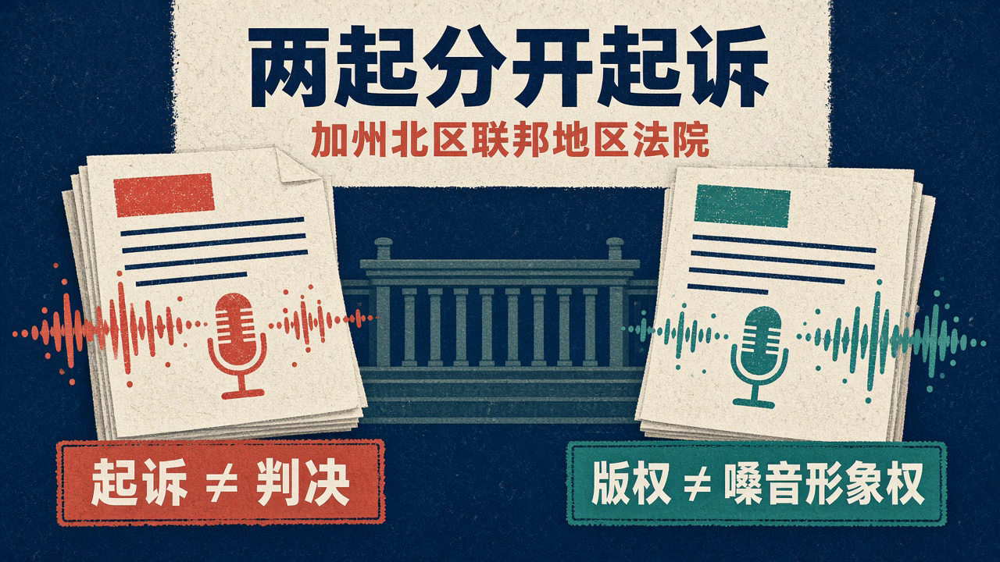
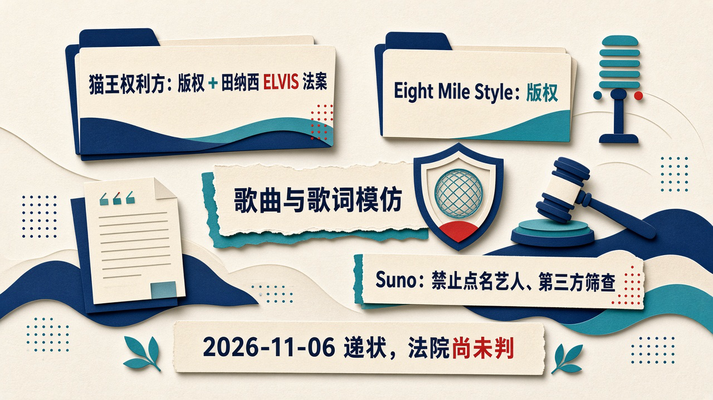

# 起诉不是判决：猫王权利方援引 ELVIS 法案告 Suno 克隆嗓音，Eminem 出版方另告版权

你正在给短视频配乐。提示词输进去，几十秒后，一首完整的歌出来了。旋律能用，歌词顺口，嗓音还有点像熟悉的歌手。

真要把它放进客户项目里，问题就来了：这份“像”，到底碰到了谁的权利？

这不是一条看完就能划走的名人与工具起诉热闻。关键不是谁的名字更响，而是起诉了什么、什么已经确认、什么还只是指控。

[Variety 的报道](https://variety.com/2026/music/news/elvis-eminem-sue-suno-ai-music-generator-1236941798/)把两份诉状摆到了台前：猫王音乐权利方和掌控数百首 Eminem 作品的出版方 Eight Mile Style，分别起诉 Suno。

Variety 标注的刊出时间是 2026 年 11 月 7 日上午 8:15 PT，换算为亚洲/上海是 2026 年 11 月 8 日 00:15。先记住两件事：这是两起分别提起的联邦诉讼，不是一家联名起诉；起诉也不等于法院已经判定侵权。

## 同一批律师，递的是两份起诉书

被告都是 Suno, Inc.，但两边主张的权利不能打包成一团。

猫王一案，Variety 点名的原告包括 Authentic Brands Group、Raleigh Music Publishing 等权利方。起诉书封面还列有 Elvis Presley Enterprises, LLC 和 ABG EPE IP LLC。

这份 51 页的起诉书于 2026 年 11 月 6 日周五递交美国加州北区联邦地区法院，案号是 3:26-cv-13398。

另一份来自 Eight Mile Style。按 Variety 的描述，这是一家掌控数百首 Eminem 作品的出版方 LLC，涉及《Lose Yourself》《Without Me》《The Real Slim Shady》等作品。

这里尤其不能把标题压缩成“Eminem 起诉 Suno”。Variety 明确写了，Eminem 本人没有以个人身份参与这起诉讼。

[Billboard 的报道](https://www.billboard.com/pro/elvis-presley-ai-voice-cloning-lawsuit-suno/)称，同一批律师也在周五为 Eight Mile Style 另行起诉；CBS Detroit 称该案同样递交加州北区联邦地区法院。两边由同一批律师代理，不意味着原告合并，更不意味着它们用了完全相同的法律路径。

## 猫王案不只问歌像不像，还问嗓音被谁利用

猫王权利方的诉状，有两条需要拆开的主线。

一条是版权。作品有没有被未经授权使用，生成内容有没有侵犯受保护的表达，这是版权争议。

另一条是人的嗓音与身份。就算没有直接搬出某首歌的歌词，一个产品能不能未经许可，利用大家一听就会联想到某位歌手的声音来做生意？这不是把“版权”换个词再说一遍。

比如，给客户交付配乐时，“歌词是新写的”和“声音身份获得了许可”就是两个不同的回答。前一个回答即使属实，也没有自动回答后一个问题。反过来，围绕嗓音的争议，也不能替代对具体歌曲表达的版权判断。

据 Variety，原告指控用户生成歌曲时点名猫王，平台便利用了他的身份，还允许生成体现猫王“丰富的嗓音色彩”的曲目，而没有取得许可。

为此，原告援引田纳西州 2024 年通过的 ELVIS 法案，全称 Ensuring Likeness Voice and Image Security Act。Variety 将其概括为禁止 AI 公司未经授权克隆歌手嗓音的法律。

起诉书还提出田纳西普通法公开权、规避技术保护措施、删除或篡改版权管理信息等案由。但新闻的核心，不是把这些法律名词堆满屏幕，而是作品权利与嗓音身份保护同时进入争议。

诉状里甚至写道，“下一个猫王不会拿起吉他”，并指责 Suno 把艺人的身份、劳动、创造力和时间编码进系统，变成持续赚钱的流水线。

这是起诉方的强烈表达，不是法院认定。ELVIS 法案能否支撑这些具体主张，要由案件继续检验，不能从一份诉状直接跳到胜诉结论。

## Eight Mile Style 告的是歌曲与歌词模仿

另一案的落点不同。

按 Variety，Eight Mile Style 指控 Suno 允许用户生成模仿 Eminem 曲目及歌词的歌曲，侵犯其版权。

报道没有说这起案件也援引 ELVIS 法案。不能因为两起案子同时出现，就把猫王案的嗓音权主张自动复制过去。

Variety 还说，两份起诉书都附上了生成曲目的例子，声称有的听起来像猫王，有的歌词复刻了 Eminem 的作品。

这些是原告提交的举证与主张，不是已经完成的司法鉴定，也不是听众凭耳朵投票就能定案。

“听起来像”足以让一个创作者警觉，却还不是完整的法律结论。从样本到责任，中间还有具体主张、证据和法律适用。越是容易被传播的几秒音频，越不能替法院把这些环节全部省略。

对做音乐和内容的人来说，这个区别很实际：声音让人联想到谁，和歌词、歌曲表达用了什么，可能触及不同的权利。把它们都叫“AI 模仿”，反而遮住了真正要争的东西。

## Suno 说有防护，原告说仍能生成争议内容

Suno 对 Variety 的回应，也必须单独放回它自己的位置。

Suno 发言人表示，平台存在是为了帮助人们创作新的、原创的音乐，不是拿任何人的姓名或形象做交易，并禁止未经授权使用艺人作品。

为防止滥用，Suno 称，不允许针对特定艺人姓名和歌曲的提示词，也与第三方服务商合作，筛查上传的音频文件和歌词是否存在潜在滥用。

公司还表示，会持续加强防护措施，继续增加保护艺人和用户的新保障。

这份回应没有说“我们从没用版权音乐训练”，也没有在这段声明里提出“公平使用”辩护。不能拿别处听过的说法，替它补成更完整的答辩。

眼下的分歧很清楚：平台描述自己的限制和筛查，原告则拿生成样本质疑其行为。宣称有防护，不自动证明争议不存在；原告交出样本，也不自动证明全部诉请成立。

## 一首歌生成得出来，不代表权利问题已经解决

这起新闻刺中做事的人，是因为创作入口已经很轻，权利关系却没有跟着变轻。

做内容的人在意能不能交稿，音乐人则在意自己的作品和辨识度如何被使用。这两种关切并不因为一个按钮就消失。眼下两份诉状提出的，恰恰是生成界面没有替任何一方解决的问题。

一个人需要的可能只是三十秒背景音乐；权利方在追问的，却可能是作品、歌词、嗓音身份分别怎样被使用。工具把这些东西合进一个生成按钮，不意味着法律也只剩下一种问题。

目前能确认的是，两起诉讼分别提起，猫王案同时涉及版权与 ELVIS 法案，Eight Mile Style 另案主张版权，Suno 则强调自己的限制与筛查。法院尚未判定侵权，更没有这两案已经判赔的结论。

这当然推不出“AI 音乐被判死”，也推不出所有生成工具都违法，或者用户马上不能再用 Suno。

真正被这两份诉状推到法院面前的，是生成速度之外那笔尚未厘清的账：一首歌可以瞬间出现，但作品与嗓音背后的权利，不会因此自动变成免费素材。
