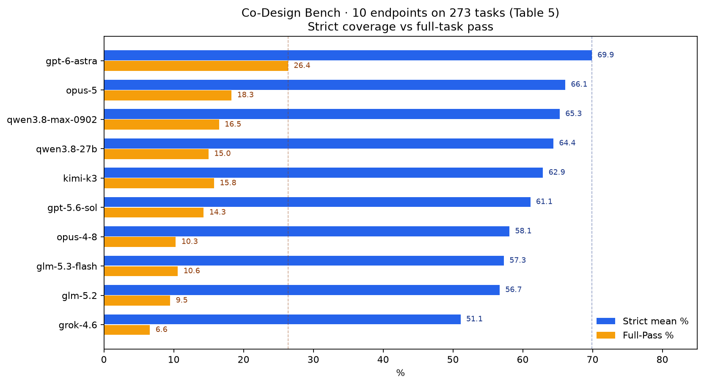
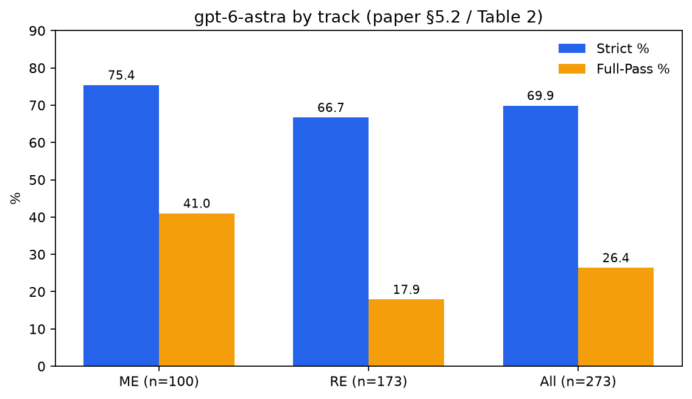
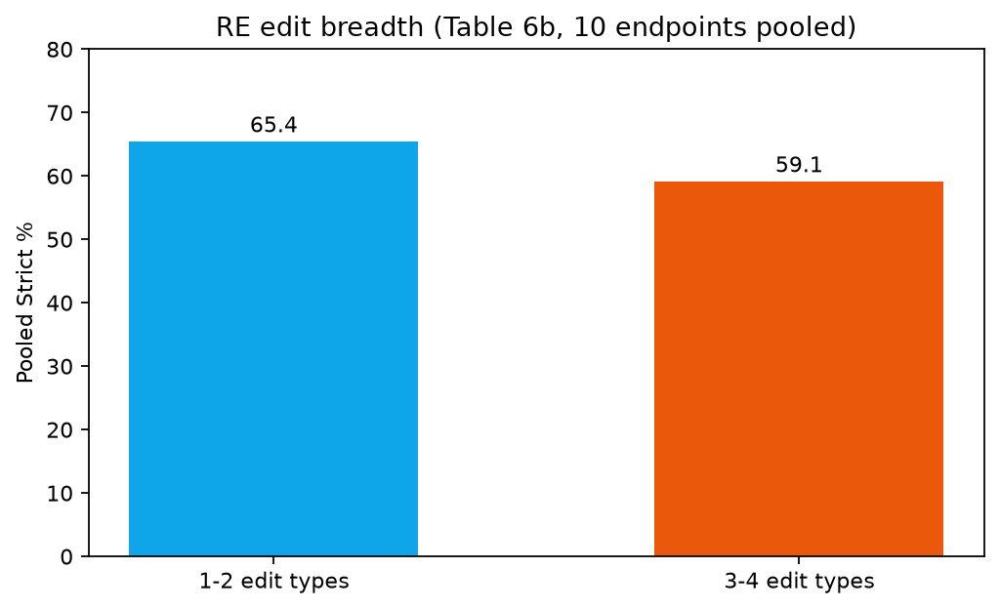

# 平均满足约七成要求，整题全过只有 26.4%：Co-Design Bench 里 AI 改应用还差整单交付

你让编程助手改一个现成页面。它跑完了，界面也动了，看起来大半要求都对上了。

可验收时总会卡在一处：某条依赖汇总没跟着更新、某个状态恢复没接上，或者附件里读到的数字只落进了半个视图。

「大部分写对了」和「这道题整单过关」不是一回事。

阿里 Token Hub 与复旦、浙大、港中大、交大、南洋理工等机构的研究者，在 [Co-Design Bench](https://arxiv.org/abs/2610.35138) 里把这件事量了出来；项目页在 [codesignbench.github.io](https://codesignbench.github.io/)。[The Decoder 在 2026 年 11 月 8 日的报道](https://the-decoder.com/ai-coding-agents-still-need-human-cleanup-on-nearly-three-out-of-four-tasks-in-a-real-world-test/)也抓住同一条裂缝：最强端点平均能满足约七成验收标准，却只在 26.4% 的任务上整题全过。

这不是谁家聊天体感更强的排行榜，也不是亲测某一款产品好不好用。它是在统一 agent 执行环境里，对 273 道真实会话改应用题给出的基准分数。

## 2.6 万会话不是直接变成 273 题

论文首页标注 arXiv:2610.35138v1，日期是 2026 年 10 月 26 日。题目写明：多模态协作编码评测，面向 agentic 模型。

数据从生产侧编码会话来。源语料先有 39,325 条查询，覆盖 26,314 次真实编码会话；去重后留下 37,463 个候选。再经过可运行起点恢复、过滤、按难度与可验证性排序、专家写隐藏验收标准，才定成 273 道题、2,331 条准则。

所以「约 2.6 万会话筛出 273 题」方向没错，但中间还有查询去重和大量筛除。会话也不等于笼统说的「所有真实编程任务」——主体是前端改应用，且最终题集偏难、偏可验收。

两轨分法也很具体：

- 多模态编辑 ME：100 题，局部视觉、结构、内容修改，可附图片、音频、视频或文档；553 条准则。
- 仓库编辑 RE：173 题，跨组件、路由、状态与数据流的协同改动；1,778 条准则。

题面给的是可运行的改前应用、规范化请求和可选附件；验收标准对求解 agent 隐藏。没有金标准代码，也没有目标截图当答案。

论文举的收据题很能说明「局部改对了仍可能整单不过」：要从单据里读出一个数值，写进可编辑行，还得让依赖汇总一起对上。只改表格、不改汇总，Strict 会吃分，整题全过直接失守。仓库轨的剪辑器题则把时长上限、条数上限、删除或拆分后的恢复、时间轴对齐缠在一起——界面上看得出按钮，不等于状态机已经按请求转完。

## 七成要求过关，不等于这道题过关

主对比固定 Claude Code 这套 harness，十个模型端点各跑同一批 273 题。Agent 可以在同一次运行里检查、编辑、构建并执行应用，上限是三小时墙钟时间和 120 轮；碰到轮次上限，评测的是最终工作区状态，而不是第一稿代码。

论文写得很清楚：验收看的是最终应用状态；分数也只认最终候选，中间改对过、最后又没留下的东西不计分。

因此这里的 Full-Pass（整题全过）指：这一轮 agent 跑完后，隐藏准则条条都是 Pass。它允许同题内反复改、跑、修，不等于「单次生成、不许修复」的第一遍就全对。

评测本身先 build、渲染，用源码与浏览器证据给每条准则打 Pass / Partial / Fail；再由另一个 LLM 去反驳正面结论，查桩代码、硬编码、不可达入口和需求错位；视觉与交互主张还要有截图或操作记录，缺证据就中止计分。

最强端点按论文 Table 5 / Table 2 写作 **gpt-6-astra**。它在全部 273 题上的平均严格完成率是 **0.699**，也就是每道题里平均约 **69.9%** 的准则拿到 Pass；整题全过率只有 **26.4%**。换句话说，仍有 **73.6%** 的任务至少留着一条没完全过的准则。

分轨更刺眼：

| 范围 | Strict 平均 | 整题全过 |
| --- | --- | --- |
| ME 100 题 | 0.754 | 41.0% |
| RE 173 题 | 0.667 | 17.9% |
| 综合 273 题 | 0.699 | 26.4% |

仓库轨更难整题交全。平均覆盖还不低，整单交付却掉到两成以下。

论文把这两条指标拆开写，正是怕读者把「平均满足很多要求」读成「任务已经做完」。Strict 看的是每条准则有没有完全通过；Full-Pass 看的是一道题里是否条条都 Pass。Partial 还能进 Graded 分，但进不了整题全过。

## 平均完成率最高，也只有四分之一任务全过

综合榜按 Strict 排序，数字来自论文 Table 5：

| 模型 | Strict | Graded | 整题全过 |
| --- | --- | --- | --- |
| gpt-6-astra | 0.699 | 0.753 | 26.4% |
| opus-5 | 0.661 | 0.719 | 18.3% |
| qwen3.8-max-0902 | 0.653 | 0.716 | 16.5% |
| qwen3.8-27b | 0.644 | 0.709 | 15.0% |
| kimi-k3 | 0.629 | 0.695 | 15.8% |
| gpt-5.6-sol | 0.611 | 0.679 | 14.3% |
| opus-4-8 | 0.581 | 0.649 | 10.3% |
| glm-5.3-flash | 0.573 | 0.639 | 10.6% |
| glm-5.2 | 0.567 | 0.637 | 9.5% |
| grok-4.6 | 0.511 | 0.580 | 6.6% |

名次会随轨道变。kimi-k3 在 ME 排第四，到 RE 掉到第六；Qwen3.8-27B 在 ME 第五，到仓库轨升到第二，Strict 0.645，略高于 opus-5 的 0.642。论文明确说，这点差距推不出该模型的普遍优势。

烧更多 token 也不自动换更高分。ME 上 gpt-6-astra 中位 32 轮、约 1.24M token，Strict 0.754；GLM-5.2 用到 69 轮、约 7.29M token，Strict 只有 0.572。

## 改动类型叠得越多，十家一起掉

仓库轨里，结构、样式、交互、内容四类改动大量重叠：173 题中有 166 题同时要多种类型。

按类型数量切一刀更清楚。十个端点池化后，1–2 类改动的 Strict 是 0.654；3–4 类掉到 0.591。论文写明：**十个端点在更宽改动组上全部更低。**

真实项目里，一次请求往往正是把布局、交互和内容缠在一起。基准分数在这里下降，不是在提醒「别用 AI」，而是在提醒：你以为助手已经做完的那一单，常常还差最后几条耦合要求。

## 这是基准分，不是你的实测体验

主结果固定在 Claude Code harness 上。附录另测同一模型换 Codex、OpenCode、Qwen Code，名次和分差会跟着环境变。论文建议把模型与工作环境一起报，不要只报模型名。

评测也有边界：每题是一条固定请求，不模拟中途追问；LLM 裁判仍可能出错，尽管有反驳与证据审计，还有前端专家抽查了 200 份任务–模型输出。

另外，旧基准在 agent 可自跑自修时会冲到接近满分。论文用 WebCompass-edit 的 150 题做对照：同一套 rubric 下，qwen3.7-plus 从单次生成的 73.6% 升到 agentic 的 95.1%；opus-4-8 agentic 达到 99.4%。那是另一套题池与协议，不能和 Co-Design Bench 的 26.4% 直接加减。它只说明：执行方式会改分数；即便允许迭代修复，接近满分也不等于真实改应用已经交完。

点开改完的页面，走一遍插入、删除、恢复，再核对附件里的数字有没有落到每一个依赖视图——卡人的往往不是「完全没写」，而是漏掉那一条还连着别的状态的准则。只报 Strict、不看整题全过，也会把这种缺口盖住；仓库级、多类型耦合题上，盖得更狠。换一套 harness，同一端点的相对名次还可能倒过来，所以这张表也不能当成换个聊天窗口就能复现的亲测结论。

## 还差的那一条，往往才是交付

Co-Design Bench 没有宣布某家产品不能用，也没有测量「世界上所有真实编程任务」的成功率。它量的是：在这 273 道真实会话改应用题上，十个端点在允许检查、修改、构建和执行的 agent 运行里，把多少要求做对，又有多少题在最终状态上真正整题全过。

最强结果已经把裂缝写清楚了——平均约七成准则可以通过，整题全过却只有约四分之一。

下一次你看着助手改完页面、自己还要补最后一处的时候，卡住的也许不是「它完全不会写」，而是「部分要求满足」从来都不等于「这单已经交付」。
