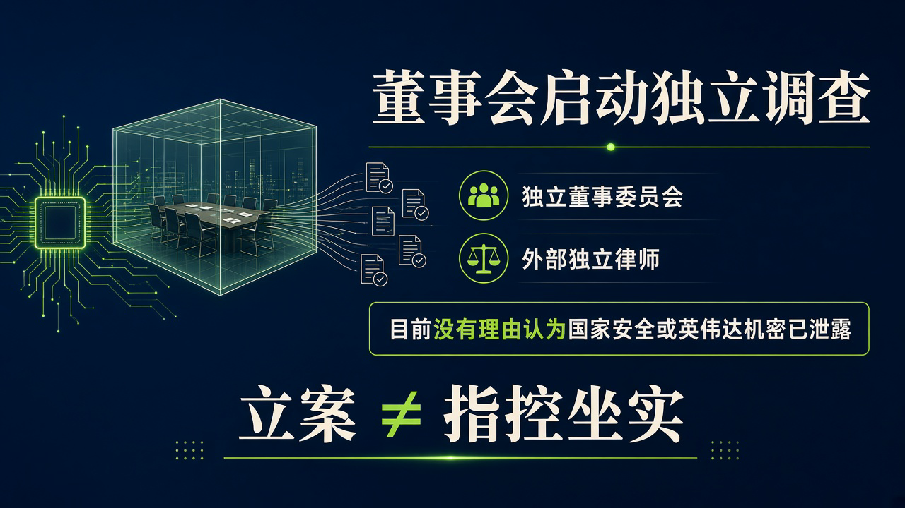
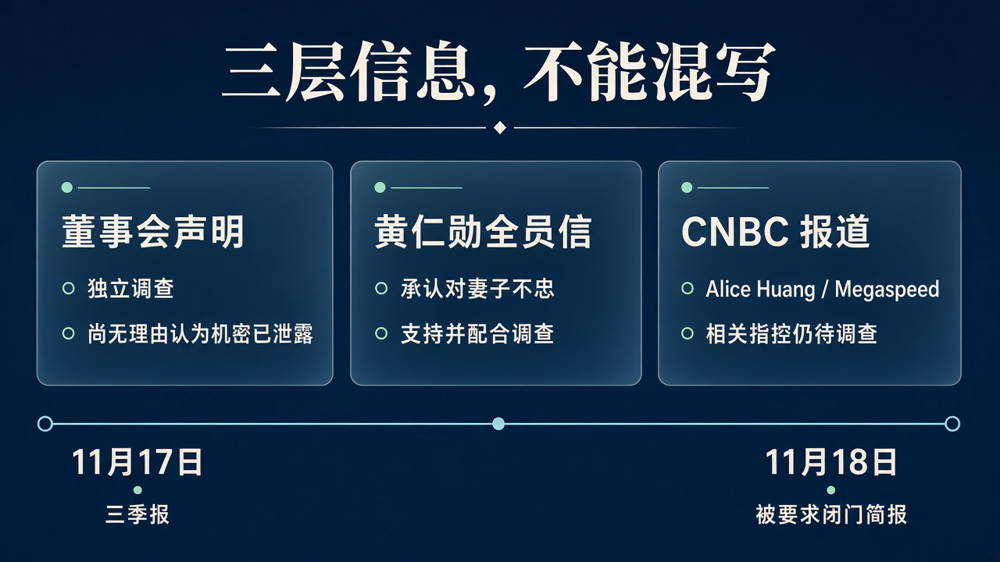

# 立案调查，不是间谍指控坐实：英伟达董事会查黄仁勋是否被外国情报针对

这不是一条看完就能划走的名人出轨新闻。

英伟达董事会启动了针对创始人兼 CEO 黄仁勋的独立调查，要查的是：他是否被外国情报活动针对。

一家处在 AI 算力供应核心的公司，董事会把这个问题正式摆上桌，分量显然不只在个人私生活。买算力、建应用、做基础设施的人，关心的是这家公司的领导层、客户关系和国家安全审查，会怎样在同一张桌上接受追问。

**调查还没结论，三季报和被要求参加的闭门简报，却已经排进了接下来几天的日历。**

但越是这样的新闻，越不能把几层信息揉成一句「黄仁勋承认了」。他承认了什么，董事会在查什么，媒体又报道了什么，答案并不相同。

## 董事会立了案，也把「尚无理由认为泄密」写进声明

英伟达新闻室日期标为 2026 年 11 月 8 日的[董事会声明](https://nvidianews.nvidia.com/news/statement-from-nvidia-board-of-directors)，没有给出具体发布钟点。

声明说，鉴于近期关于黄仁勋成为外国情报活动目标的报道，董事会正在启动独立调查。负责监督的，是独立董事组成的委员会，并由外部独立律师协助。

这里的「立案」，是董事会启动公司层面的独立调查，不是说司法机关已经对他刑事立案。

声明把美国国家安全和经济安全放在优先位置，称这对英伟达及其股东的利益至关重要。与此同时，它也明确写道：

**董事会目前没有理由认为，国家安全或英伟达机密已被泄露；调查将审视所有可获得的信息。**

前半句不是「已经查明绝无问题」，后半句也不是「已经掌握泄密证据」。两句放在一起，才是董事会此刻公开的完整位置：启动核查，但没有宣布指控成立。

董事会还说，黄仁勋完全支持审查，承诺配合；董事会对他和领导团队仍有信心，会在适当时候提供进展。

所以，启动调查与继续支持现任领导层，在这份声明里是同时存在的。不能把前者写成已经撤换 CEO，也不能用后者抹掉调查本身。

尤其要注意，董事会用的是「外国情报活动」，没有点名中国，没有写 Alice Huang，也没有写 Megaspeed。

## 黄仁勋承认对妻子不忠，没有承认间谍指控

同样标为 11 月 8 日，英伟达新闻室还刊出了另一份文件：[黄仁勋发给员工的全员信](https://nvidianews.nvidia.com/news/a-message-to-our-company)。导语说明，这是他当天早些时候发出的邮件。

这不是董事会声明，而是黄仁勋自己的话。

他在信中说，自己对妻子不忠，伤害了妻子和孩子，没有任何借口，深感抱歉。他表示为自己的行为及造成的伤害承担全部责任，也承认自己辜负了领导英伟达这份职责，将努力重新赢得信任。

谈到报道提出的国家安全担忧，他说支持董事会的独立调查，会全力配合，并承诺保护英伟达、支持美国国家安全。

信里没有写婚外情对象的名字，没有 Alice Huang，没有 Megaspeed，也没有说对方是间谍。

**承认婚外情，与承认遭情报渗透，是两件完全不同的事。**

把这两件事接成一条自动成立的因果链，省了读新闻的力气，却越过了目前最关键的证据空白。全员信确认的是他的个人行为和配合调查的态度，不是调查结论。

## Alice Huang 和 Megaspeed，来自 CNBC 的报道

[CNBC 主稿](https://www.cnbc.com/2026/11/08/nvidia-jensen-huang-investigation-china-spy.html)刊出时间换算为亚洲/上海，是 2026 年 11 月 9 日 04:12。

CNBC 报道，黄仁勋向员工承认婚外情，相关女性为 Alice Huang，与云公司、英伟达客户 Megaspeed 有关联。

关于更敏感的部分，CNBC 引用《纽约时报》和《金融时报》的报道，称美国情报机构担忧 Alice Huang 向北京传递信息。

这是 CNBC 引用其他媒体呈现的担忧和指控，不是董事会已经公布的调查发现，更不能改写成「英伟达确认中国间谍窃密」。

CNBC 还报道，Megaspeed 被指帮助受到限制的中国企业获取英伟达 AI 芯片；英伟达代表此前曾表示，Megaspeed 已因规避出口管制受到调查。

「被指」不能删，「此前」也不能删。它们分别限定了事实状态和表态时间，不能被装进这次董事会声明，冒充刚刚作出的官方认定。

至于黄仁勋是否继续担任 CEO，英伟达对 CNBC 表示，今天的消息不会拖慢公司，黄仁勋承诺不中断地继续担任 CEO。这是公司对 CNBC 的表态，与董事会表达信心方向一致，但并不是董事会声明里的原句。

信息拆开后，新闻没有变轻，反而更清楚了：个人行为已有本人承认，独立调查已有正式声明，而关于情报活动的具体指控，仍需调查回答。

## 出口管制让这件事不只停在私人关系

为什么一段私人关系，会和芯片贸易摆在同一条新闻里？

CNBC 给出的背景是，AI 对国家安全越来越重要，英伟达正处在中美贸易争端的中心。美国限制其最先进 AI 芯片对华出口，同时批准过部分较旧、速度较慢型号的出口。

按 CNBC 的报道，黄仁勋一直推动扩大 AI 芯片对华出口，理由是让全球使用并基于美国技术继续建设，对美国更有利。

因此，客户关联、芯片流向、出口管制，与 CEO 是否被外国情报活动针对，会被一起追问。这不是给婚外情加一层科技包装，而是英伟达本来就处在商业利益与国家安全交汇的位置。

但背景不是证据。支持扩大出口，不能证明遭到渗透；与客户有关联，也不能直接证明机密外流。调查要补上的，恰恰是这些不能靠联想填满的环节。

## 三季报在前，闭门简报要求在后

接下来，公开议程会很密。

按 CNBC 报道，英伟达将在 11 月 17 日发布三季报；三名众议院共和党委员会主席在周三致信，要求黄仁勋于 11 月 18 日与议员进行闭门简报。

这是议员提出的要求，不是报道已经确认他完成了简报，也不是董事会调查将在那天结案。CNBC 还提到，公司月底将在华盛顿举行一场大型会议。

这些节点并没有自动改变芯片出口规则，也不能替股价写好剧本。但它们意味着，公司要继续谈业绩和业务，围绕领导层与国家安全的追问却已经到来。

英伟达眼下真正面对的，不是用一封道歉信结束舆论，而是让独立调查回答那些道歉信回答不了的问题。董事会已经启动程序，仍表达对领导层的信心；接下来的分量，要落在调查能交出什么事实上，而不是落在谁先把指控写成结论上。
