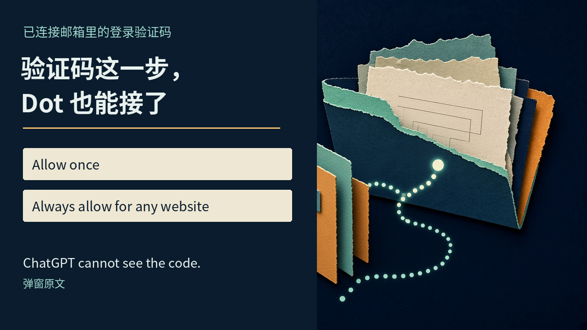
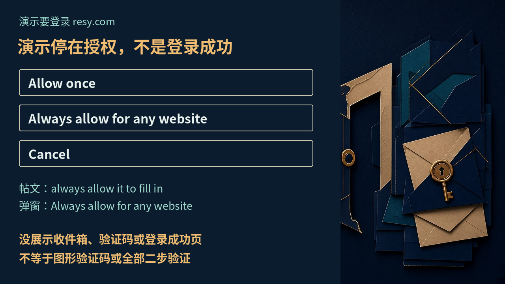

# Dot 能接邮箱登录验证码了：点「一直允许」，演示里的范围不只眼前这个网站

你把一件事交给 AI，刚放下手机，它又来找你：去邮箱看一下验证码。

打开邮件，复制，切回来，粘贴。动作不难，但你又成了这条自动化流水线上的人工接头。

OpenAI 的 Dot 这次补的，就是这个小缺口。已经连接的邮箱收到登录验证码，它现在可以在获得授权后，代你把这一步接上。

**省下的是一次来回切换，真正要看清的，却是你按下的那颗授权按钮管多宽。**

2026 年 11 月 8 日凌晨 3:17，亚洲/上海，OpenAI 做浏览器和浏览器使用的产品同事 James Sun 在 [X 原帖](https://x.com/JamesZmSun/status/2119147164039618879)里宣布了这项升级。他说，Dot 可以使用发到已连接邮箱的登录验证码，替用户顺畅登录；提示出现时，可以允许使用一次，也可以一直允许自动填入。

03:25，亚洲/上海，[ChatGPT 官方账号转发](https://x.com/ChatGPT/status/2119149172511440980)了这条，没有另加文字。这是产品同事发帖、官方账号转发，不是 OpenAI 新闻室正式公告。

过去，这种打断最麻烦的地方，不是多花几秒，而是任务的责任又交回到你手上。你得知道它卡在哪，找到对应邮件，再确认接下来还要不要继续。一个看似很小的登录环节，足以让「交给它」重新变成「陪着它做」。

所以这条消息不需要被包装成 AI 接管互联网。把一种常见的中断接顺，已经有实际价值。尤其当你本来只想给出目标，而不是一路盯着浏览器走，这样的小补丁才会改变委托的手感。

## 聊天里要登录 resy.com，视频停在了批准之后

James 附了一段约 11 秒的无声手机演示。

用户在 Dot 聊天里问：“Will you log into resy with my email?” 意思是，能不能用我的邮箱登录 resy。

Dot 回答：“I'll open Resy and start signing in with your email.” 它会打开 Resy，开始用邮箱登录。

随后出现带锁图标的状态条：“Auto-fill OTP code from email”。这里的 OTP 是登录用的一次性验证码，不是让你找红绿灯、选自行车的图形验证码。

白色弹窗的标题是：“Use the code from your email?” 它在问，能否使用邮件里的验证码。

弹窗正文写着：“Use the verification code sent to your connected email to sign in to resy.com. ChatGPT cannot see the code.” 前一句说明用途：用已连接邮箱收到的验证码登录 resy.com。后一句则是界面给出的说明：ChatGPT 看不到这个验证码。

弹窗关闭后，片尾状态变成带勾的“Autofill approved”，意思是自动填入已获批准。

**批准了，不等于视频展示了登录成功。**

这段画面始终留在 Dot 聊天界面，没有出现目标网站登录页、收件箱、验证码数字，也没有出现登录成功页。它能让人看清授权怎么问，不能替后面没拍到的过程作证。

这不是吹毛求疵。对于替人操作账户的助手，「可以代办」「用户同意了」「最终办成了」本来就是三个不同的状态。把演示停在哪里说清楚，才能让期待落在真正得到确认的能力上。

## 「一直允许」后面，还有 any website

弹窗给了三个选项。

“Allow once”，只允许这一次。

“Always allow for any website”，一直允许用于任何网站。

“Cancel”，取消。

这里值得停一下。James 在帖子里写的是“always allow it to fill in”，一直允许它填入。演示按钮写得更具体：“Always allow for any website”。

**按钮上的长期许可，文字范围不限于眼前这个 resy.com。**

这不是说它已经能登录任何网站，而是说，这颗按钮表达的批准范围，不只当前网站。权限范围和实际支持能力，是两回事。

一个是让它把眼前这次登录继续做完，一个是以后遇到其他网站时，也允许这种自动填入。忙的时候，两者都像是在说「别再卡住我」，但你交出去的持续性并不相同。

这里也不该把两种选择分成「聪明」和「保守」。只允许一次，是把决定留在当前这件事上；持续允许，是用更宽的许可换更少的打断。两种都可以有用，前提是界面把差别摆在你眼前，而不是让你以为只是同一句话的两个版本。

视频没有清楚拍到用户点了哪颗按钮。能确认的是三项选择出现过，随后弹窗关掉，状态变成获批。不能替用户补写一次点击。

对做事的人来说，这才是升级里最有分量的地方：AI 不只需要会填，还需要让人看懂，这次点头会跟着它走多远。

## 「ChatGPT 看不到」是界面说明，不是无限安全保证

“ChatGPT cannot see the code” 很醒目，但不能顺手扩写成「模型绝对读不到邮件」，更不能拿一句弹窗文案当密码学证明。

[Dot 的隐私、安全与防护 FAQ](https://help.openai.com/en/articles/20001529-dots-privacy-security-and-safety-faqs)对密码有类似的分层说明：在支持的登录流程中，Dot 会暂停，由用户在安全登录表单里输入凭证；表单把凭证直接送到浏览器环境，不向模型暴露。

这套说明讲的是受支持的密码登录流程，不等于已经解释了此次邮件验证码功能的全部实现。FAQ 在 11 月 8 日查看时显示约两天前更新，早于这条凌晨发布的帖子，不能当成新能力已经写入文档。

它还明确划了一条线：用户另外在聊天、文档或插件里分享的密码，不在上述保护范围里。

所以，安全表单里的凭证如何传递，和你主动把秘密发进聊天，是两条不同的路径。邮件已经连接，也不该被理解为所有敏感信息都能随便交给对话框。

## 你的电脑登过，不代表 Dot 的云浏览器登过

如果觉得「我不是早登录了吗」，[官方入门说明](https://help.openai.com/en/articles/20001530-getting-started-with-your-dot)给了答案：Dot 是 ChatGPT 里的常驻 agent，有自己的云电脑；它的云浏览器有独立的登录会话。

你在个人电脑上登录，不会顺带让 Dot 登录。

这也解释了为什么验证码这种小步骤，会影响委托能不能继续。你已经能访问的网站，换到它的浏览器，仍可能需要重新证明身份。

用户可以连接个人邮箱，让 Dot 为任务使用它。此次升级接上的，是已连接邮箱里的登录验证码，不是给它发了一个能通吃身份验证的通行证。

FAQ 仍提醒，用户可能需要提供认证码，或接手完成安全检查。改密码、转账这样的高敏感动作要求本人接手，Custom Rules 也不能关掉这些核心要求。

因此，不能把邮件验证码自动填入，扩写成短信验证码、身份验证器、硬件钥匙都能代办，更不能写成 CAPTCHA 也能过。

入门页说 Dot 正向符合条件的个人及工作区用户逐步开放，这描述的是产品整体可用性。James 没有另给这项验证码能力的功能级开放范围，不能据此宣布所有人现在都已拿到。

从「帮我做」到「我不用一直守着」，中间隔着很多这样的接缝。能跨过邮件验证码这一道，并不代表下一道安全检查也自动消失。评价它有没有进步，要看具体省掉了哪次接手；判断它能走多远，也得停在已经说清、已经展示的地方。

它并没有把登录这扇门拆掉，而是让其中一种常见的敲门方式，少叫你回来一趟。

这确实比多说几句漂亮话更接近一个能干活的助手。但当那颗按钮从「这一次」变成「任何网站」，好助手的标准也随之变了：不只是少打断你，还得让你在最想省事的那一秒，看清自己究竟答应了什么。
