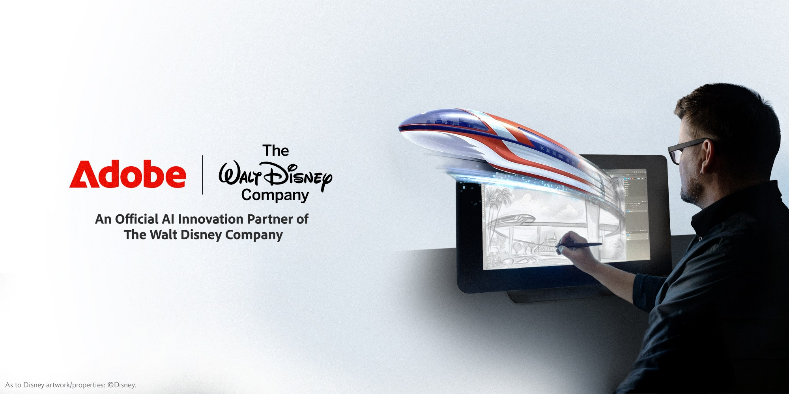
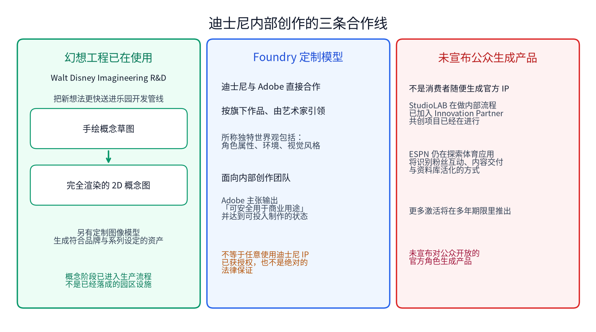

# 草图转成概念图：Adobe Firefly Foundry 给迪士尼内部定制模型

一张乐园概念草图画完，下一步通常要反复推敲，才能变成能拿去开会的概念图。加速落在谁的创作管线里，官方角色和世界观会不会对公众打开，是两件不同的事。

2026 年 11 月 9 日，Adobe 在 [Adobe MAX 宣布](https://news.adobe.com/news/2026/11/adobe-and-the-walt-disney-company-alliance)与华特迪士尼公司达成多年期战略联盟。Adobe 成为迪士尼的 Official AI Innovation Partner，将提供 Firefly、Firefly Foundry、Premiere、Photoshop，以及配套工程与研究资源，用来支持迪士尼的制作管线。定制模型与工具会用于创新实验室、乐园与邮轮的概念探索和开发。联盟同时包含全球营销激活、行业活动合作与客户故事。

## 迪士尼通过 Firefly Foundry 定制内部模型

迪士尼将与 Adobe 直接合作，打造针对其旗下作品、由人主导、由艺术家引领的生成模型。这些专有模型按迪士尼作品定制，训练所称的独特世界观，包括角色属性、环境和视觉风格。Adobe 称，由此得到的输出「可安全用于商业用途」，并达到可投入制作的状态，从而加快工作、让团队能开展更多创作项目。

「可安全用于商业用途」是 Adobe 的官方主张。它不等于任何人都可以任意使用迪士尼 IP 并已获得授权，也不构成一份绝对的法律保证。

这套安排面向内部创作团队，不是面向消费者、可随便生成官方角色的产品。这份通稿没有列出完整的训练数据和授权范围，也就推不出全部迪士尼资产都已开放商用。

## 幻想工程已经把草图送进乐园管线

Walt Disney Imagineering Research & Development 已经在使用 Firefly Foundry，要把新想法更快送进主题乐园开发管线。其中一项是草图到图像的模型，能把手绘概念转成完全渲染的 2D 概念图；另有定制图像模型，用于生成符合品牌、符合系列设定的创作资产。

更快送进管线，说的是概念阶段的生产流程变化，并不等于这些概念图已经变成落成的园区设施。

## StudioLAB 在做内部流程，ESPN 仍在探索体育应用

Adobe 加入华特迪士尼影业 StudioLAB，成为 StudioLAB Innovation Partner，与创作者和技术人员一起探索、扩展内部创作工作流。与 StudioLAB 的共创项目已经在进行。

ESPN Edge 创新中心本身就是探索、测试并实施影响体育叙事的新技术。接下来，ESPN 与 Adobe 将识别 AI 如何增强与体育粉丝的互动、塑造内容交付方式，以及如何活化 ESPN 资料库。这部分共创项目也已启动，更多激活与体验会在多年期限里陆续推出。通稿没有宣布已上线面向观众的体育功能。

联盟还将扩大 Adobe 在迪士尼媒体平台上的呈现，并预计出现在 Adobe Summit、Adobe MAX 等行业会议。

对乐园设计团队，一张手绘草图能更快变成可讨论的概念图，是生产流程上的变化。对公众而言，官方角色和世界观的使用权限并没有因此改写：内部定制模型加快的是迪士尼自己的创作管线，并不等于观众可以自行生成官方 IP 并拿去商用。
