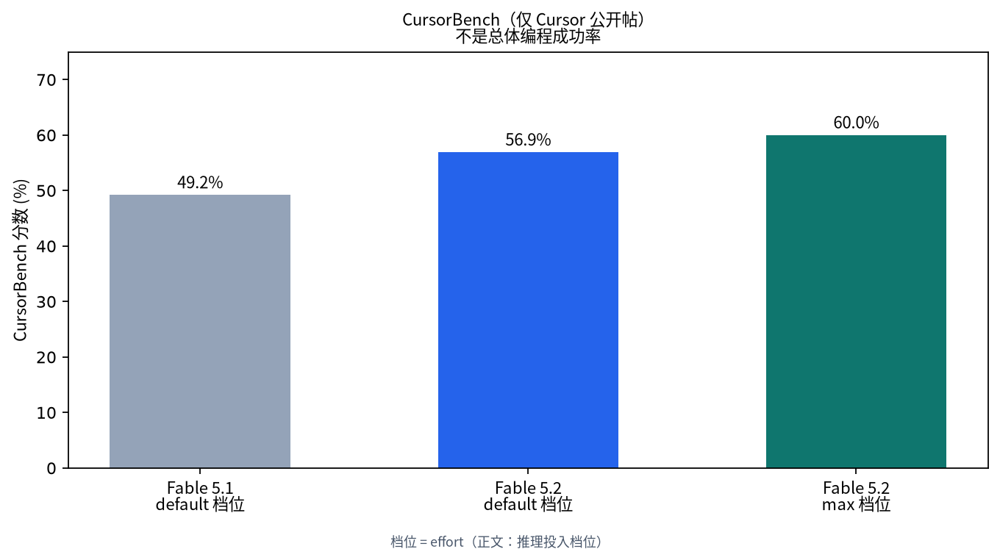
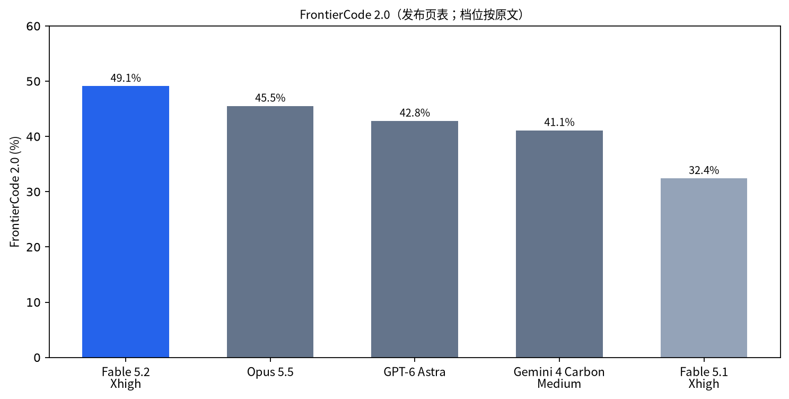

# 约千个 agent 花 30 小时形式化费马大定理：Fable 5.2 没有重新发现证明

你要是在等「机器把证明写进 Lean、板子真能点亮」这类结果，会先撞上 Anthropic 2026 年 11 月 9 日放出的 [Claude Fable 5.2 / Mythos 5.2](https://www.anthropic.com/claude-fable-and-mythos-5-2)。

发布页把它俩放在最难的开放技术挑战上，同时又写明：多数编码与知识工作仍建议先从 Claude Opus 5.5 起步，再按范围上探 Fable / Mythos，或下探 Sonnet / Haiku。

约 30 小时那次费马形式化，并不是从空白公理库里「重新发现」Wiles 证明：团队事先拿到 60 条待证陈述、一句经典路线草图、相关定义，以及来自**更早一次形式化**的 **47 条已证引理**；还预设了 lead / helper，并对 lead 发过剩余时间提醒。形式化的对象是已知证明，不是新的数学发现。

## Fable 面向更广用户，Mythos 仍需核验

Fable 与 Mythos 是同一底层模型。Fable 带更强的网络安全与生物安全护栏，面向更广用户；从事有益网络安全或生物医学研究的组织，可经 Life Sciences / Cyber Verification Program 申请 Mythos。

Mythos 5.2 在发布页里主要落在核验后的网络安全与部分生命科学能力；Fable 5.2 的护栏会挡住多数高风险网络安全相关任务。把 Mythos 写成「更强日常编程版」并不成立。

价格与速度以同页为准：相对 Fable / Mythos 5.1，生成速度**至多**约快 30%；定价为每百万 input token **8 美元**、output **40 美元**。可选 fast mode 生成速度**至多**再约 2.5 倍，定价为 **16 / 80 美元**每百万 token。这些是标价与上限表述，不是你本地必达的时延承诺。Fable 5.2 写明今日可在含 AWS、Google Cloud、Microsoft Azure 在内的平台使用，开发者模型 ID 为 `claude-fable-5-2`。Mythos 仍走核验通道；Mythos 的 fast mode 仅对核验计划内组织开放。

## 约千个 agent、约 30 小时：依赖清单先于「写完了」

发布页写：约 1000 个 Fable 5.2 agent、约 30 小时、最少人类干预，完成费马大定理的 Lean 形式化。

[claude.dev 同日博文](https://claude.dev/blog/safely-scaling-multi-agent-teams-with-fable-5-2/)把口径收紧：

- 跑的是 **early version of Claude Fable 5.2**，文中称作 toy experiment。
- 任务是 **reproduce a formal proof**：把已知论证翻成 Lean 可逐步检查的形式；费马大定理本身仍回到 Wiles 1995 年的工作。
- 时长精确写到 **28.7 小时**；Langlands–Tunnell 约 28.4 小时证完，最终定理约 28.7 小时进入 main。
- 起点资产包括前述 60 条陈述与 **47 条先前已证引理**。这 47 条是更早形式化里已经证明过的构件，不是「未证假设」；本轮要新完成的是那批陈述上的 Lean 证明，并在共享 main 上接受检查。
- 相对 9 月：未发布研究模型 + Prove2Me + 研究者指导，约 11 天。本轮不用 Prove2Me、无研究者现场指挥，output token 约三分之一、证明长度约七分之一。
- 同配置 Opus 5.5：18 小时完成约 **26%**，到 30 小时几乎不再推进；对比是**每个模型单次运行**，不是跨模型通用成功率。

关于「过检」：博文转述 lead 的话是，费马大定理已在 main 上，并由 **official checker** 做 **kernel-checked**——在 Lean 语境里，通常指内核接受了提交的证明项。它说明的是这次仓库里被提交、被 checker 接受的形式化步骤；**不等于**外部数学家已对这份约 30 小时产物做了独立复核。博文也没有声称第三方已独立核验该次产物。9 月那次与本轮不能自动共用同一套外部验收叙事。

验收时还要看依赖面：最终成果建立在给定陈述清单与那 47 条已证引理之上。可以说「在给定起点上完成了目标陈述的形式化并经官方 checker」；不宜说成「从零无先验地完整重写并重新发现了费马证明」。

## 三块真机板：官方协作展示

发布页与 [硬件研究文](https://www.anthropic.com/research/claude-electronics-design)描述同一组案例：一句式需求出发，Fable 5.2 设计三台带 PCB、3D 打印外壳与固件的设备——家用语音助手集线器、USB 免提音箱、手持电子宠物；合作方是制板公司 Diode。

官方写明的分工是：Claude 写规格、从美国经销商挑选有货元件、布四层板、做外壳 CAD、写软件；每块板在不到一天内达到可制造状态，人工输入很少。**Diode 制造电路板，并在 Claude 指导下装配与测试**；三台设备无需电气改线即可工作。研究文同时写明：原型尚未做电气验证、天线调谐、热测或商业认证，也不是按量产设计；Claude 没有接到测试仪器或制板/贴片产线，物理制造与测试由 Diode 工程师完成。Anthropic 与 Diode 存在商业关系。

这是 Anthropic 与 Diode 的官方协作展示。在其自述条件下，设计文件可直接下板且无需电气改线；不能外推成已过认证、可量产的成品交付。

## CursorBench 的 56.9% / 49.2% / 60% 各管各的

亚洲/上海时间 **2026 年 11 月 10 日 03:52**，[Cursor 官方账号发帖](https://x.com/cursor_ai/status/2119880829212172509)称：Claude Fable 5.2 已在 Cursor 可用；在 **max** 推理投入档位下 CursorBench **60%**，为该榜当时最高；在 **default** 推理投入档位下 Fable 5.2 为 **56.9%**，相对 Fable 5.1 的 **49.2%**。effort 指同一模型可调的推理投入，不是另一套产品名。

这三个数都绑在 **CursorBench** 与标明的推理投入档位上，不能偷换成「所有真实编程任务成功率」。帖中附图把 56.9% 标在 High effort–default 一点；60% 对应更高成本的 max 档。

Anthropic 发布页另一张表里，agentic coding 的 **FrontierCode 2.0** 另有一套数：Fable 5.2 在 Xhigh 推理投入档位为 **49.1%**，Fable 5.1 Xhigh **32.4%**，Opus 5.5 **45.5%**，GPT-6 Astra **42.8%**，Gemini 4 Carbon Medium **41.1%**。这是「改动是否会被开源维护者合并」一类评测，与 CursorBench 不是同一榜。

## 证明过检、原型点亮，都有各自的验收条件

Lean 的 official checker 接受提交，说明的是给定先验下的形式化步骤可被内核检查；板子点亮，说明的是官方协作原型在特定制造与指导下工作；CursorBench 与 FrontierCode 的分数，说明的是标明榜单与推理投入档位下的结果。

三件事都成立，也仍然推不出「换上 Fable 5.2，编码与硬件交付自动交卷」。发布页把最难技术活交给 Fable / Mythos，同时把多数日常默认位留给 Opus 5.5——你手头那一单，还要看先验、产线与评测条件是否对得上。
