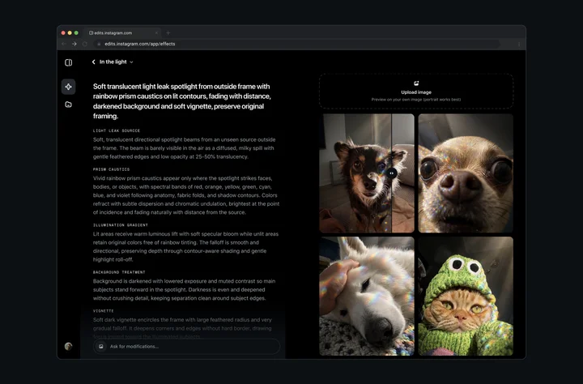
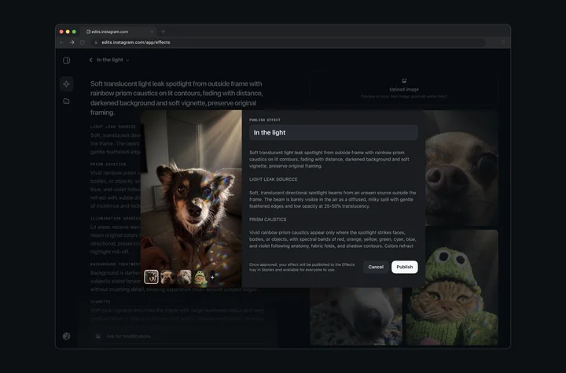

# 一句话能做 Stories 滤镜：通过审核才会进 Instagram 效果库

想给 Instagram Stories 做一个别人也能用的滤镜，以前往往得会设计、会搭效果。现在在美国、18 岁以上的人，可以在网页上先用一句话做出自己的效果。

2026 年 11 月 9 日，Instagram 的 Edits 在[官方介绍](https://edits.instagram.com/blog/introducing-effect-builder/)里推出 Effect Builder：一个用来为 Instagram Stories 制作 AI 效果的网页工具。官方的说法是，不必先有设计或编程经验，「只要能描述，就能做」，入口是 [edits.com/effectbuilder](https://edits.com/effectbuilder)。该工具在美国面向 18 岁以上的人开放，创建和发布效果免费。

## 先在自己的照片上预览，再决定要不要提交

官方步骤的第一步，是打开上述网页，输入提示词来生成效果，并在自己的照片上试到看起来像自己想要的样子。官方举例包括温暖的复古胶片颗粒、梦幻淡彩水彩，以及鲜明的漫画对比。测试阶段合作创作者 @kemar.anthony 做出的光棱效果，也出现在介绍里。

官方配图里的编辑界面，左侧是详细的风格说明，右侧可以把效果套到自己上传的照片上预览，底部还有「Ask for modifications」输入框。

据 [The Verge 的报道](https://www.theverge.com/tech/1030061/instagram-ai-effect-builder-filters)，提示框还可以附上风格参考图；生成之后，也能用后续提示继续改。该文作者还试过让 Instagram 的 AI 改写提示：一句「做成漫画书页」被扩成好几段关于色盘和光线的说明，但扩写后生成的滤镜看起来和原句几乎一样。

## 生成完成后，还得通过安全审核

效果可以从 Effect Builder 直接提交，但不是生成完就对所有人可见。官方介绍写得很清楚：每条效果都要先经过安全审核，通过之后才会出现在 Instagram Stories 的效果浏览器里，和其他效果放在一起。

审核通过后，这个效果会出现在 Instagram Stories 里供人使用；别人用到它时，会回链到作者的 Instagram 主页。官方还写了使用侧的细节：别人在做 Story 时可以找到并套用这个效果，效果上带有作者的 Instagram 用户名，可以点进主页；看到的人也可以点「Try it」来用。作者自己用过的效果，会出现在 Stories 里的「My effects」。

生成出一款看起来能用的滤镜，只说明这边已经能预览。它会不会出现在别人的 Stories 效果库里，还要看这次提交能不能通过安全审核。本公告没有写明审核要多久。用一句话描述并做出来，和效果能公开分发，是两个步骤。
