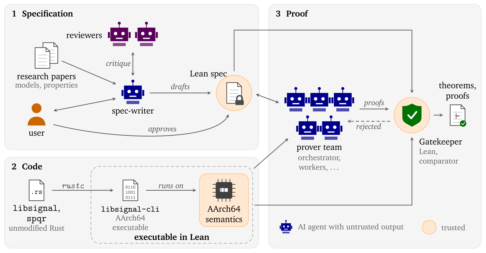
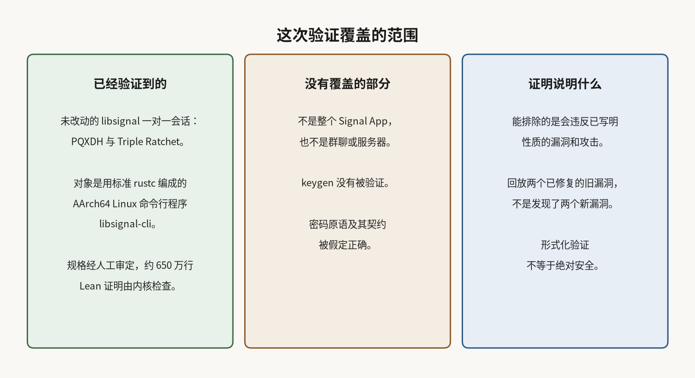

# 约 650 万行 Lean 验证了 libsignal 的机器码，不是整个 Signal App

用 Signal 发一条加密消息时，真正把协议落到代码里的，是一份叫 libsignal 的实现。协议设计被分析过很多次，可实现和编译结果里仍可能藏着漏洞。

2026 年 11 月 10 日，Google DeepMind 在[介绍页](https://deepmind.google/blog/introducing-alphaproof-code/)和[技术页](https://google-deepmind.github.io/code-verification/)发布 AlphaProof Code。研究人员引导智能体，为这份参考实现写出形式化证明。技术页写，智能体生成了约 650 万行经 Lean 检查的证明，依据约 2.6 万行需信任的规格和 AArch64 语义。这项证明工作由五人团队用四周完成。规格由人与智能体一起起草，每一条都经人工审定后再进入证明。

DeepMind 自称，这是首次为广泛部署、且未经改动的密码协议实现，完成协议级安全性质的证明。

## 证明的是前向保密，以及失窃后能否重新锁上

已证性质里，一类是前向保密。前向保密依赖消息密钥沿单向链更新并删除旧密钥。这里的证明有具体的密钥泄露条件，符号模型也没有排除重放导致的前向保密损失。

另一类是失窃后的恢复。新的 Diffie-Hellman 交换能重新引入秘密；在论文限定的泄露条件下，后续消息密钥可以恢复保密。这不等于任意失窃后回复一条消息就能恢复。

这两项是在符号模型和计算模型里，针对经典对手证明的，也就是还不能靠量子计算破解传统公钥算法的对手。符号模型把密码原语当成理想化的黑盒；计算模型则给这类算法对手的成功概率设上界。符号模型还证明了有条件的握手保密：在后量子密钥封装机制 KEM 未被破解、相关身份密钥和预密钥以及握手输出未泄露的前提下，即使对手日后破解传统的 Diffie-Hellman，握手密钥仍可保持秘密。

棘轮一侧还有一套叫 SPQR 的稀疏后量子棘轮，会在普通消息里穿插后量子密钥交换，设计上是为了在量子对手面前也能从失窃中恢复。但符号模型中的棘轮定理让对手自选 SPQR 的密钥，计算模型也不保证抗量子对手，因此这项后量子恢复并没有被证明。

## 验到的是 AArch64 Linux 上的命令行构建

他们没有去验证整个 Signal 应用、群聊或服务器。技术页写明：把未改动的 libsignal 链进小型命令行工具 libsignal-cli，用标准 rustc 编成 AArch64 Linux 机器码，再对这份可执行文件陈述定理。覆盖的是一对一会话里的 PQXDH 握手和 Triple Ratchet 消息；群聊留作后续工作。定理覆盖用预密钥包开始会话，以及加密、解密一条消息；密钥生成没有被验证，定理把双方的密钥当作已经准备好的前提。

这次结果针对的是这份 libsignal-cli 构建。Signal 的 Android 和 iOS 应用跑的是同一份 Rust 代码，几乎所有安卓手机和所有 iPhone 也使用 AArch64，只是编译选项、链接方式和操作系统接口不同。如果可以相信这些差异不会改变协议代码在这份命令行程序里表现出来的行为，这些定理才适用于那些手机环境。

## 密码原语是按契约假定正确的

证明建立在人工审定的规格上。要相信这些定理，还需要信任 Lean 内核、AArch64 语义，以及一些被改用契约描述的例程。底层密码原语的安全性无法在这次证明里再证一遍，因此被写成假定：在计算模型里作为假设提出，在符号模型里被理想化。

智能体写出的数百万行证明本身不被默认信任。只有 Lean 内核检查通过，并且证明的正好是已批准的规格，才会被接受。

为了检查规格够不够严，他们把两个此前已经修复的 libsignal 漏洞重新放进隔离版本，并证明这份有问题的二进制不满足符号安全定理。这两个漏洞来自已有研究，并且已经修复。这次是隔离回放，不是新发现了两个漏洞。

## 形式化验证不等于绝对安全

多设备状态不在范围内。计算模型给出的成功概率上界有规模限制：如果几乎每条消息都开启一轮新的棘轮更新，即使只有一个足够长的会话，上界也可能不再提供有意义的保证；多个长会话同样会遇到这个问题。这是证明界限失去信息量，不是说到了这个规模就实际不安全。形式化证明能排除的，是会违反已写明性质的漏洞和攻击。规格若写错、假定若不成立，或问题落在范围之外，并不因此消失。

在这些模型和假定成立时，这份已编译的核心协议代码被证明能保住上述保密性质。规格或假定一旦靠不住，这些保证也就不再自动成立。
