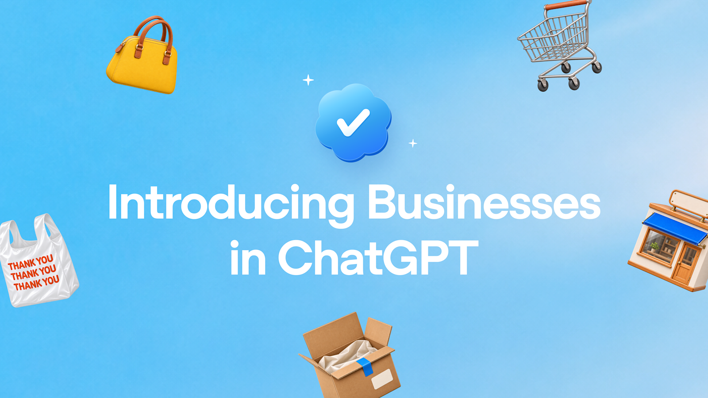
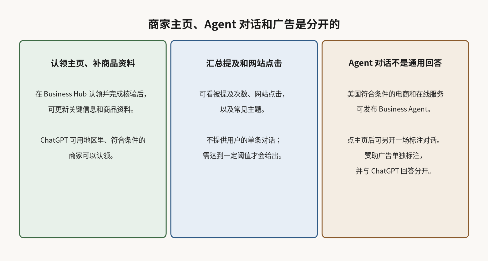

# ChatGPT 有商家主页了：想问商家，可以另开一场 Agent 对话

在 ChatGPT 里问「这两款哪个更适合我」，或拿两家店的商品放在一起比较，推出商家主页后，多了一个选择。商家可以认领自己的主页；如果对方已经发布了 Business Agent，用户可以选择再单独开一场对话。

2026 年 11 月 10 日，OpenAI 在[介绍页](https://openai.com/index/introducing-businesses-chatgpt)宣布推出测试版 Businesses in ChatGPT。OpenAI 称，这让商家有新的方式和「每周使用 ChatGPT 的 12 亿人」建立连接。商家可通过 Business Hub 认领主页、管理资料，并查看人们如何与自己互动。另外，符合条件的美国电商和在线服务商家，可以开始使用 Business Agent。

## 商家能认领资料、看汇总点击，但看不到单条对话

在 Business Hub 里，公司可以认领自己在 ChatGPT 中的组织；核验通过后，可更新关键信息，并自行添加带价格和库存的商品资料。OpenAI 称，任何位于 ChatGPT 可用地区、且符合条件的商家，都可通过 Business Hub 认领。[官方帮助页](https://help.openai.com/en/articles/20001635-setting-up-your-business-on-chatgpt)写明，认领人须是所有者或获得授权的代表，不必先有广告账户或 ChatGPT Enterprise 协议。

Shopify 商家可以从 Business Hub 或 Shopify 后台连接店铺，以简化核验。官方同时写，Shopify 商家的符合条件商品已经通过 Shopify Catalog 接入 ChatGPT。帮助页补充：做 Business Agent 并不必须用 Shopify；若使用 Shopify，可以连接商品资料来同步价格和库存，但仍需单独审阅并发布 Agent。帮助页还写，接上资料流不等于已经发布 Agent，也不保证 ChatGPT 会推荐这些商品。

Business Hub 提供汇总洞察，包括商家被提及的次数和网站点击。商家还可以查看 discovery topics，也就是网站被引用的对话里常见主题。OpenAI 写明：不会把用户的对话或 Business Agent 聊天分享给商家；洞察是汇总的，只有达到一定阈值才会提供。帮助页进一步解释，线上商家的「提及」是指 ChatGPT 引用了该商家网站，只出现品牌名不算；这些洞察看的是过去 28 天的汇总活动。

## 用户可以选择另开 Agent 对话，它和通用回答是分开的

认领之后，符合条件的组织可以搭建、测试并发布 Business Agent，用来回答问题、帮人了解自己的产品。当商家出现在模型回答里，人们可以点进去看它在 ChatGPT 上的主页；如果已经有 Business Agent，顾客可以选择另开一场对话，继续问差别、问哪项功能更适合自己。

这场 Business Agent 对话会明确标注，独立于顾客原来的 ChatGPT 对话，也有别于 ChatGPT 自己的独立回答。帮助页还写，当前体验里，Agent 可以解释产品和政策，并链到商家网站，由顾客在网站上完成下单、预约或查询订单；它现在不能代为完成这些动作。

Business Agent 目前面向美国符合条件的电商和在线服务商家开放；帮助页补充，还需要有网站，并符合 [Business Agents 政策](https://openai.com/policies/business-agents-policy/)里的行业要求。有的商家可以管理主页，但不一定有资格做 Agent。OpenAI 说，之后计划把 Businesses in ChatGPT 和 Business Agent 扩展到更多市场和品类。

## 投放广告另有标注，发布 Agent 不等于买推荐

商家也可以赞助 Business Agent，并把它当作 ChatGPT 广告的落地处。官方写，赞助位置会明确标注，并且与 ChatGPT 的回答分开。[赞助 Agent 的帮助页](https://help.openai.com/en/articles/20001651-setting-up-a-sponsored-business-agent-in-ads-manager)还写：广告不会影响 ChatGPT 的回答；只发布 Agent，并不等于开始投放广告。该帮助页同时写明，Business Hub 与 Ads Manager 里的 Agent 设置目前不同步，不能当成已经自动变成同一个 Agent。

认领主页、发布 Agent、投放广告是三条不同的能力。按官方说明，发布 Agent 不等于买到推荐，投放广告也不等于改写 ChatGPT 的独立回答。

在 ChatGPT 里比较商品，推出商家主页后，可能多出一张可以点开的商家主页；若商家已发布 Agent，用户还可以选择另开一场单独标注的对话。那是商家提供的资料和对话，和 ChatGPT 自己的独立回答不是同一件事。
