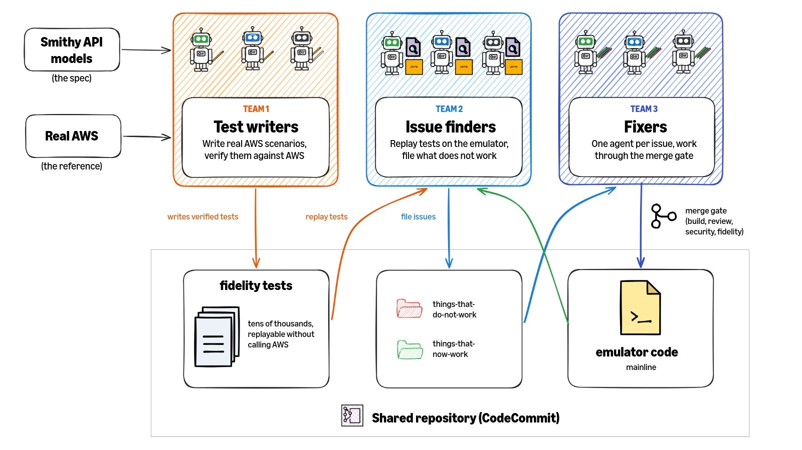
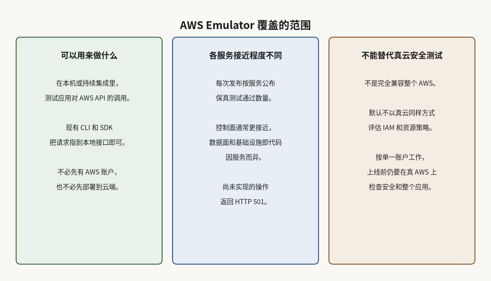

# AWS 称上千个智能体写了全部代码：这个本地模拟器怎么验收

写依赖 DynamoDB 或 S3 的应用，开发者往往要先配好 AWS 账户、准备云资源，才能验证接口调用对不对。编码智能体改完调用之后，同样需要确认这些行为。

2026 年 11 月 11 日，AWS 在[新闻博客](https://aws.amazon.com/blogs/aws/test-your-applications-against-aws-locally-with-aws-emulator/)宣布 AWS Emulator 正式可用。它在你自己的机器上提供一个本地 HTTPS 接口，现有的 AWS CLI、SDK 和编码智能体可以用同一套 API 去调用。Linux 可安装 RPM 或 Debian 软件包，macOS 和 Windows 需按文档用 Docker 自行构建镜像，官方不提供现成镜像。也可以从源码构建。启动后把环境变量指到本地端点，应用代码不用改。源码在 [GitHub](https://github.com/aws/aws-emulator)，主体以 CC0 1.0 公共领域方式发布，vendor 目录另按 Apache 2.0 许可。没有额外服务费，只有真正部署到 AWS 时才为云资源付费。

这正是它的用处：同一套建表、写入、再读回的测试，可以先在本机或持续集成里跑，不必先配好真实账户和云资源。

## 公司称全部代码由自治智能体写，验收靠保真测试和合并门禁

Amazon 在[介绍](https://www.aboutamazon.com/news/aws/how-autonomous-ai-agents-built-aws-emulator)里写，上千个自治 AI 智能体写了 AWS Emulator 的每一行代码，团队没有编写，也没有审查这些代码。这是公司自述，不是第三方审计结论。

按这篇介绍，验收并不是人去逐行看代码。三组智能体分别写测试、找问题和修问题。测试要先对照真 AWS 验证，再用来衡量模拟器是否一致；官方说这类保真测试已有数万条。修完的改动要过合并门禁：编译不过会被挡住，另外还有智能体检查编码规范、做安全审查，并确认保真度没有回退。都通过才会合入主线，再经发布流水线打包。保真测试和安全审查智能体，都不能等同于人工逐行审查。

## 各服务接近程度不同，未实现的操作会返回 501

官方[文档](https://docs.aws.amazon.com/emulator/latest/userguide/fidelity.html)写明，模拟器面向已公布 API 模型的服务，但和真 AWS 有多接近，要看具体服务和功能。每次发布会按服务公布保真测试通过数，写法是多少项里通过多少项，分数只是当时的快照。文档还写，目前用来管理资源的控制面接口通常更接近，实际读写等数据面操作以及 CloudFormation、Terraform、AWS CDK 等基础设施即代码的支持则因服务而异。尚未实现的操作返回 HTTP 501 和 NotImplemented。保真测试本身主要在 us-west-2 对照真 AWS 验证，全球性服务则在 us-east-1。

## 默认不能当成像真云一样的权限测试

文档和博客都写：它不会像 AWS 那样评估 IAM 策略和基于资源的策略。有的服务会对你在模拟器里创建的用户和角色做策略评估，但方式和真云不同；用模拟器自己签发的密钥签名的请求，默认不会被拒绝。它也不检查 KMS 密钥策略或 S3 存储桶策略。每个模拟器按单一账户工作，不会按请求里的区域或账户号去隔离资源，也没有跨账户、跨区域行为。官方明确说，不要用它来测试应用是否安全，上线前仍要在真 AWS 上检查安全设置和整个应用。

状态默认保存在内存里，进程停下就会清空。默认只监听本机。遥测默认开启，可以关掉。官方还写，没有为长时间运行或压力测试做过验证。

本机把调用跑通，并不代表真云里的权限也会放行。正式部署前，仍要用实际账户和策略再验证一遍。
