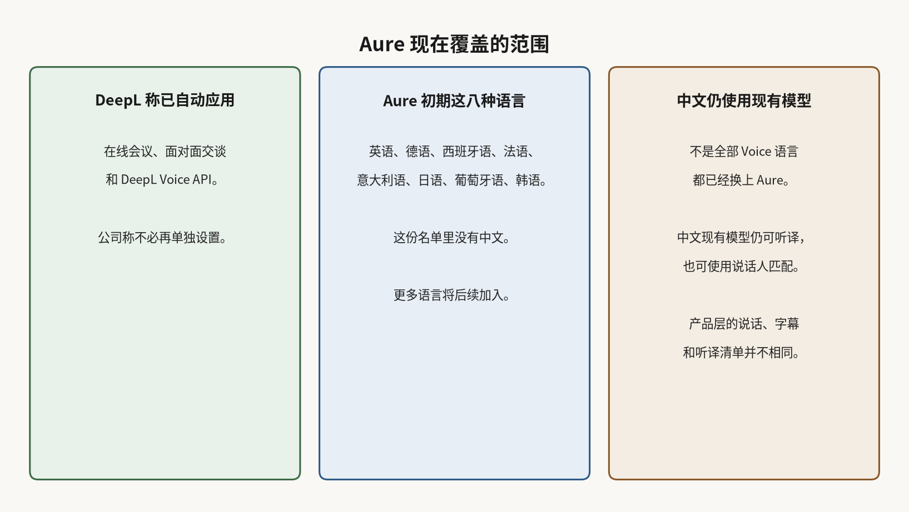

# DeepL Aure 想让翻译跟上语气变化：初期八种语言不含中文

开跨语言的会，或拿着手机当面谈，听的人往往不只听词。对方突然放慢、加重某个字，或从严肃转成兴奋，这些变化会改变这句话该怎么理解。

2026 年 11 月 11 日，DeepL 在[新闻稿](https://www.deepl.com/en/press-release/aure-voice-ai-model)发布语音翻译模型 Aure，为实时语音翻译产品 DeepL Voice 提供新的能力。公司称，Aure 会持续跟上说话时的语气、情绪、重音和语速变化，让译出的声音不只是把词换一种语言。

按这次通稿的介绍，这和近期的声音保留不是同一件事。声音保留要保住的是音色，也就是听上去仍像同一个人，而不是换成一套通用合成声。DeepL 说，Aure 要再往前一步：跟上这副嗓音在对话里怎么变化。通稿还介绍，此前 DeepL Voice 主要靠对话开头的一段固定采样，来决定译出的声音该怎么听，能分出是谁在说，却跟不上后来的情绪、重音或语速，也难表现话里带刺的语气。Aure 改为持续分析正在进来的语音，同时用上译出的词和原始音频，再决定这句话该怎么说。

DeepL Voice 的在线会议、面对面交谈和 Voice API 本身早已对外提供。这次新发布的是模型 Aure。DeepL 称，这些新能力现已自动应用在上述三处，不必再单独设置。更多语言将后续加入，但没有新增确认日期。

## 初期八种语言里没有中文

新闻稿写明，Aure 初期支持英语、德语、西班牙语、法语、意大利语、日语、葡萄牙语和韩语。这份名单里没有中文。DeepL 同时说，其他语言会继续由现有语音模型支持。[在线会议产品页](https://www.deepl.com/en/products/voice/deepl-voice-for-meetings)仍把语音互译写成三十种语言、字幕四十种以上。这是整个 DeepL Voice 产品的覆盖，不能直接读成 Aure 已经覆盖同样范围。[帮助中心的语言说明](https://support.deepl.com/hc/en-us/articles/26625846174364-DeepL-Voice-languages)仍把中文列在 DeepL 自有模型、带说话人匹配的听译语言里。所以中文用户并不是突然不能用 DeepL Voice，只是这次新的持续跟随能力，还不在官方初期名单上。

DeepL Voice 的说话、字幕和听译，本来就不是同一张清单。有的语言能说、能看字幕，听的时候却没有 DeepL 自有的说话人匹配音色；有的语言甚至没有语音输出。Aure 的新闻稿把上述八种语言写成一份清单，没有再拆开输入和输出。

要用上这些能力，得先在可用的 DeepL Voice 套餐或付费 API 里。Voice 套餐本身并不带上 Voice API。在线会议产品的[帮助页](https://support.deepl.com/hc/en-us/articles/16810100955676-About-DeepL-Voice-for-Online-Meetings)列出，中国大陆不在其官方支持范围内。

## DeepL 未公布 Aure 的延迟和准确率数字

DeepL 把 Aure 写成实时翻译，并说模型会在一句话还没说完时就开始适应说话的人。公司还说，训练时把声音身份、韵律和说话内容分开处理，再用强化学习去保住翻译质量，并称译出的语音听起来自然、不带口音。这些都是官方主张。

开会或当面交谈时，更值得记住的是那条分界：Aure 要解决的是语气会不会跟着变，而不是宣称所有语言、所有地区都已经同样可用。中文等语言眼下仍走现有模型，更多语言将后续加入。
