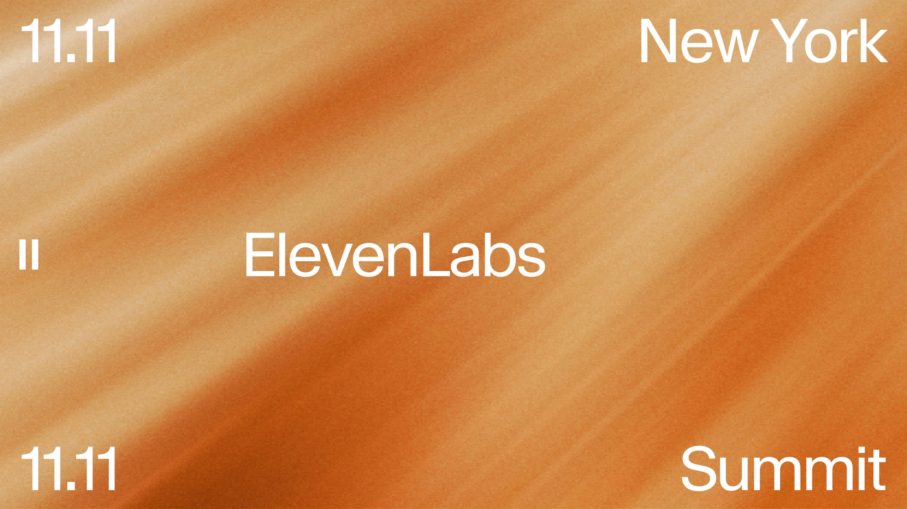
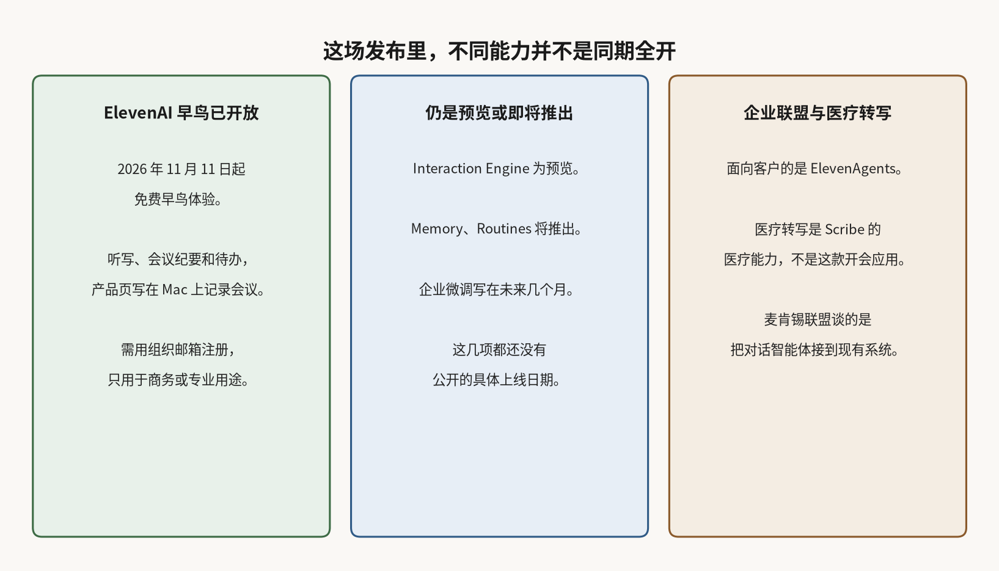

# ElevenAI 开放免费早鸟：在 Mac 上听会，整理纪要和待办

会一散，纪要、分工和下一步常常要自己补。2026 年 11 月 11 日，ElevenLabs 在纽约峰会介绍了面向员工的应用 ElevenAI：听会、做纪要、整理待办。按公司的说法，它走的是员工这一侧，和面向客户的 ElevenAgents 不是同一件事。

当天[峰会综述](https://elevenlabs.io/blog/nyc-summit)写，免费早鸟体验即日开放。[产品页](https://elevenlabs.io/elevenai)称，这是一款桌面应用：听写可在能打字的地方按住快捷键使用，会议纪要写明在 Mac 上记录，会后给出摘要、待办和跟进草稿，听写和纪要支持 90 多种语言。

条款介绍，需用组织邮箱注册、只用于商务或专业用途；未满 18 岁，或未到你所在地法定成年年龄，不能使用。免费档的使用时长可以调整，当前公开页没有列出具体额度或付费价格。

产品会在画面上显示正在记录的提示，峰会文也写记录需征得在场同意。[条款](https://elevenlabs.io/elevenai-terms)仍把依法告知和取得同意的责任放在使用者这边，并写明输出要自行核对后再用。产品页还写，音频不保存，转写记录留在这台 Mac；条款同时说明，为提供、保障和支持这项服务，内容可能经第三方大模型处理，且不会用来训练模型。

## ElevenAgents 的记忆和自动跟进仍待推出

面向客户的 ElevenAgents，Memory 将让智能体记住已验证回访客户在对话里提到、但客户管理系统里未必有字段的信息；Routines 将在通话前后跑多步跟进，比如写回客户系统或发报告。Interaction Engine 在会上预览，用来处理对话轮次、插话，并按环节选用模型。面向企业的模型微调则写在未来几个月。这些都还没有公开的具体上线日期。

给 ElevenAI 听写和纪要供电的，是语音转写模型 Scribe v3。公司另有面向医疗场景的转写能力，用来识别药品名和临床用语，和这款员工开会应用不是同一件事。条款还限制，未经相应协议不得提供受保护的健康信息。

## 麦肯锡联盟谈的是把对话智能体做进现有系统

同一天，ElevenLabs 与麦肯锡宣布[合作](https://elevenlabs.io/blog/mckinsey)，并由麦肯锡的人工智能工程团队 QuantumBlack 提供工程能力，目标是先用初始场景验证对话式智能体，再推广到更大规模。联盟公告以荷兰电信公司 KPN 的既有实践为例，提到订单查询、预约管理，并写保险理赔受理、保单服务是下一步想覆盖的方向。

员工用 ElevenAI 整理会议，和企业把面向客户的对话智能体部署进现有系统，不是同一套上线承诺。前者现在是 Mac 上的免费早鸟；后者要把智能体接到现有系统，麦肯锡联盟是当天公布的路径之一。
