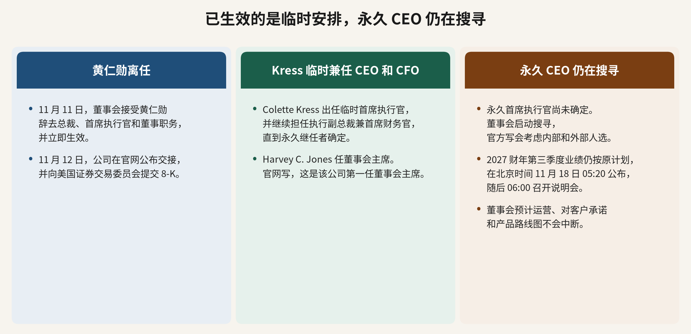

# 黄仁勋辞去英伟达总裁、CEO 和董事：CFO 临时兼任，永久继任还在搜寻

聊天、搜图、训练模型，很多服务背后都要经过英伟达的芯片。对普通人来说，它不只是一个股票代码，更是这轮人工智能算力的主要供应商之一。这家几乎和黄仁勋画等号的公司，董事会已经接受他辞去总裁、首席执行官和董事职务。

2026 年 11 月 12 日，英伟达在[新闻稿](https://nvidianews.nvidia.com/news/nvidia-announces-ceo-transition)里宣布此事。[8-K](https://www.sec.gov/Archives/edgar/data/1045810/000104581026000082/nvda-20261111.htm)写，董事会在 11 月 11 日接受辞任，并立即生效。

这还不是已经找到下任正式首席执行官。现任执行副总裁兼首席财务官 Colette Kress 出任临时首席执行官，并在永久继任者确定前继续兼任财务工作。董事会同时启动搜寻，官方写会考虑内部和外部人选。

## 临时 CEO 同时管财务，董事会也有了主席

Kress 从 2013 年 9 月加入英伟达起就担任执行副总裁兼首席财务官。新闻稿写，在此之前，她在思科、微软等公司做过近 25 年财务工作。8-K 的签署栏里，她的职务写的是临时首席执行官、执行副总裁兼首席财务官。

董事会还任命 Harvey C. Jones 为主席。新闻稿称，这是该公司第一任董事会主席。8-K 写，Jones 从 1993 年起就是董事，2004 年起担任家族办公室 Square Wave Ventures 的管理合伙人。新闻稿另写，他曾担任新思科技首席执行官和执行主席。

11 月 8 日，董事会曾就黄仁勋是否被外国情报活动针对，启动独立调查。当时的[声明](https://nvidianews.nvidia.com/news/statement-from-nvidia-board-of-directors)仍对他有信心，并写明当时没有理由认为国家安全或公司机密已经泄露。交接公告及 8-K 没有披露辞任原因，也没有给出这项调查的结论。

## 董事会预计运营和产品路线图不会中断

新任主席 Jones 说，董事会对 Kress 和领导团队有充分信心，并预计公司运营、对客户的承诺和产品路线图不会中断。

Kress 说，将与领导团队一起，在黄仁勋过去 33 年打下的基础上继续推进，重点仍是服务客户、合作伙伴、开发者和股东。

## 三季报仍按原定时间公布

2027 财年第三季度已于 10 月 25 日结束，业绩仍按原计划，在北京时间 11 月 18 日 05:20 公布，随后 06:00 召开业绩说明会。这一安排与 10 月 28 日[预先通知](https://nvidianews.nvidia.com/news/nvidia-sets-conference-call-for-third-quarter-financial-results-6928873)一致。

最高职务已经换人，但只是临时安排，永久继任还没有名字。接下来要看的，是正式继任者会是谁，以及 11 月 18 日的财报上，领导层会怎样阐述接下来的业务。
