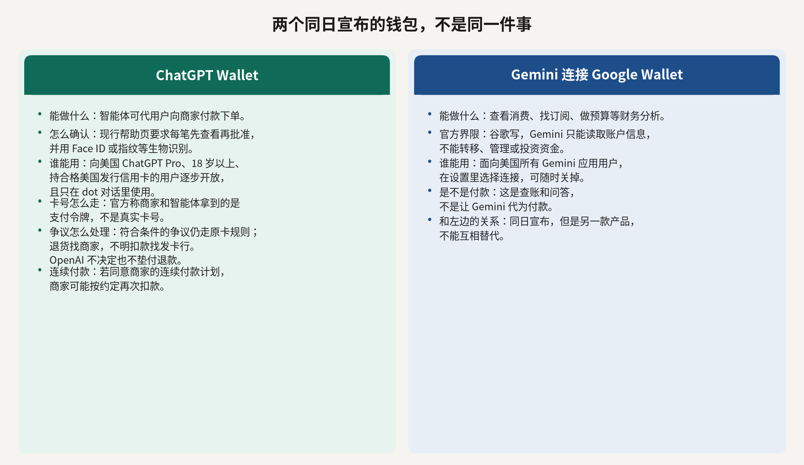

# ChatGPT Wallet 开始向美国 Pro 开放：智能体代付，现行流程逐笔确认

想让 ChatGPT 帮自己找东西并下单，最担心的往往是：它会不会拿着卡号自己买。2026 年 11 月 13 日，OpenAI 在[介绍页](https://openai.com/index/introducing-chatgpt-wallet/)发布 ChatGPT Wallet，给智能体一条可被商家接受的付款方式，同时把真实卡号从智能体和商家那边拿开。

官方写的现行用法是：卡只需添加一次，之后购买要本人先看商品、金额和所用的卡，再用 Face ID 或指纹一类安全校验批准。[帮助页](https://help.openai.com/en/articles/20001654-making-purchases-with-chatgpt-wallet)写，批准后会生成支付令牌，用替代的卡号、安全码和有效期完成结账，真实卡号不会分享给商家或智能体。钱仍然记在你选的那张卡上。

这不是一张可以随便花的新卡，也不是官方保证零风险或包赔。[条款](https://openai.com/policies/chatgpt-wallet-terms/)写明，AI 可能出错，批准只覆盖屏幕上展示的商家、商品和金额；订单是你和商家之间的交易，不保证商家一定接受。OpenAI 还可以设置交易、商家或类别等限制，部分网站也可能挡住智能体付款。

## 先只给美国 Pro，而且只在 dot 里用

ChatGPT Wallet 从 11 月 13 日起开始逐步开放。即便是符合条件的美国 Pro 用户，也可能暂时还没有入口。目前只在与 dot 的对话里使用，需要先设置好 dot；帮助页写，它不能在普通 Chat、Work 或单独的 Codex 线程里用。dot 可以帮忙找商品、准备订单并在批准后继续结账。按当前帮助页流程，首次提交订单前仍须本人确认。

资格上，用户须年满 18 岁，住在美国，在美国使用，信用卡有美国账单地址，并持有合格的美国发行信用卡。帮助页列出美国运通、Chase、Mastercard 和 Visa，但一张卡是否合格，仍由相关机构判断。借记卡和用户自己的虚拟卡在上线时不被支持；Chase 卡还须是主卡持有人，不能是附属卡用户。官方没有宣布中国可用。

它和 ChatGPT 订阅的付款方式、礼品卡或预存余额不是同一套资料。帮助页还把它和账户里的 ChatGPT 余额分开说明。

## 符合条件的争议仍走原卡规则，不是 OpenAI 包赔

介绍页写，现有卡片奖励，以及对符合条件争议的保护仍然保留，并举例像商品有缺陷这类情况。条款和帮助页进一步说：订单、退货、退款找商家；拒付、未识别或未授权的扣款找发卡行。OpenAI 可以提供 Wallet 记录协助，但不决定也不垫付商家退款或银行卡拒付，除非法律另有要求。

各方看到的信息也不相同。官方称真实卡号不给商家和智能体；[隐私说明](https://openai.com/policies/chatgpt-wallet-privacy-notice/)则写，OpenAI 自己也收不到完整卡号和安全码，这些由服务商在安全表单里采集。下单时，商家及其服务商会拿到完成结账所需的令牌、订单、联系和地址等信息，官方还写可能向商家提供设备或风控信息。发卡行和支付网络则会参与资格判断、令牌和授权。这些第三方按各自条款处理数据。

条款允许预先授权 ChatGPT 代为批准。介绍页把完全交给智能体、按限额或品类自动下单，列为未来方向。帮助页当前仍是逐笔批准。若用户同意商家的连续付款计划，商家可能按约定再次扣款。

## 和 Gemini 接谷歌钱包不是同一件事

同一天，谷歌在[博客](https://blog.google/innovation-and-ai/products/gemini-app/google-wallet-gemini-app/)宣布，美国所有 Gemini 应用用户可以连接 Google Wallet，用来看消费、找订阅、做预算。官方写得清楚：Gemini 只能读取账户信息，不能转移、管理或投资资金。连接可随时关掉。这是查账和问答，不是让 Gemini 代付。

ChatGPT Wallet 开的是一条受限的代付通道，也不是所有店都能过。对一笔订单来说，更要紧的是商家和金额是否相符、有没有被写进连续付款，以及事后争议会落到哪一套发卡行规则上。
