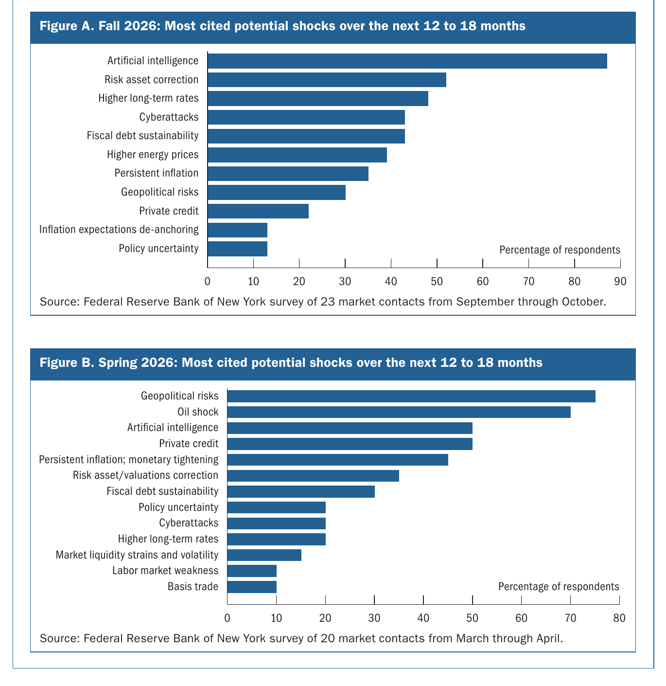
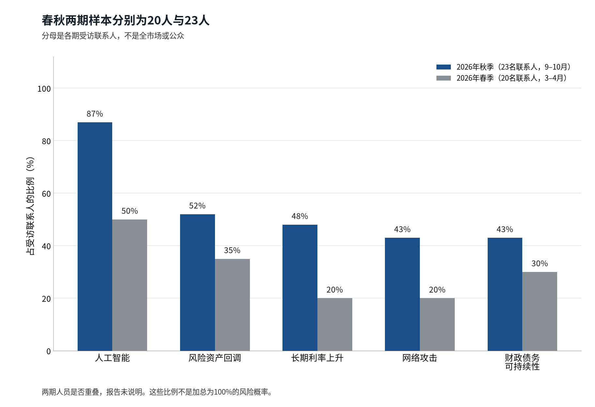

# 美联储金融稳定报告里的问卷：23名联系人中87%提到AI冲击

人工智能公司的股价和融资，最后能不能兑现成盈利，会牵动市场对金融风险的担忧。美联储理事会11月这期《金融稳定报告》里，一份23名市场联系人的问卷中，87%提到了AI。

完整内容见官网[报告页](https://www.federalreserve.gov/publications/financial-stability-report.htm)和[报告PDF](https://www.federalreserve.gov/publications/files/financial-stability-report-20261113.pdf)，问卷写在专栏「Survey of Salient Risks to Financial Stability」。

## 问的是未来12到18个月，哪类冲击伤害最大

纽约联储工作人员向范围较广的联系人征求对美国金融稳定风险的看法。9月和10月收到23份答复，联系人包括经纪自营商、银行、投资基金和咨询机构的专业人士。专栏写明：这是受访者观点的摘要，不应被理解成代表美联储理事会或纽约联储的看法。

附录图注给出的原题是：在未来12到18个月里，如果发生，你认为哪些冲击会对美国金融体系的运转造成最大的负面影响。秋季图上最常被提到的五项比例加起来已经远超百分之百。这些是各风险被提及的比例，不是加起来等于100%的风险概率分配。

报告概览列出这五项：人工智能87%，风险资产回调52%，长期利率上升48%，网络攻击43%，财政债务可持续性43%，分母都是当期受访的联系人。专栏把人工智能称作被提到最多的风险，同时又写：网络攻击和财政债务可持续性被看作潜在后果最严重。

受访者谈到AI时，专栏归纳了三块：股票估值偏高，盈利不及预期可能带来估值回落和市场调整；网络安全，既包括老练国家行为体的恶意攻击，也包括前沿AI模型本身可能造成的损害；以及与AI相关的复杂融资安排。许多人还担心AI相关股票大幅修正，认为偏高估值、循环融资和靠债务扩张可能放大亏损。

## 春秋两期分别收到20份和23份答复，不能当成同一组人的变化

[2026年5月那一期报告](https://www.federalreserve.gov/publications/files/financial-stability-report-20260508.pdf)里，同一份问卷在3月和4月收到20份答复，问题同样针对未来12到18个月。11月报告把春季这五项写成：人工智能50%，风险资产回调35%，长期利率上升20%，网络攻击20%，财政债务可持续性30%。春季图上，地缘政治风险和石油冲击还排在人工智能前面。

专栏说，相较春季问卷，人工智能、长期利率上升和网络攻击的提及增幅最大。两期样本分别是20人和23人，是否为同一批人，报告没有说明，不能当成同一组人的前后变化，这两个百分比也不是全市场或公众的比例，更不是崩盘概率。

## 报告对估值和数据中心杠杆另有评估

报告正文另有评估，和问卷里的担忧不是同一件事。概览写道，资产估值压力仍然偏高，股票估值指标维持高位，部分受到市场对超级智能的热情推动。报告还另设专栏讨论数据中心扩张中的杠杆。

问卷里提出的具体问题是：人工智能的盈利能不能支撑现在的估值，债务和循环融资会怎样分担可能的亏损，网络风险又会如何扩大影响。这些是这份问卷中被提出的问题，不是已经确定会发生的事实。
