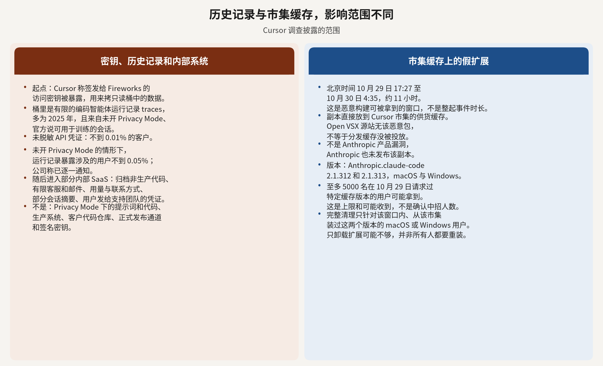

# Cursor 调查更新：历史智能体记录被拷，假 Claude Code 来自市集缓存

用 Cursor 的人这回最想先分清：提示词和代码在不在里面，要不要整机重装，以及更新软件能不能让已被拿走的凭证失效。2026 年 11 月 13 日，Cursor 发布[调查更新](https://cursor.com/blog/security-incident-update)，把 10 月底出现的假 Claude Code 扩展，连到更早的密钥和数据问题。公司称绝大多数客户未受影响，并已按各自情况直接通知。

## 起点是签发给 Fireworks 的密钥，不是全量代码泄露

Cursor 调查称，攻击者拿到了公司签发给 Fireworks 的访问密钥，并称该密钥由 Fireworks 暴露。攻击者用它从一只只读存储桶里拷走数据。桶里是有限的编码智能体运行记录 traces，大多来自 2025 年，且来自未开启 Privacy Mode、官方说可用于模型训练的会话。一小部分运行记录里有未脱敏的凭证。公司给出的数字是：不到 0.01% 的客户有 API 凭证被暴露。

Fireworks 另有自己的[10 月安全公告](https://fireworks.ai/security/bulletins/october-2026-security-incident)和[后续更新](https://fireworks.ai/security/bulletins/october-2026-security-incident-update)，写评估任务环境变量中的密钥和令牌在部分客户账户里被获取，并要求收到通知的客户轮换列出的第三方凭证。Fireworks 未在其中点名 Cursor。

## 归档代码和客服数据被访问，生产发布系统未受影响

公司称，攻击者从这些凭证进入 Cursor 使用的部分 SaaS 工具，进而访问了部分归档的非生产源代码仓库，有的含商务联系信息；还有有限的客户支持和邮件、产品使用指标和联系方式、部分编码智能体会话摘要，以及用户发给支持团队的一些凭证。

按 Cursor 此次调查，生产发布代码和客户代码仓库未受影响。正式客户端和云服务从另一套代码托管系统发布，攻击者未进入该系统，发布签名密钥也未暴露。当前发往 Cursor 的数据和实时流量、正在进行的推理请求，以及 Privacy Mode 下的提示词和代码，公司也列为未受影响。对未使用 Privacy Mode 的情形，公司称运行记录暴露涉及的用户不到 0.05%，并已逐一通知；没收到通知，则数据不在这些历史记录里。

调查没有写出密钥暴露和进入内部 SaaS 的具体日期。公司称监测系统发现未经授权活动后，停用了供应商密钥、轮换凭证并切断后续访问，也曾关闭超出证据所需的内部和产品服务，确认安全后再恢复。官方称见到的最后一次攻击者活动在 11 月 1 日并已被阻断，认为事件已得到控制。

## 假扩展是市集缓存投毒，不是 Anthropic 产品漏洞

10 月 29 日，攻击者用从内部系统暴露数据里窃得的凭证，把未经授权的 Claude Code 扩展副本直接放到向 Cursor VS Code 扩展市集供货的缓存上。Cursor 写，Anthropic 并未发布该副本，这也不是 Anthropic 产品的漏洞。市集源站 Open VSX 从未出现过该恶意包，但这不等于分发缓存没被投放。

[安全公告](https://cursor.com/blog/claude-code-extension-security-notice)和调查更新都写，受影响的是在暴露窗口内，从 Cursor 市集安装或更新到 Anthropic.claude-code 2.1.312 或 2.1.313 的 macOS 和 Windows 用户。公司称，10 月 29 日请求过特定缓存版本的用户至多 5000 人可能拿到恶意构建。这是上限，也是可能收到，不是已确认中招人数。恶意构建大约存在 11 小时后被撤下，窗口为北京时间 10 月 29 日 17:27 至 10 月 30 日 4:35。

公司随后关闭市集并重建上线，同时与云厂商把攻击者服务器下线，并发布安全公告、开始通知受影响用户。

## 装过这两个版本的人，需要按公告检查和清理

官方把完整清理限定在上述窗口、这两个版本、且来自 Cursor 市集的 macOS 或 Windows 安装。按安全公告，符合上述条件的人要检查 `authorized_keys` 里有没有名为 `svc-telemetry` 的密钥；若有，需隔离主机，清理密钥、持久化机制和隧道进程，评估是否重装系统，并在受信任的机器上轮换可从受影响主机访问的凭证和会话。找不到这一项，并不等于已经安全。公告写明，只卸载扩展可能不够，载荷会留下仍在运行的独立持久化脚本。把 Cursor 更新到新版本，也不能让已被窃的凭证自动失效。

没在该窗口安装这两个版本的人，官方没有要求全员重装或重做系统。若凭证或客服、商务数据可能被涉及，公司称已直接通知，管理员会收到需要轮换的具体密钥名单。

这次更新把假扩展和更早的密钥、历史记录放进同一条调查叙述，但各段范围并不相同。对普通开发者，仍要看自己有没有收到通知，以及有没有在那约 11 小时里从 Cursor 市集装过那两个版本，而不是把全量代码泄露或所有人都要重装当成结论。
