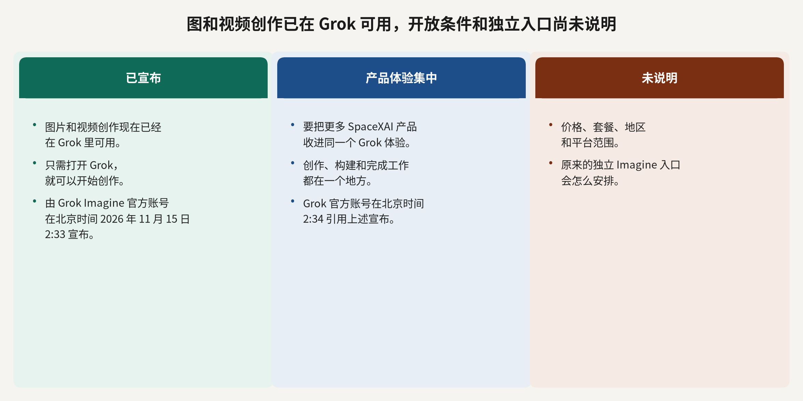

# Grok Imagine 宣布图和视频创作已在 Grok 可用，独立入口安排未说明

做图、做视频，是否还要另找一个入口？Grok Imagine 这次把答案指向 Grok。北京时间 2026 年 11 月 15 日 2:33，Grok Imagine 官方账号在[帖子](https://x.com/imagine/status/2121672946968318285)里写：图片和视频创作现在已经在 Grok 里可用，只需打开 Grok 就可以开始创作。

不到一分钟后，北京时间 2:34，Grok 官方账号[引用这条帖并写道](https://x.com/grok/status/2121673185540378797)：正在把更多 SpaceXAI 产品收进同一个 Grok 体验，这样创作、构建和完成工作都在一个地方。

## Grok 要把更多产品收进同一个体验

官方先说清的是两件事。图和视频创作已经可以在 Grok 里用，打开 Grok 就能开始；同时，Grok 要把更多 SpaceXAI 产品收到同一个体验里，让创作、构建和完成工作都在一处。

此前 SpaceXSI 在[产品新闻](https://x.ai/news/grok-imagine-image-2)里，把 Imagine Image 2.0 的入口写在 grok.com/imagine 以及 iOS 和 Android 应用上。那是 2026 年 8 月的模型发布。

这次宣布没有公布价格、套餐、地区和平台范围，也没有说明原来的独立 Imagine 入口会怎么安排。

