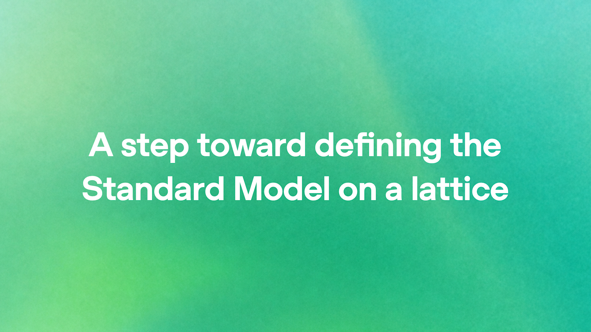
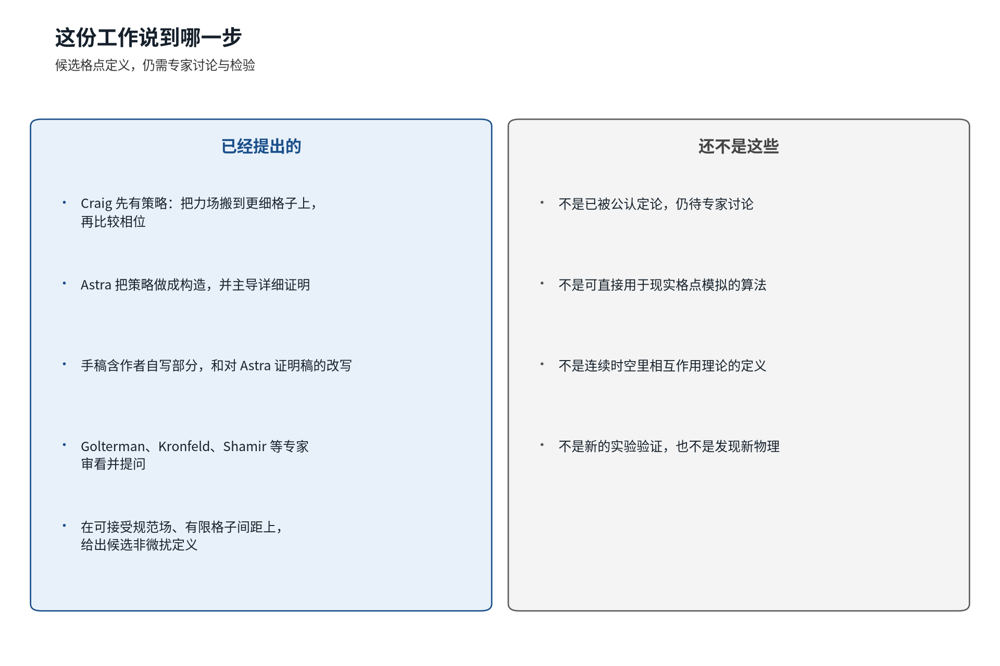

# OpenAI科学博客首篇：Craig与GPT-6 Astra提出标准模型格点候选定义

标准模型把已知的基本粒子，以及强力、弱力和电磁力算得很准，也和实验对得上。可是要把整套理论放到时空格子上，不靠“相互作用很小”来做完整定义，尤其是弱力对左手和右手粒子区别对待，这件事已经缺了几十年。缺的不是再发现一颗新粒子，而是定义本身还差一块。

OpenAI在11月15日推出[科学博客](https://openai.com/index/our-new-blog-for-science/)，首篇嘉宾文章是加州大学圣巴巴拉分校粒子理论组负责人、OpenAI访问科学家Nathaniel Craig写的[《A step toward defining the Standard Model on a lattice》](https://openai.com/index/step-toward-defining-the-standard-model)。他讲述如何与GPT-6 Astra合作，在[10月的预印本](https://arxiv.org/abs/2610.09093)里提出一个候选的格点定义。OpenAI也在[X上介绍了这篇文章](https://x.com/OpenAI/status/2122123437141553630)。

## 策略是Craig的，详细证明由Astra主导

Craig在博文里写，自己已有一套思路，却一直没能证明它在所有需要覆盖的情形里都成立。这套思路是：把要定义理论的那张格子上的力场，再搬到一层层更细的格子上；比较相邻两层上被允许的费米子状态，得到相位修正的一部分，再把这些部分加起来，得到原来那张格子上的相位规则。

他说，Astra帮助把这一策略做成了具体构造，并在详细证明上起了主导作用：它建议了怎样把一组力场搬到更细的格子上，说明细格子上的比较会收敛到一个确定答案，并主导写出详细证明。预印本致谢写得更具体：手稿把作者自己写的章节，和经过大量改写的Astra证明稿合在一起；他和同事提出的测试，包括Lean形式化验证，由Astra执行，部分补充材料也由Astra撰写。

格点场论研究者Maarten Golterman、Andreas Kronfeld和Yigal Shamir花时间审看了Astra的证明，并提出追问。Craig说，这些经验和问题帮助他增强了对结果的信心。这是专家帮忙审看，还不是期刊同行评审之后的定论。

## 这是有前提的候选定义，离实用模拟还远

预印本标题是《A gauge-invariant measure for lattice chiral fermions》，作者署名为Craig，单位包括圣巴巴拉分校和OpenAI，arXiv标注于2026年10月6日提交。它给出的，是标准模型在时空格子上的一个候选非微扰定义：不把相互作用当成很小的修正，先把整套规则写清楚，供专家继续检验。

构造用在有限的周期四维格子上，作者要求格子上的规范场满足足够严格、且与体积无关的小方格约束。论文结论写明，这是原则上的表述，而不是立刻能用于现实格点模拟的方法；连续时空里相互作用理论的定义仍然开放。Craig在博文里也说，这个规定是不是具备人们希望的全部性质，还需要专家讨论。他还在考虑有限格子间距上的反射正定性，这是一种还需要进一步检验的性质，作者说它有助于把这种格子模型里的计算，和概率守恒的量子理论联系起来。

论文报告称，形式化检查里有十六个Lean 4模块编译通过，并在记录的假设下核验了形式陈述。作者同时写明，Lean验证并不是物理学里的最后结论，形式假设之外还有许多可能出问题的地方。

读者看这类进展，真正该关心的是这些环节怎样接起来：人先提出策略，模型把细化想法做成构造并主导详细证明，再经过专家追问和形式检查。眼下关键仍是这个候选定义能否经受进一步检验，而不是实用的格点模拟已经可以做。
