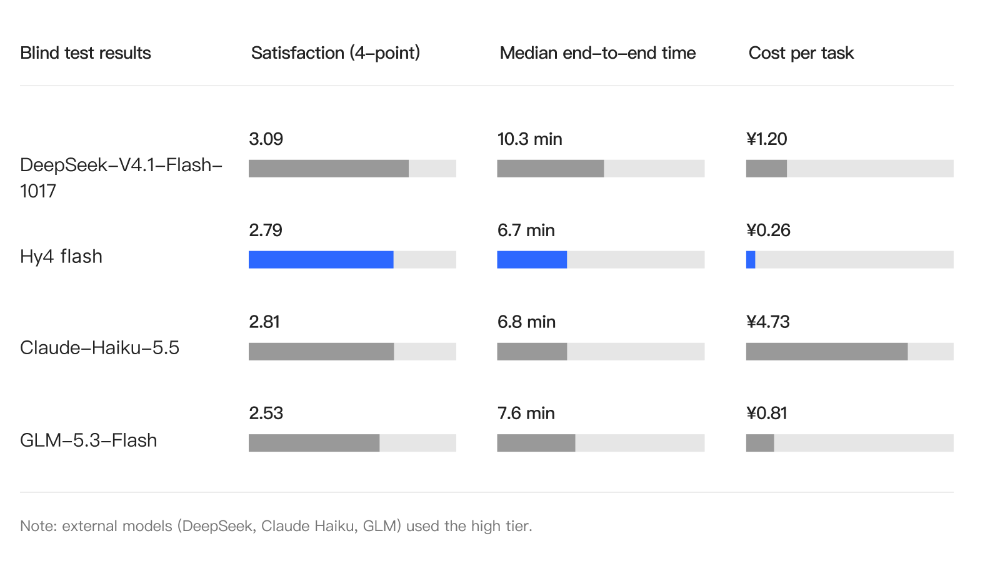
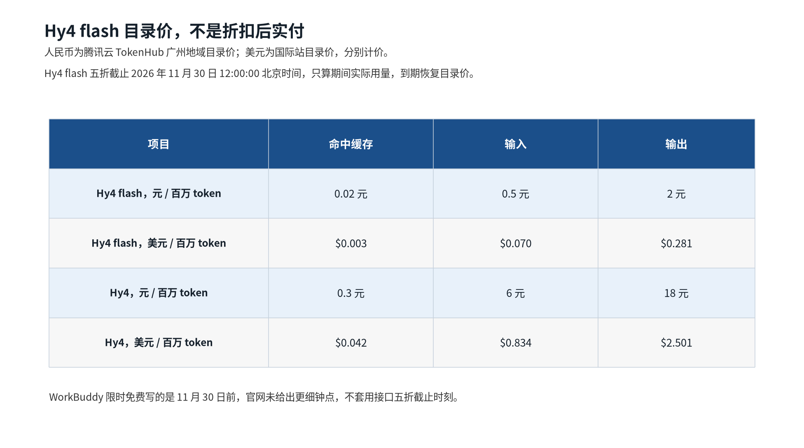

# 混元Hy4 flash发布：官方办公盲测成本约Haiku 5.5高档的十八分之一

做一页PPT、改一份表格、把长文档整理成能交差的材料，这类日常办公活现在多了一个更便宜的选项。11月16日，腾讯混元推出[Hy4 flash](https://hy.tencent.com/research/hy4-flash)，官方把它定位为面向日常工作、迄今性价比最高的Hy模型。官方账号[Tencent Hy也发了介绍](https://x.com/TencentHunyuan/status/2122217770314301469)。

官网写道，模型总参数224B，其中64B是Engram参数，每个token激活12B，支持多模态和100万token上下文。腾讯建议，在深度搜索、文档处理、做PPT、简单前端展示和电脑操作等大部分日常任务中使用Hy4 flash，长程软件工程等更复杂的活，仍建议用智能上限更高的Hy4。

## 官方向Haiku 5.5看齐的，是满意度，不是全面第一

官方帖写，在日常工作的人工盲测里，Hy4 flash与Claude Haiku 5.5高档相当，单任务成本约降到十八分之一。配套对照图给出的数字是：四分制满意度上，Hy4 flash为2.79、中位端到端用时6.7分钟、单任务成本0.26元；Haiku 5.5高档为2.81、6.8分钟、4.73元。同一张图里，DeepSeek-V4.1-Flash-1017高档的满意度是3.09，高于前两者，但用时10.3分钟、单任务成本1.20元。图上注明，外部模型用的都是高档。

这是内部WorkBuddy用户的盲测。官网补充，受测的是85位内部用户、27类共259个日常工作任务；Hy4 flash的用户满意度接近Haiku 5.5，单任务成本显著低于参与对比的模型，任务时长也最短。这些结果对应的是这组内部日常任务。

## WorkIndex更省，但复杂长程任务仍推荐Hy4

官网另有一套内部评测WorkIndex，覆盖做PPT、改PPT、人机一起写材料、改文档、修表格、处理音视频和看图等日常活。这不是上面那组盲测。官网称Hy4 flash综合效果略优于之前的Hy4 preview；按这套内部WorkIndex，单任务成本约为Hy4 preview的十三分之一、正式版Hy4的二十分之一。复杂的长程任务，腾讯仍推荐用Hy4。

## 目录价是多少，折扣用到哪一天

腾讯云[TokenHub价格页](https://cloud.tencent.com/document/product/1823/130055)里，广州地域目录价是每百万token输入0.5元、输出2元、命中缓存0.02元。[国际站价格页](https://www.tencentcloud.com/zh/document/product/1300/78937)目录价是每百万token输入0.070美元、输出0.281美元、命中缓存0.003美元，与官方帖一致。两套目录价分别计价。TokenHub写明：从该说明发布之日起，到2026年11月30日12:00:00北京时间，Hy4 flash按目录价的五折结算，只算这期间实际产生的用量，到期恢复目录价。WorkBuddy则是11月30日前限时免费，官网没有再写出更细的截止钟点，与接口五折的截止时刻不是同一条说明。

腾讯宣布，模型已在腾讯云TokenHub、WorkBuddy、元宝、企业微信、QQ、ima、Marvis等产品上线，并表示将接入OpenRouter，计划开放权重。

想看看它对自己的办公活够不够用，可以在WorkBuddy限免期内，拿同一份不含敏感信息的PPT或文档任务试做：事实是否写对，格式要不要改，还要返工几次。模型调用便宜是一回事，连同人工修改后能省多少，才是日常用起来的账。
