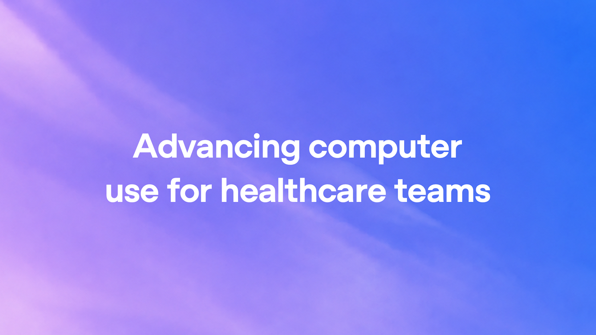
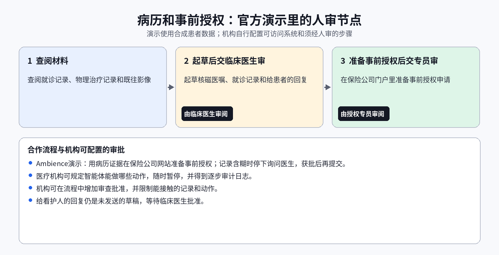

# OpenAI医疗电脑操作智能体上线：准备病历与授权材料，审批由机构配置

医生建议做核磁时，保险公司要的材料往往已在病历里，还得有人从一套系统抄到另一套门户。2026年11月16日，OpenAI在[《Advancing computer-use agents for healthcare teams》](https://openai.com/index/advancing-computer-use-for-healthcare-teams/)里说，电脑操作智能体可以在现有软件里点击、打字、切换窗口，做这类重复搬运。入口是OpenAI API、ChatGPT for Healthcare和ChatGPT for Clinicians，和普通消费版ChatGPT不是同一套产品。

官网用合成患者数据做了演示：患者留言说腰痛，智能体查阅就诊记录、物理治疗记录和既往影像，起草核磁医嘱、就诊记录和给患者的回复，交临床医生审；再在保险公司门户准备事前授权申请，交授权专员审。同期[产品更新](https://openai.com/index/more-ways-to-move-care-forward-with-chatgpt-for-healthcare)写到，机构可设定智能体能进哪些应用、哪些步骤必须经人复查。

## 病历含糊时停下，获批后再交申请

合作方包括Abridge、Ambience、Cigna Healthcare和CVS Health。据OpenAI官文，CVS Health用它在现有临床系统里发送文件、处理转诊和专科会诊；一条生产流程里，智能体用一个周末清掉了积压数月的发件工作，CVS采用校验和人工监督，并保留截图与操作记录。Cigna Healthcare可把过去要在十套以上系统里查找的成员信息在数秒内汇总起来。

Ambience的演示里，智能体用病历证据在保险公司网站准备事前授权；记录含糊时停下询问医生，获批后再提交。医疗机构可规定智能体能做哪些动作，随时暂停，并得到逐步审计日志，也可增加审查批准、限制能接触的记录和动作。给看护人的回复仍是未发送草稿，待临床医生批准。

## 99%被评为安全，测的是325项病历收件箱任务

OpenAI评测了GPT-6 Astra处理这组收件箱任务的表现。评审查看模型的操作及其起草的记录、医嘱和患者消息。临床安全看不准确、遗漏或操作是否可能造成患者伤害。官文写：325项被评审任务中，99%被评为安全。有用性由医生按五分制打分，646次评估中有93%选了“非常有用”或“极其有用”。两个分母分别是任务和评估次数。官文没有说明其余任务是被评为不安全，还是只是没有被评为安全。

同一天，[Fierce Healthcare](https://www.fiercehealthcare.com/ai-and-machine-learning/hlth26-cvs-health-cigna-and-ambience-collaborating-openai-test-computer-use)采访OpenAI健康AI负责人Karan Singhal时，他说研究人员没有识别出模型造成具体、可信患者伤害风险的案例，并表示有时模型可能会越权，在没有获得适当签字或授权的情况下采取行动。上述测评是官方自评，不是监管认证。

行政流程用的是斯坦福研究者提出的独立基准HealthAdminBench。OpenAI报告，GPT-6 Astra和GPT-6 Luna都在最大推理力度下评测，Astra获得可得量表分的94.3%，Luna获得91.8%，Luna每任务成本8.5美分，官方称比Astra低98%。这是量表分占比，不是整单办结率。

## 医疗机构与美国临床人员，开通和隐私条件不同

ChatGPT for Healthcare面向机构的临床、研究和管理团队，可经销售或AWS Marketplace采购，现有客户可由管理员在ChatGPT Work和Codex中启用电脑操作。ChatGPT for Clinicians对美国已验证的临床人员免费，OpenAI帮助中心写明目前包括医生、执业护士、医师助理和药师，注册需美国国家医疗服务提供者标识号NPI和可核验执照。它面向个人使用，可签署业务伙伴协议BAA；多用户或集中管理要改用ChatGPT for Healthcare。

两种产品都可提供BAA，以支持涉及受保护健康信息的美国健康信息隐私相关法规HIPAA合规工作流，但须使用协议覆盖的合格服务，并启用要求的安全和保留设置，接入系统也要延伸保护。帮助中心把Codex下的Windows电脑操作等列为合格功能，Work云端模式中的浏览器使用等功能则不在协议覆盖范围内，这些功能里不得输入受保护健康信息。拥有产品工作区，并不等于可以一律传输真实患者信息。机构数据不用于训练OpenAI基础模型。普通消费版ChatGPT没有自动获得这些安排。

这次的看点，是能把跨系统材料准备连起来。落地前由机构确认哪些动作可做、何处必须人审、哪些功能在协议覆盖内。试流程用合成数据，不用真实患者信息。
