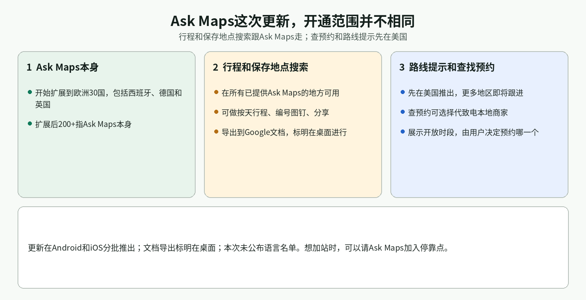

# 谷歌Ask Maps可排多日行程并查预约空位：查预约和代打电话先在美国

排三天旅行，难的不只是挑景点：停靠顺序、营业时间和临时加的一顿午饭，得放进同一份计划。2026年11月16日，谷歌在[《New Ask Maps features to help with holiday travel and prep》](https://blog.google/products-and-platforms/products/maps/ask-maps-holiday-travel-features-2026/)里宣布了Ask Maps的一批新能力：做行程、在路线上给出行前提示、查找本地预约，以及搜索已保存地点。

这些更新先在Android和iOS开始分批推出，将陆续出现在地图应用里。同一天，Ask Maps开始扩展到欧洲30个国家，包括西班牙、德国和英国；扩展后的200多个国家和地区，指的是Ask Maps这项产品本身。旅行行程和列表搜索在所有已提供Ask Maps的地方可用。本次更新没有公布语言名单。

## 多日行程带编号图钉，能分享也能导出文档

可以用它规划一天的购物行程，或像示例里那样做三天公路旅行，得到按天排列的日程、贴士，以及每个停靠点的编号地图图钉。满意后可以分享给亲友，或在桌面导出到Google文档。

出发前，可用Ask Maps调出行程，或在对话记录里找“itinerary”标记。此时会看到实时路况、地点是否在营业，以及下一站的氛围。想加站时，可以请Ask Maps沿途加上观景点或午餐地点，再从行程里点前往下一站。

保存地点搜索也随Ask Maps提供。官文举例：可以问已保存地点里，哪些在30分钟内能接待五人。系统会在列表中查看实时空位，由用户挑选后再出发。

## 查找预约先在美国，空位由用户自己选

无论是多日公路旅行，还是在城里办几件事，打开导航时还能看到路线上的“Know before you go”提示，包括停车或充电位置，以及天气、可能延误和通行费。这类路线导航提示和查找预约先在美国推出，更多地区即将跟进。

在预约查找功能里，用户可以选择让Ask Maps在网上查找美容、宠物护理、汽车和家庭维修预约，并代为致电本地商家。例如询问附近下午4点的美甲空位，Ask Maps会展示附近商家的开放时段，方便用户决定预约哪一个。

已经获得这些功能的人，可以用自己的保存列表生成一份行程草稿，核对这些地点的营业时间、路上交通，以及临时改站是否合理。真正需要预约时，以可选时段和最终确认结果为准。
