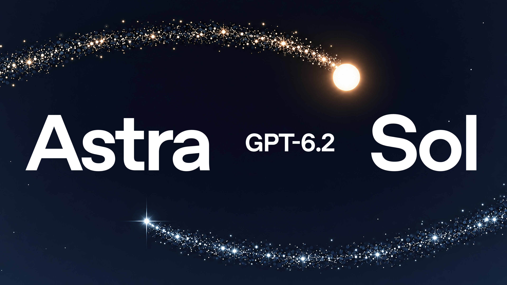
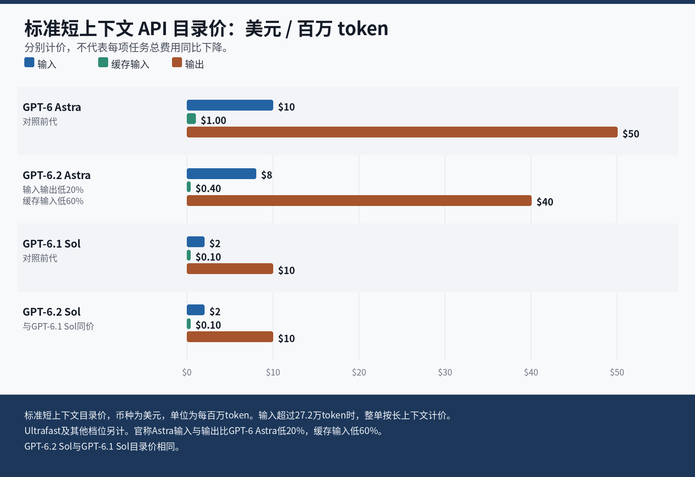

# GPT-6.2 Astra与Sol发布：旗舰API输入输出降价两成

改一份要按公司模板走的幻灯片，或在Codex里顺着报错追到测试，难处不只是写得出来，还得改得少，并算得清额度。2026年11月17日，OpenAI宣布发布GPT-6.2 Astra和GPT-6.2 Sol：前者面向更难的专业项目，后者面向日常工作，并称两款模型在更难的任务上能用更少的输出token得到更好结果。

## 两款模型进入Work和Codex，企业套餐需管理员开通

据[OpenAI官博](https://openai.com/index/introducing-gpt-6-2-astra-sol/)，即日起Plus、Pro、Enterprise和Edu用户可在ChatGPT Work和Codex使用这两款模型；[ChatGPT学习中心](https://learn.chatgpt.com/docs/whats-new/gpt-62-astra-sol)还把Business列入可在Work中选用的套餐。Enterprise和Edu需工作区管理员开通后，符合条件的用户才能使用。开发者可通过API使用`gpt-6.2-astra`和`gpt-6.2-sol`，发布时两款模型都提供Ultrafast。

按ChatGPT学习中心的表述，这是月费200美元和500美元的Pro方案：500美元档可用两款模型的Ultrafast；官博称首次向200美元档开放Ultrafast，先从GPT-6.2 Sol开始。Codex与Work共用额度。学习中心举例，Astra适合跨服务追查、修复并跑测试，Sol适合审阅拉取请求或按反馈改代码。

## Astra标准价输入输出低两成，缓存输入低六成

官博称，GPT-6.2 Astra的API输入和输出token价格比GPT-6 Astra低20%，缓存输入再低60%，标准价为每百万token输入8美元、缓存输入0.40美元、输出40美元。GPT-6.2 Sol沿用GPT-6.1 Sol的价格：每百万token输入2美元、缓存输入0.10美元、输出10美元。

[API定价页](https://developers.openai.com/api/docs/pricing)列出，GPT-6 Astra的标准短上下文目录价为每百万token输入10美元、缓存输入1.00美元、输出50美元，现价对应为8美元、0.40美元和40美元。

这些是美元计价的标准短上下文目录价，不是折后任务总价。定价页写明，输入超过27.2万token时，整单按长上下文计价。Ultrafast另按目录计价。

## 官方称Agents’ Last Exam更高更便宜，Fable对比排除了九道题

官博称，在测试多步专业工作的Agents’ Last Exam上，GPT-6.2 Astra刷新最高分，比GPT-6 Astra高5.2分、成本不到三分之一，比Claude Fable 5.2高5.5分、成本仅为5%。这组比较由OpenAI公布；Fable 5.2的排行榜成绩排除了九道使用了备用模型的题目，不能当作完全同条件的独立对测。

官博还说，GPT-6.2 Astra比GPT-6 Astra显著更便宜，原因是更好的token效率、输入和输出八折，以及缓存输入四折。内部GDPval v2称，Astra比上代高6.2个百分点，同时少用22%的输出token。输出token变少，并不等于一项任务的总费用按同一比例下降。

对于日常编码和代理工作，官博称GPT-6.2 Sol比GPT-6.1 Sol更聪明、更省，能在同一付费方案里完成更多任务；在Cognition的FrontierCode 2.0上，两款模型都在max档时，Sol与Astra相差0.5分，成本约为五分之一。这同样是官方及所引基准的说法。

这次降的是目录单价，能否真正省钱，还要看同类任务的返工次数、token用量和实际费用。
