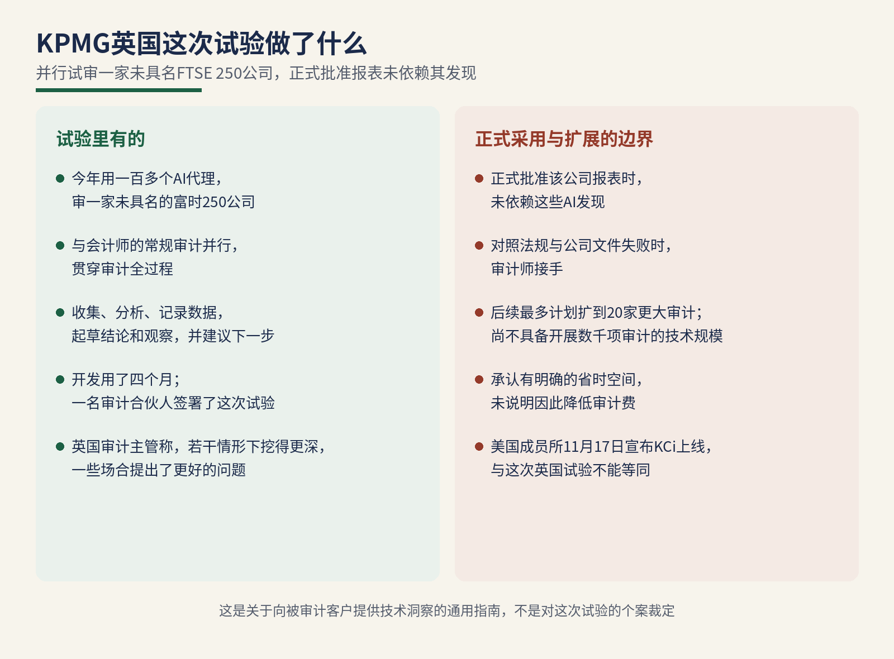
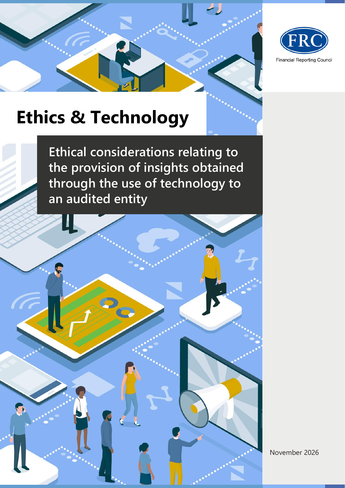

# KPMG英国让百余AI代理并行试审：正式批准报表未依赖其发现

审计师要为上市公司的年度财务报表签署审计报告，关键不只是检查做得快，而是哪些发现能写进正式意见。据[Business Standard](https://www.business-standard.com/industry/news/kpmg-finds-ai-agents-ask-better-questions-than-human-auditors-in-trial-126111800471_1.html)转述《[金融时报](https://www.ft.com/content/5168b3e9-75d0-4be0-9ccd-d327d6b16c05)》11月18日报道，KPMG英国在今年对一家未具名的富时250指数公司做了试验：一百多个AI代理被用到审计各环节，与会计师的常规审计并行。

这次试验代号Project Exponential。报道称，这些代理负责收集、分析和记录数据，起草结论与观察，还能彼此协作并建议下一步；开发用了四个月。以往审计里的AI多用于单项任务，这次是把代理贯穿到一次大型英国审计的全过程。

## 主管称有些问题问得更深，正式报表仍未依赖试验发现

KPMG英国审计主管Cath Burnet对《金融时报》说，在若干情形下，“AI能够挖得深得多”，并在一些场合提出了“更好的问题”。这是她对试验的评价，不是一份对外公布的独立评分对测。

据报道，一名审计合伙人签署了这次试验，但KPMG在正式批准该公司报表时，并未依赖这些发现。员工为代理设定目标，提供公司业务和以往审计信息，并在完成审计意见前检查并质疑其结论。Burnet说，试验团队的“形态和规模”与传统审计不同，但人的参与仍然“至关重要”。

## 对照法规与公司文件失败时，审计师接手

Burnet还说，审计中有一部分仍需人工介入：一个AI代理没能把一套法规与公司文件正确对应起来，审计师随即接手。

她同时提到，目前还没有开展数千项审计所需的技术规模；有的公司可能不愿使用；部分公司的数据仍不够干净，难以让代理有效工作。

## 后续最多计划20家更大审计，报道未说明因此降费

KPMG计划把该项目扩展到最多20家更大规模的审计，并希望将来向客户提供基于AI的审计。

KPMG承认，基于AI的审计有明确的省时空间，但报道中没有说明这些效率是否会转化成更低的审计费。

11月17日，美国成员所KPMG LLP另有[公告](https://kpmg.com/us/en/media/news/kpmg-unveils-next-era-of-ai-enabled-human-assured-audit-with-us-launch-of-kpmg-clara-intelligence.html)，在美国发布KPMG Clara intelligence。这是一则平台上线说明，与这次英国并行试验不能等同，目前也不能断言两者完全没有关联。

## 监管指南：向被审计客户提供技术洞察，可能影响独立性

11月16日，英国财务报告委员会发布非强制性的[《Ethics and Technology》指南](https://www.frc.org.uk/documents/9983/Ethics_and_Technology_Ethical_considerations_relating_to_the_provision_of_insights_obtained_through_the_use_of_technology_to_an_audited_entity_p9UHapho.pdf)，说明如何适用既有道德要求，不另行增设规定。官文写明，向被审计单位管理层或治理层通报通过技术获得的洞察，在某些情形下可能对诚信、客观或独立性构成威胁，尤其是产生这些洞察的工作并不属于财务报表审计的一部分。[同日新闻稿](https://www.frc.org.uk/news-and-events/news/2026/11/new-guidance-supports-auditor-independence-when-using-technology-including-ai/)中，监管标准执行董事Mark Babington也强调，审计师独立性必须始终处于审计服务公众利益的核心。

主管说有些问题问得更深，正式批准报表时却并不依赖这些发现：中间这段距离，才是这次试验真正留下的问题。技术能否在更多审计里站稳，以及向被审计客户提供洞察时如何守住独立性，都还有待验证。
