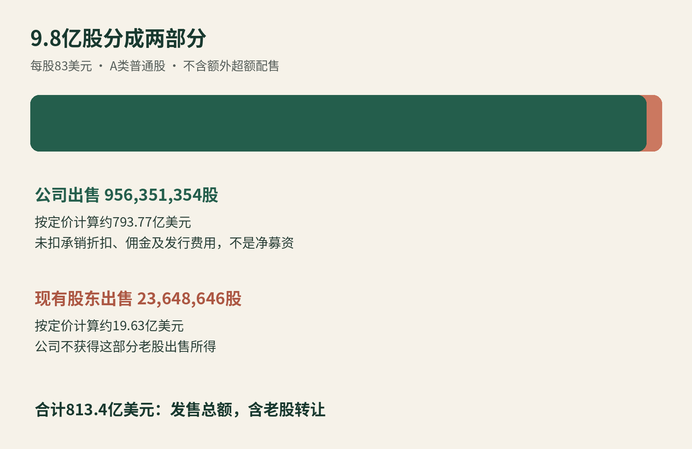
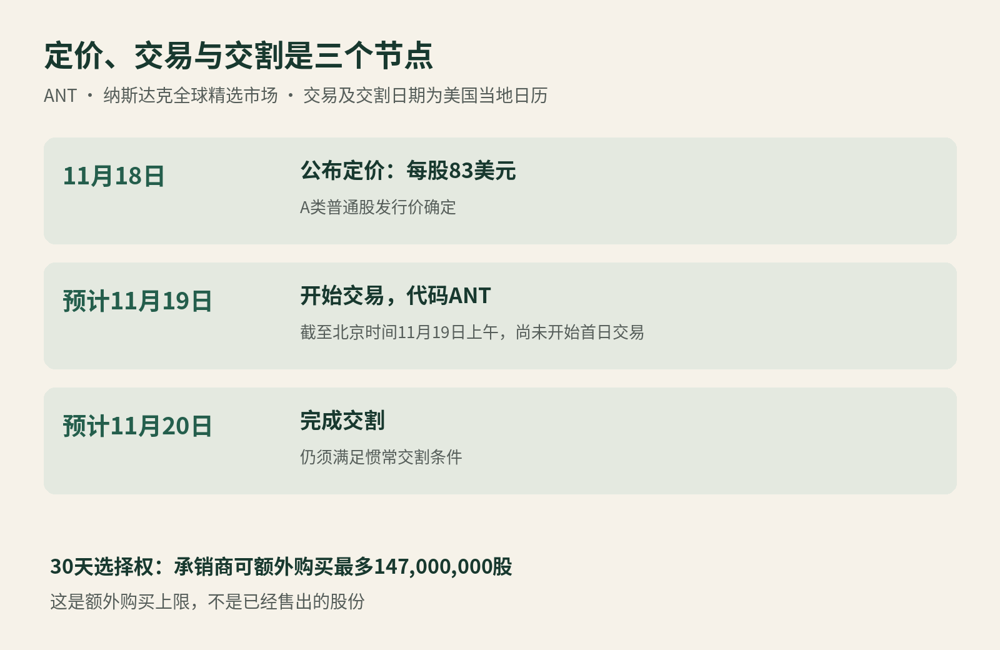

# Anthropic IPO定价每股83美元：发售约813亿美元，含老股转让

把Claude接进工作流的人，关心的不只是模型下一次升级，也包括背后的公司能拿到多少资金、以什么价格接受公开市场检验。Anthropic在11月18日发布的[IPO定价公告](https://www.anthropic.com/news/anthropic-prices-initial-public-offering)中，将A类普通股发行价定为每股83美元，预计以ANT为代码登陆纳斯达克全球精选市场。

截至北京时间11月19日上午，股票尚未开始首日交易。83美元是发行价，首日成交价和涨跌还没有答案。

## 9.8亿股中，公司出售约9.56亿股

官稿列出的总发售股数是980,000,000股，其中公司新发股份956,351,354股，现有股东转让老股23,648,646股。按每股83美元计算，整笔发售总额为813.4亿美元，包含老股转让，不计额外超额配售。

公司出售部分按发行价计算约793.77亿美元，老股部分约19.63亿美元。两项都还没有扣除相关费用，不能把总发售额当成公司净募资。Anthropic明确表示，不会获得出售股东转让股份的任何所得。

## 预计美国当地11月19日交易，20日交割

公司预计股票于美国当地11月19日在纳斯达克全球精选市场开始交易，代码ANT；预计11月20日完成交割，前提是满足惯常交割条件。交易开始与交割完成，是不同的节点。

承销商还获得一项30天选择权，可以额外购买最多147,000,000股A类普通股，也就是1.47亿股。这是额外购买的上限，并不意味着这些股份已经售出。

## 约1.5万亿美元是媒体的完全稀释估值

[PitchBook报道](https://pitchbook.com/news/articles/anthropics-81-3b-haul-makes-it-the-largest-tech-ipo-ever)称，此次定价对应约1.5万亿美元的完全稀释估值。这个口径把潜在股份也纳入考虑，与本次卖出多少股、筹得多少钱不是一回事；定价官稿本身没有列出公司市值。

发行价已经确定，公开市场愿意给出的价格还没有形成。对Anthropic而言，这次发售既带来公司出售股份的资金，也让部分现有股东转让持股；真正检验这一定价的下一步，是股票开始交易后的市场成交。
