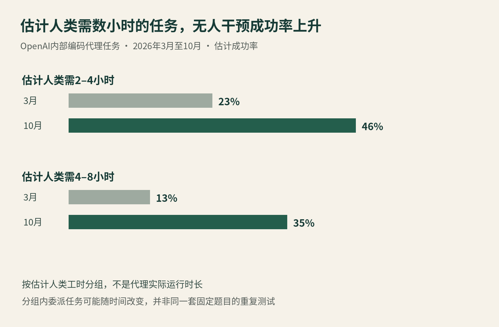
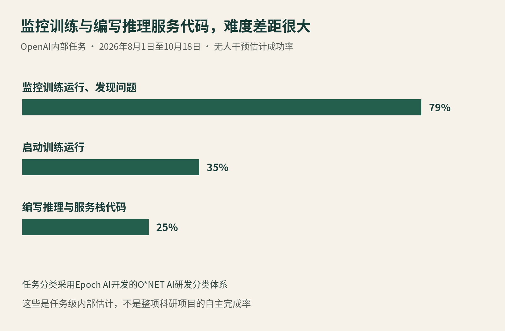

# OpenAI研究加速报告：数小时编码任务更能独立完成，推理服务代码仍是短板

让AI帮忙写实验代码，最费心的往往是决定哪一步可以交出去、哪一步必须盯着。11月18日，OpenAI发布[研究加速报告](https://openai.com/index/research-acceleration-jagged-frontier/)，用内部测量说明编码代理怎样改变AI研发。它呈现的不是整齐划一的替代，而是一条高低不平的能力边界：有的任务已相当能放手，有的仍容易卡住。

## 估计人类需2至4小时的任务，成功率从23%升至46%

OpenAI称，从2026年3月至10月，估计人类需要2至4小时完成的任务，代理无人干预的估计成功率从23%升至46%；估计需4至8小时的任务，则从13%升至35%。这里的小时数是估计的人类工作量，不是代理实际运行时间。

统计对象是研究人员委派给编码代理的任务。公司提醒，随着代理进步，人们也可能改变各工时组中愿意交出去的工作，因此变化既可能反映能力提高，也可能反映委派方式改变，并非同一套固定题目的连续考试。这些比例未附各工时组的月度任务数。

## 监控训练79%，编写推理与服务栈代码25%

另一组分类统计覆盖8月1日至10月18日。OpenAI给出的无人干预估计成功率，监控训练运行、发现问题为79%，启动训练为35%，编写推理与服务栈代码为25%。分类采用Epoch AI开发的O*NET AI研发分类体系。

同样发生在AI研发里，盯运行状态和写底层代码却不是同一种难题。低成功率的环节仍可能卡住整个流程，单项任务的数字也不能直接当作整项研究的自主完成率。

## 10月日用量中位数折合2400美元，按API标价计算

报告称，10月研究员每天使用代理工具的用量，按API目录价折算，中位数约2400美元；第90百分位约23000美元。这是标价等值，不是研究员实际付出的账单，也不是OpenAI内部真实成本。

公司指出，用量折算金额的变化还包含使用增加、转向更贵的模型，以及模型行为和代理运行框架变化，不能只理解为做完的研究增加了多少。

## 101人假设问卷，算力和编制分开问

8月下旬至9月上旬，OpenAI调查了101名研究人员：假如团队未来三个月失去所有强于GPT-5.2的编码代理，愿意交换多少资源以恢复前沿代理？两道分开的题目中，回答中位数分别是团队当前算力的30%、团队编制的40%。

这是对工具价值的假设判断，并非实际裁员或资源交易，也不是同时交出两种资源。公司承认，这类自报可能不准确，抽样方式也并非严格的代表性抽样。

访谈里的研究者仍需紧盯实验、代码和分析假设，避免代理绕远路或产出低质量材料。编码环节变快，不能自动推导出整体科研同比加速，更不等于已经实现递归自我改进。眼下更清楚的变化是：研究者正在重新划分可以放手的任务，而短板仍决定整个研究流程能走多远。
