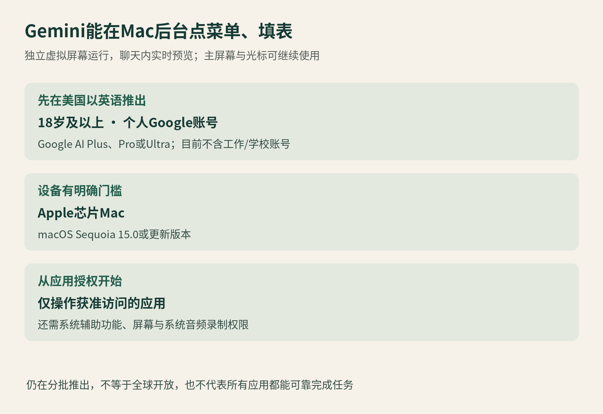
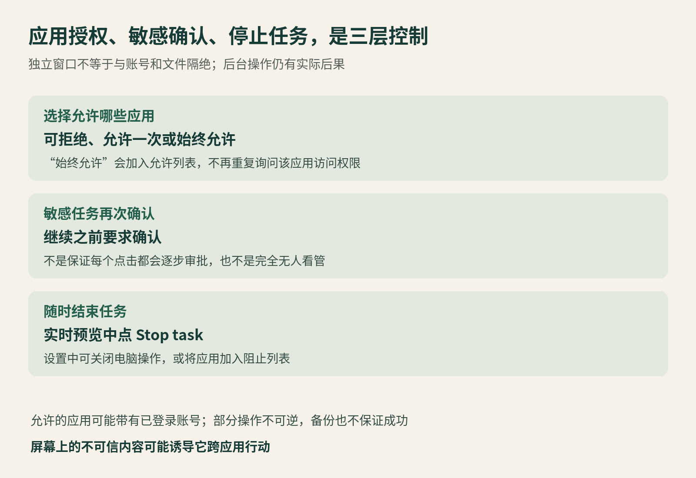

# Gemini能在Mac后台操作应用了：美国英语先开，用户可选应用并随时停下

把PDF里的重量、尺寸抄到运输报价表，再在菜单里来回点选，费时间的往往不是计算，而是挪数据和填格子。谷歌给Gemini Mac应用加入了电脑操作能力：你描述任务，它可以在本地文件、桌面应用和网页之间点击、输入、滚动、点菜单。

[11月19日官博](https://blog.google/innovation-and-ai/products/gemini-app/computer-use-mac/)列出的例子包括从本地PDF提取信息填写报价表、批量处理照片，以及从数据看板取数做幻灯片。这些是谷歌介绍的用途，不是已经实测的完成率或省时承诺。

## 它在独立窗口干活，主屏幕和光标留给你

谷歌称，Gemini把操作放在隔离的后台窗口，聊天中显示实时预览，主屏幕和光标不被占用。人可以继续打字或做别的工作，不必一直等它点完。

这次先在美国以英语分批推出，面向18岁及以上、使用个人Google账号的Google AI Plus、Pro和Ultra用户。硬件要求是Apple芯片Mac，系统为macOS Sequoia 15.0或更新版本。[帮助页](https://support.google.com/gemini/answer/18956635?hl=en)进一步说明，目前只在个人账号的Gemini任务中提供，不含工作或学校账号。

## 应用可以允许一次，也可以加入始终允许列表

开始之前，用户要启用电脑操作，并授予系统辅助功能、屏幕与系统音频录制权限。Gemini第一次使用某个应用时，会询问拒绝、允许或始终允许；只有获准的应用才能被控制。

帮助页写明，选择“始终允许”会把应用加入允许列表，之后不会再次询问该应用的访问权限，除非将它移出列表。敏感任务则会在继续前要求确认。因此，选定应用和批准敏感动作是两道不同的门，不是每次点击都停下来等人盖章。

任务运行时可以在预览中查看过程，点“Stop task”随时结束。设置中还能关闭整个电脑操作功能，或把某个应用加入阻止列表。把重复点击交出去，不等于把决定权也一并交出去。

## 隔离窗口不等于账号和文件都没有风险

帮助页提醒，Gemini可能使用桌面应用里的已登录账号和活动会话；屏幕上的不可信内容也可能诱导它跨到其他已允许应用采取行动。某些本地编辑器或开发工具权限，还可能带来命令执行或更广的文件改动。

它会尝试建立临时备份，但并不保证成功，有些操作仍不可逆。后台不抢光标，解决的是人和代理争用电脑的问题；能否把事情放心交出去，还取决于应用权限给得多宽、敏感操作能否及时停下，以及任务结果是否经得起检查。
