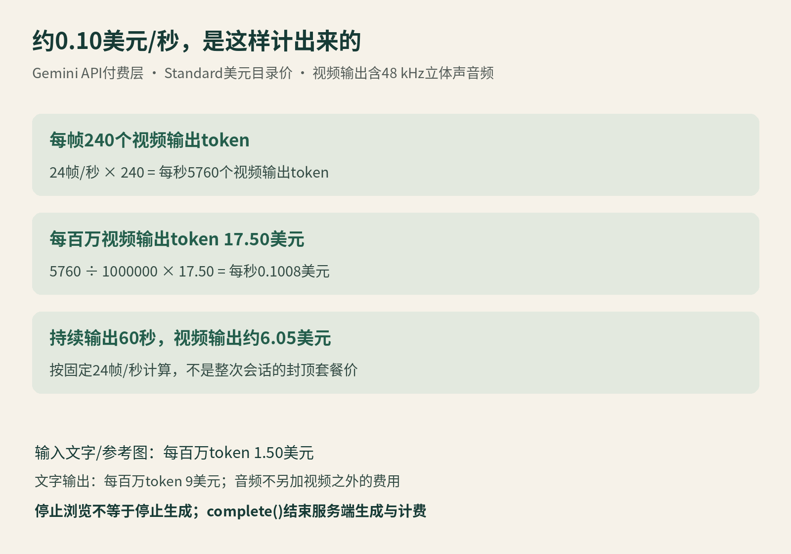
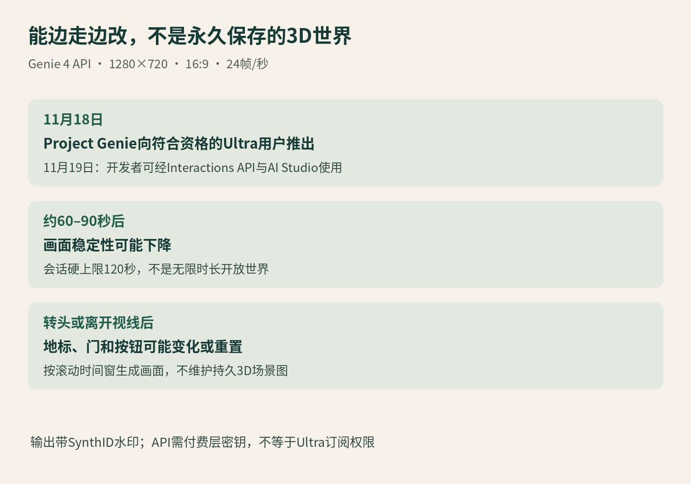

# Genie 4进入Gemini API：能边走边改世界，视频输出约0.10美元一秒

讨论一个展厅或游戏场景，静态效果图很难回答“走到拐角后会看到什么”。Genie 4现在给开发者多了一种原型工具：用文字、参考图或两者一起生成环境，再用键盘移动、中途发文字改天气、灯光、物体或事件，画面与声音实时接着生成。

谷歌在[11月19日公告](https://blog.google/innovation-and-ai/technology/developers-tools/genie-4-in-gemini-api/)中宣布，Genie 4进入Gemini API的Interactions API和Google AI Studio。前一天，[Project Genie产品更新](https://blog.google/innovation-and-ai/models-and-research/google-deepmind/genie-4-now-available-project-genie/)面向符合资格的Google AI Ultra订阅用户推出，Pro用户可加入候补名单。产品订阅入口和开发者API是两回事：API要求付费层Gemini API密钥。

## 约0.10美元一秒，按生成的视频输出token计费

[开发文档](https://ai.google.dev/gemini-api/docs/genie)给出的输出是720p、16:9、每秒24帧，带48 kHz立体声音频。它不是先做好一段视频再播放，而是随着移动和文字事件即时生成后续画面。

[定价页](https://ai.google.dev/gemini-api/docs/pricing#genie-4)列明，每帧计240个视频输出token，24帧就是每秒5760个；Standard价格为每百万视频输出token 17.50美元，折合每秒0.1008美元，约每分钟6.05美元，已包含立体声音频。这说的是视频输出金额，不是所有输入输出合计的会话套餐价。文字或参考图输入另按每百万token 1.50美元计，文字输出每百万token 9美元。

## 关掉标签页，服务端可能还在生成

会话结束处理会直接影响账单。文档明确，关闭浏览器标签页或退出本地代码块，只是断开传输，不会立即停止服务端生成；只要仍在生成输出，就不能把断线当成停费。

开发者应在结束时调用`complete()`，停止服务端世界生成和token计费，并接收结束事件。`cancel()`可立即中止服务端生成；`detach()`只是断开本地连接，不能用来暂停或停止计费。Genie 4也不支持把断开的会话当成可随时续上的存档。

## 60至90秒后可能变形，硬上限120秒

实时画面流畅，不代表背后保存着一套永久不变的三维地图。文档说明，Genie 4依靠滚动时间窗模拟画面，并不维护持久3D场景图。看向别处超过8秒，或转一整圈，地标、门和按钮就可能变化或重置。

视觉稳定性可能在60至90秒后下降，会话硬上限为120秒。这并不是保证前90秒一定稳定，也不是能无限延长的开放世界。11月18日产品公告里的三分钟生成、连接多个世界和360度全景图能力，属于Genie 3更新，不能搬到Genie 4 API上。

谷歌称输出包含不可感知的SynthID水印。它可以让交互创意更快变得可看、可走、可修改，但精确文字、物体数量和长期状态仍会漂移。拿它讨论场景，与拿它当可靠仿真环境，要求的是两种不同的准确性；API开放了连接方式，还没有消除这道距离。
