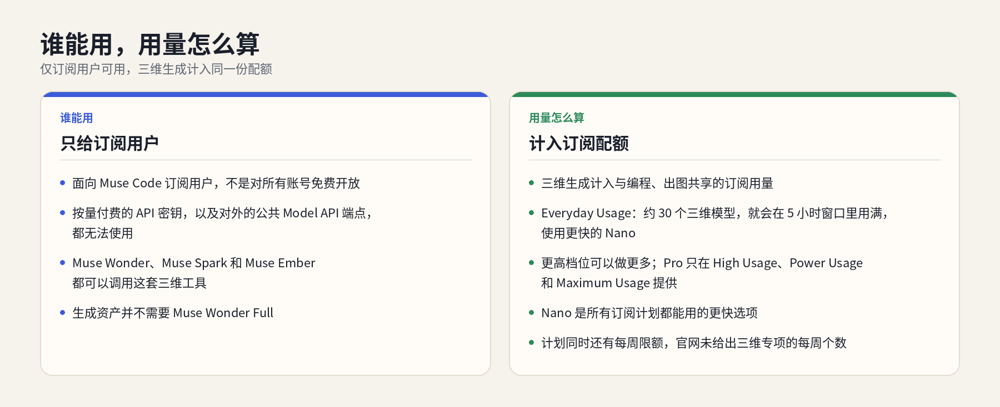
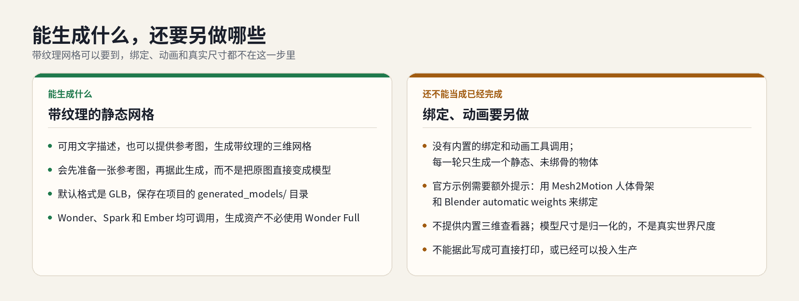

# Muse Code上线3D建模：订阅用户能用文字或图片生成带纹理网格

做游戏原型，或先把一个场景摆出来看一眼的时候，卡住进度的常常不是关卡逻辑，而是手头还没有一个带贴图的模型。

Meta在[11月20日的开发者博客](https://dev.meta.ai/resources/blog/build-3d-models-with-muse-code/)里宣布，Muse Code订阅用户现在可以通过工具调用，生成带纹理的三维网格。作者Mike Arcuri把用途写成做游戏、送到3D打印机，或用来观察场景。这是订阅能力，不是对所有账号免费开放。

## 文字或图片都能要模型，但会先经过一张参考图

[资产文档](https://dev.meta.ai/docs/muse-code/asset-generation)写，你可以用文字描述一件物体，也可以丢进自己的参考图。系统会先准备一张参考图，再据此生成三维资产：纯文字时，会先用Muse Image画出参考图；如果你提供的是自己的图片，会先做一轮清理渲染，调整视角、背景和光线，三维模型是从这张处理后的图生成的，而不是直接使用原图。

一次生成对应一件物体。灯笼、木箱和角色是三个资产，即便它们属于同一款游戏。结果默认是GLB，放在项目的generated_models/目录里，并返回主文件和附属文件路径。文档提醒：Muse Code交出的是文件，并不提供内置三维查看器；模型尺寸是归一化的，不是真实世界尺度，要在场景里自行设定比例。细小文字，以及键盘按键、轮辐这类重复细节，也可能不准确。

Muse Wonder、Muse Spark和Muse Ember都可以调用这套三维工具，在它们看起来最适合完成任务时就会用。文档还写明，生成资产并不需要Muse Wonder Full。

## Everyday大约五小时三十个，用的是Nano

三维生成的费用计入订阅配额。[订阅说明](https://dev.meta.ai/docs/muse-code/subscriptions)把编程、出图和三维资产算进同一份用量，并且同时存在五小时限额和每周限额。博客给出的具体数字是：Everyday Usage档大约可做30个三维模型，就会在一个五小时窗口里用满；这一档用的是更快的Nano。更高档位可以做更多，并且可以使用追求更高质量的Pro。文档把Pro的范围写得更明确：High Usage、Power Usage和Maximum Usage才能用Pro，所有订阅计划都能用Nano。

按量付费的API密钥，以及对外的公共Model API端点，都用不了这项能力。[认证与计费页](https://dev.meta.ai/docs/muse-code/auth)写明：每个订阅计划都包含三维资产创建，但它不随pay-as-you-go的API密钥提供。

## 出得了模型，并不等于已经绑骨、能活动

博客说，这些工具能做出各种各样的三维角色，但没有内置的绑定和动画工具调用。资产文档写得更具体：每一轮生成得到的是一个静态、未绑骨的物体；绑定、动画和把场景拼起来，都是生成之后的另一步。官方给出的示例提示，是另外请模型用Mesh2Motion的人体骨架和Blender的automatic weights来绑定，并交付一个可以检查简单动画的网页查看器。那条示例指向Muse Wonder Full，而这是更高档计划里的能力，不是生成网格本身的前提。

因此，官方虽然把送去3D打印机列为用途之一，并不等于网格已经按真实尺寸做好、可直接打印，或可以直接投入生产。要让角色动起来，也不是按一下开关就能完成。

它把游戏原型里缺模型的等待，变成了一次生成请求。真正接入制作流程时，仍要检查网格细节、设置比例，再处理绑定和动画；这些后续工作能否少花时间，才决定生成一个模型到底省了多少事。编程、出图和三维生成共用订阅配额，也意味着试错次数要一起算。
