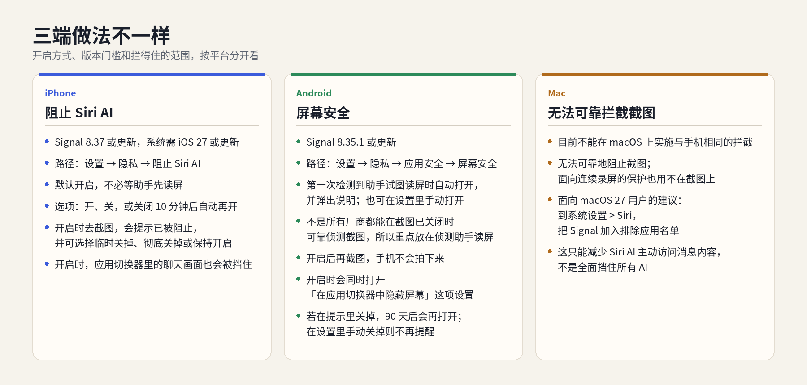
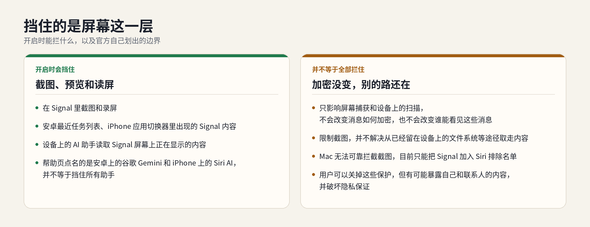

# Signal阻止系统AI读聊天屏幕：iPhone默认开，安卓检测到才开

打开聊天的时候，有没有闪过一个念头：系统自带的手机助手，会不会把屏幕上的对话读走？

Signal总裁Meredith Whittaker在[11月20日的博客](https://signal.org/blog/protecting-your-privacy/)里写，他们正在限制内置进手机系统的AI代理，避免这些代理有可能捕获并保存Signal里的内容。这跟去年在Windows 11上默认挡住Microsoft Recall截取聊天画面是同一类做法。这次点名的，是iOS 27里Siri AI的Onscreen Awareness，以及安卓上在可被检测到时试图读取Signal屏幕的谷歌Gemini Intelligence。

## iPhone上，阻止Siri AI默认就是开的

[帮助页](https://support.signal.org/hc/en-us/articles/11338514641306-Screen-security-blocking-Google-Gemini-and-Siri-AI)写明：iPhone要用Signal 8.37或更新版本，系统还得是iOS 27或更新。设置项叫「阻止Siri AI」，路径是设置 → 隐私 → 阻止Siri AI，默认开启。除了开和关，还有「关闭10分钟」：方便你临时截一张图，十分钟后会自动再打开。

功能开着的时候，会挡住在Signal里截图和录屏，也不会让聊天内容出现在应用切换器里，并限制设备上的AI助手读取Signal屏幕上正在显示的内容。如果这时去截图，iPhone会提示已被阻止，并可选择关闭10分钟、彻底关掉，或保持开启。

## 安卓要先发现读屏，才会自动打开屏幕安全

安卓的版本门槛是Signal 8.35.1或更新。设置项不叫「阻止Siri AI」，而叫「屏幕安全」，路径是设置 → 隐私 → 应用安全 → 屏幕安全。

它不是一装上就替所有人关掉截图。帮助页说，第一次有AI助手试图读取Signal屏幕时，屏幕安全会自动打开，并弹出说明；如果希望马上生效，也可以在设置里手动打开。Signal在博客脚注里解释，很多厂商定制的安卓系统，在截图本已关闭时，并没有可靠办法侦测截图动作，所以他们把重点放在侦测AI助手是否在访问屏幕，一旦发现就自动打开屏幕安全。

开启之后，安卓同样会挡住Signal内部的截图和录屏、最近任务列表里的聊天预览，以及设备上的AI助手读屏。这时再去截图，手机不会拍下来。打开屏幕安全时，也会一并打开「在应用切换器中隐藏屏幕」。

## 可以关掉，但暴露的不只是自己

这些保护可以关闭。关掉之前，Signal会要求确认，因为AI助手随后或许就能扫描Signal里的内容。博客写得更直白：这样做有可能把自己和联系人的内容暴露给这些AI代理，并破坏隐私保证。

两端关掉之后的提醒也不一样。iPhone关掉后不会再提醒，聊天会不会出现在应用切换器里，要另看「在应用切换器中隐藏屏幕」这项独立设置。安卓如果是在设置里手动关掉，也不会再提醒；如果是在提示里选择关掉屏幕安全，Signal会在90天后再次打开。

## 加密没有改，截图之外的路也不一定能拦住

帮助页写，这件事只影响屏幕捕获和设备上的扫描，不会改变消息如何加密，也不会改变谁能看见这些消息。

博客同时承认，这不是完整补救。限制截图，并不解决其他更隐秘的途径，比如从已经留在设备上的文件系统里取走内容。Mac上目前也做不到同一套拦截：Signal说无法可靠地阻止macOS截图，面向macOS 27用户的建议，只是到系统设置的Siri里，把Signal加入排除应用名单。

第三方助手如果拿到无障碍一类深层权限，博客认为也可能另有通路，他们仍在呼吁系统厂商给出更清楚的退出工具和说明。所以这并不是所有AI都被全面挡住了。手机上被默认或自动保护的，主要是屏幕这一层；Mac还得自己去排除，文件系统和其他系统路径也不一定在挡住的范围内。

助手会不会看见聊天，并没有一个对所有设备都成立的答案。符合版本的iPhone默认挡住屏幕这一层，安卓是在能检测到助手尝试读屏时自动开启，也能先手动打开；加密没有被削弱，但文件系统等其他路径、以及Mac上的截图，并不在同一套拦截里。开关还在你手里，只是关掉的时候，牵涉的不只是自己屏幕上的那几行字。
