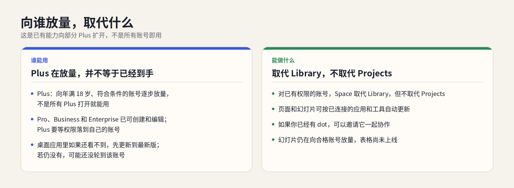
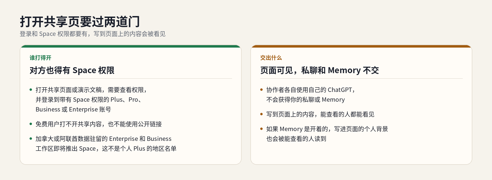

# ChatGPT Space向部分Plus用户放量：能做会更新的页面，分享却要对方也有权限

做一个会跟着Slack里的决定一起改的项目计划，或一份能自己更新的待办清单——这是OpenAI给Space举的用法。现在，这件事开始向年满18岁的Plus用户放量，但不等于所有Plus账号打开就能看见。

[11月20日的发布说明](https://help.openai.com/en/articles/6825453-chatgpt-release-notes)写，ChatGPT Space从当天起在全球向年满18岁的Plus用户放量。更具体的范围写在[入门帮助页](https://help.openai.com/en/articles/20001549-getting-started-with-space-in-chatgpt)里：它面向符合条件的Plus账号；如果桌面应用里还看不到，先更新到最新版，若仍没有，可能还没轮到你的账号。Pro、Business和Enterprise本来就能在Space里创建和编辑内容，Plus要等权限落到自己的账号上。这不是把一个全新产品一次性发给所有人。

## 先把材料做成能接着改的一页

帮助页把Space写成页面、上传文件和其他工作的存放处。你可以和ChatGPT一起创建、编辑页面，把相关内容放进同一个space，再邀请别人一起改。发布说明还写，页面和幻灯片可以按你已连接的应用和工具自动更新；在评论里标记ChatGPT，就能请它修改。如果你已经有一个dot，也可以邀请它一起协作。

官方举例包括：一份会自己更新的待办清单，一份带三维模型、可以翻看的学习指南，以及能跟着Slack里的决定保持同步的项目计划。这些是帮助材料里的用途说明，不是已经测过的完成率。

对已经获得权限的账号，Space会取代Library，成为页面、幻灯片、图片和上传文件的新入口。Projects仍然分开：项目聊天、文件和指令还在那里，创建或使用space不会取代现有的Projects。幻灯片仍在向拥有Space权限的合格账号放量，表格则尚未上线。

创建和编辑页面，主要在网页和ChatGPT桌面应用里进行；手机上也可以编辑，并能查找、阅读、分享，以及在页面和子页面之间跳转。帮助页另写，采用加拿大或阿联酋数据驻留的Enterprise和Business工作区即将推出Space，这是工作区驻留条件，不是个人Plus账号的地区门槛。

## 分享出去，对方也得有Space权限

打开一份共享的页面或演示文稿，需要有查看权限，并且登录到带有Space权限的Plus、Pro、Business或Enterprise账号。免费用户打不开这些共享内容，也不能靠公开链接把页面丢出去。

协作者各自使用自己的ChatGPT。分享页面，不会把你的私人聊天或ChatGPT Memory交给对方。不过，写到页面上的内容，能查看的人都能看见。帮助页提醒：如果Memory是开着的，ChatGPT可能在写页面时用到个人背景；这些内容一旦写上去，能看页面的人就能读到。分享前，宜核对名字、日期、计算和来源。Plus的消息次数用尽后，页面仍可手工修改。

在受管理的工作区里，能怎么分享还要看组织的设置；Enterprise管理员可能需要先打开分享，成员才能协作。

Space的用处，是把一份能继续改、也能跟着已连接应用更新的页面，放到ChatGPT里和人一起做。真正卡住分享的，往往不是你自己有没有Plus，而是对方是否已经登录，并且也有Space权限。
