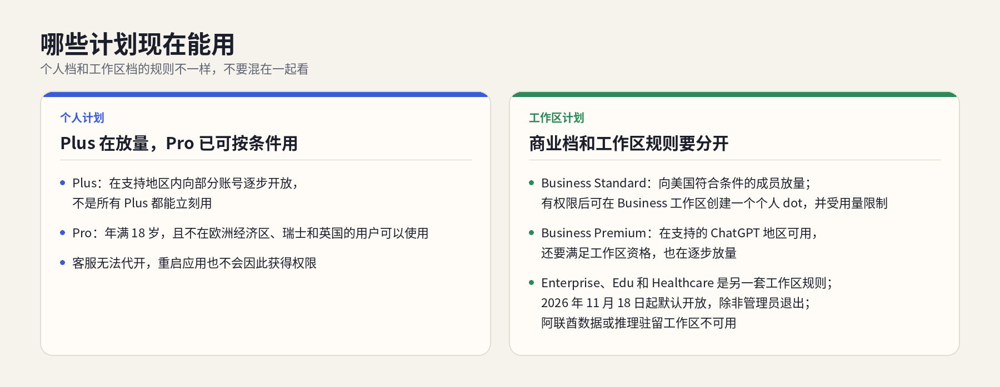
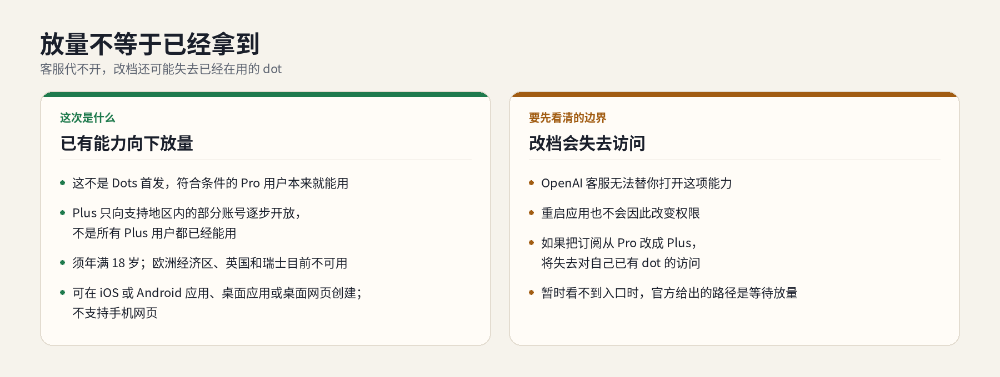

# Dots向部分Plus用户放量：不是所有Plus都能立刻用，客服也无法代开

你已经在付Plus，也想把一个能跨过对话接着做的助手请来整理材料、改演示文稿。打开ChatGPT，却不一定已经能看见自己的dot。

这不是产品首发。符合年龄和地区条件的Pro用户，本来就能用这项能力。OpenAI的[入门帮助页](https://help.openai.com/en/articles/20001530-getting-started-with-your-dot)现在写明：Dots正在向欧洲经济区、英国和瑞士以外的部分ChatGPT Plus用户逐步开放，你的账号上可能还没有。OpenAI客服无法替你打开，重启应用也不会因此获得权限。同一页还写，美国符合条件的ChatGPT Business Standard成员也在放量。

## 它能接着做完一件事，但得先等到放量落到你这里

帮助页把dot写成ChatGPT里的常开助手：你给出目标和背景，它可以在对话之间继续推进，并带着自己的云电脑，以及你选择连接的应用去检索、创作和跟进任务。它会从ChatGPT的记忆里起步，由你决定哪些事可以自己做，再回头让你审阅或改方向，也可以随时暂停。

官方举的例子包括：把数据和客户反馈收进演示文稿，并随新情况更新；把访谈记录写成节目注释和社媒草稿，再把你的修改带到各份文稿里；以及给一个应用圈定改动、写代码并测试，好让你审阅可运行的修改。这些是帮助页里的用途说明，不是已经测过的完成率。

创建入口在ChatGPT的iOS或Android应用、桌面应用，或桌面网页；帮助页写明不支持手机网页。个人与入选的Plus用户还须年满18岁，并且不在欧洲经济区、瑞士和英国。

## 工作区规则不要和Plus放量混在一起

Plus是在支持地区内向部分账号逐步放开，所以不是所有Plus用户都已经能用。Pro写得更明确：年满18岁，且不在欧洲经济区、瑞士和英国的用户可以使用。

商业档也要分开看。Business Premium在支持的ChatGPT地区可用，还要满足工作区资格，帮助页同时写它和Plus一样在逐步放量。Business Standard则是向美国符合条件的成员放量：有权限后，可以在Business工作区创建一个个人dot，并受用量限制；如果还看不到创建入口，权限可能仍未轮到该账号。

Enterprise、Edu和Healthcare是另一套工作区规则。帮助页称，符合条件的工作区已普遍提供；从2026年11月18日起默认开放，除非管理员选择退出。带有阿联酋数据或推理驻留的工作区不可用。每位成员可以创建一个个人dot。这些条件不能拿来解释为什么某个Plus账号还看不见入口。

## 从Pro改到Plus，会失去已经在用的dot

帮助页写得很直接：如果把订阅从Pro改成Plus，你将失去对自己dot的访问。这不是换档后功能稍减那么简单，而是已有的dot会因此用不了。

所以，暂时看不到入口时，官方给出的路径是等待放量，而不是找客服代开，也不是靠重启应用。已经在用Pro档dot的人，如果打算改到Plus，需要先按这一条来衡量，而不是默认改完还能接着用原来的那个助手。

这次变化的实在处，是把已经存在的常开助手，往一部分Plus账号和美国部分Business Standard成员上扩。它不是新功能首发，也不等于所有Plus用户已经拿到。看不到的时候，等放量才是官方说法；已经在Pro里用着的人，更要先看清改档会失去现有的dot。
