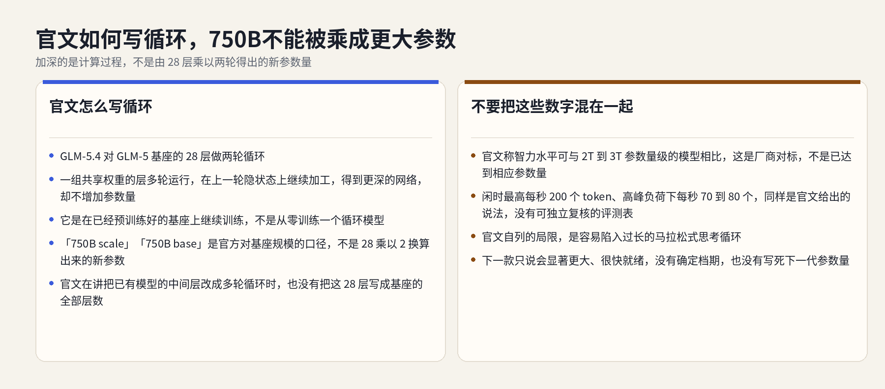
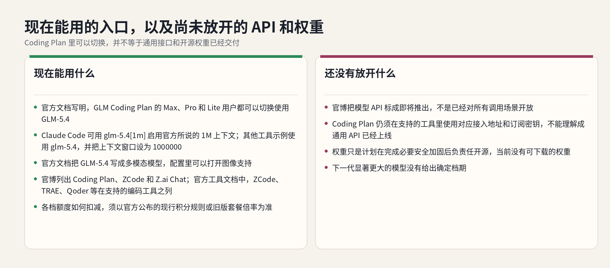

# GLM-5.4进了Coding Plan：循环加深计算，并不把参数量翻倍

如果你用Coding Plan改代码，现在可以把GLM-5.4放进同一套任务里比较：它支持百万上下文和图像输入，但官方也承认，它可能想得过长。11月23日，智谱在[官网技术博文](https://z.ai/blog/glm-5.4)发布这款Loop Transformer旗舰。[官方文档](https://docs.z.ai/devpack/latest-model)写明，GLM Coding Plan的Max、Pro和Lite用户都可以在编码工具里切换使用。通用模型API仍标着即将推出，权重也还没有放出。

## 28层循环两轮，官文写的是加深计算、不增加参数

官文把循环说得很具体：GLM-5.4对GLM-5基座的28层做两轮循环。标准Transformer里，每一层在一次前向计算中只跑一遍；Loop Transformer则让一组共享权重的层多轮运行，在上一轮的隐状态上继续加工。官文的原句是，这样能得到更深的网络，却不增加参数量。

同一段里还出现了「750B scale」和「750B base」。这是官方用来描述基座规模、以及在这一规模上做架构改动的口径，并不是由「28层乘以两轮」换算出来的新参数量，也不能把它读成已经对标到2万亿或3万亿参数。官文在讲解把已有模型的中间层改成多轮循环时，也没有把这28层写成基座的全部层数。

它不是从零预训练一个循环模型，而是在已经预训练好的基座上继续训练，改成Loop Transformer。为了在官方所说的750B规模上平衡效果和部署成本，官文还写了三处改动：按token的门控逐步更新、跨循环共享再加滑动窗口的混合KV缓存，以及第二轮复用第一轮的稀疏注意力索引。混合KV缓存这一段里，官文把100万上下文长度下的部署成本，作为对照GLM-5.3时仍然可控的理由。

## Coding Plan已经能切，通用API和权重还没有

对正在用订阅写代码的人，眼前能做的是换模型名。官方切换说明里，Claude Code可把模型写成`glm-5.4[1m]`，并配上100万的压缩窗口，以启用官方所说的1M上下文；其他支持自定义模型的编码工具，则示例使用`glm-5.4`，并把上下文窗口设为1000000。文档同时把GLM-5.4写成多模态模型，配置里可以打开图像支持。

官博把[GLM Coding Plan](https://z.ai/subscribe)、[ZCode](https://zcode.z.ai/en)和[Z.ai Chat](https://chat.z.ai)列在入口里。官方工具文档里，ZCode、TRAE、Qoder等均在Coding Plan支持的编码工具之中。这与同日[第一财经的报道](https://www.yicai.com/news/103450622.html)里「向Coding Plan全量用户开放、并同步上线部分编码平台」的方向一致；各档额度如何扣减，要以官方文档里现行积分套餐和仍在生效的旧版套餐所公布的倍率为准。

还没放开的是另外两件事。官博把[模型API](https://z.ai/model-api)明确标成即将推出，并不是已经对所有调用场景开放。Coding Plan用户按官方说明，仍要在支持的工具里用对应的接入地址和订阅密钥，不能把这理解成通用API已经上线。权重方面，官文只写计划在完成必要的安全加固后，以负责任的方式开源，当前并未提供可下载的权重。

## 对标数字和速度，仍是厂商自己的说法

官文称，GLM-5.4的智力水平可与2T到3T参数量级的模型相比；闲时推理速度最高可达每秒200个token，高峰负荷下保持每秒70到80个token。这些都是厂商在博文里给出的说法，并没有附上可独立复核的评测表。

官文自己写下的局限，是模型容易陷入过长的「马拉松式思考」循环。它同时说，这种延长的反思和自我纠正，会把准确率提高到超过其参数量所对应的水平。这同样是官方的自我评估，不是外部已经完成的复现。

至于下一款模型，官文只说会显著更大，并带走这次学到的东西，很快就绪。文中没有给出确定档期，也没有把下一代的参数量写死。

已经订阅的人，可以拿一项熟悉的代码修改任务，比较它改对了多少、等了多久、用了多少额度。尤其要看，官方承认的过长思考，在自己的任务里究竟换来了额外收益，还是只增加了等待。需要通用API或自托管部署的人，则还要等接口与权重真正交付。
