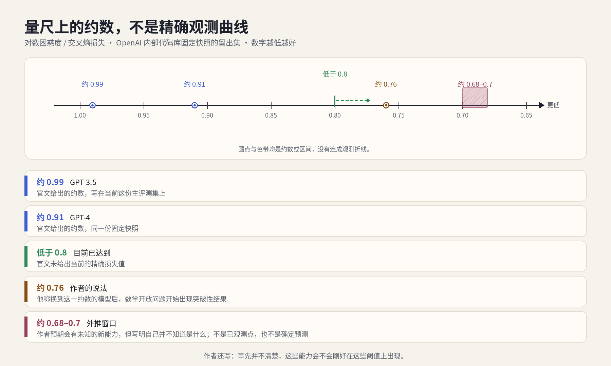
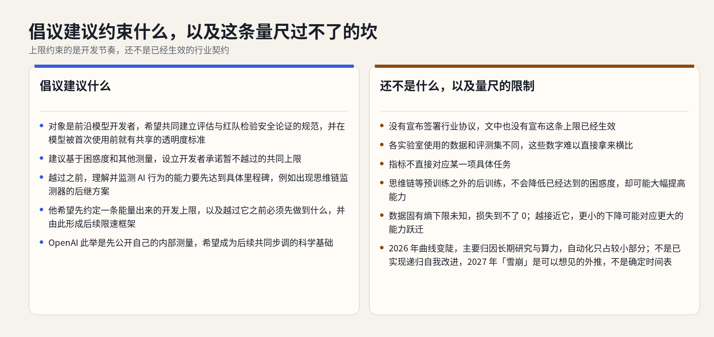

# 用预测下一个词的误差设研发上限？这是OpenAI首席科学家的倡议，不是行业已签协议

模型又变强了，人们往往是从新产品或一条演示里感觉到的。OpenAI首席科学家Jakub Pachocki在[11月22日的官网文章](https://openai.com/index/perplexity-and-intelligence/)里提出另一条更安静的量尺：预训练模型预测下一个词有多准。他主张用困惑度衡量进展，实际跟踪的是它的对数，也就是交叉熵损失，并以此比较各家实验室的进展，并据此讨论共同的安全标准。作为第一步，他公布了OpenAI内部一直在追踪的数字。这是一项倡议和透明度动作，不是已经由各实验室签署的行业协议。

## 内部代码库的固定快照，成了这次的量尺

作者写道，他们实际跟踪的通常是对数困惑度，也叫交叉熵损失，衡量模型平均能多好地预测下一个词，数字越低越好。自GPT-3.5以来，主要留出集来自OpenAI内部代码库，文中数字都针对同一份固定快照。

他强调，这条量尺并不直接对应某一项我们真正关心的具体任务。之所以仍值得看，是因为他判断：在压缩上继续推进，往往会带来事先并不清楚的新能力。各实验室使用的评测集和训练数据混合并不相同，因此这些数字也难以直接拿来横比。

## 约0.76的数学突破，来自作者的内部评测叙述

在当前这份主评测集上，他给出的约数是：GPT-3.5的对数困惑度约为0.99，GPT-4约为0.91。写到现在，损失已经低于0.8，并称在网络安全和数学等领域出现了变革性能力。他特别补了一句：事先并不清楚，这些能力会不会刚好在这些阈值上出现。

约0.76是作者自己的说法。他写道，他们把数学里的开放问题拿给模型做评测，换到对数困惑度约0.76的模型后，开始出现突破性结果。这是作者对内部经历的描述，不是一条已经公开复现的定理清单，也不能把它读成「到了0.76就必然攻克数学」。

再往下，他根据近期进展外推：进入约0.68到0.7的对数困惑度窗口时，还应预期出现更多变革性能力。他同时写明，自己并不知道那些能力会是什么，今天的测试集里也可能还没在测。这是外推中的未知窗口，不是已经观测到的点，也不是对某项具体能力的确定预测。

## 共同上限仍在提议，越过前先补监测能力

倡议的对象是前沿模型开发者。作者希望各家共同建立如何评估这类模型、如何红队检验安全论证的规范，并在模型被首次使用前就有共享的透明度标准。他进一步建议，基于困惑度和其他测量，设立开发者承诺暂不越过的共同上限，直到理解并监测AI行为的能力达到某个具体里程碑，例如出现思维链监测器的后继方案。也就是说，他想要的是一套行业标准：先约定一条能量出来的开发上限，以及越过它之前必须先做到什么；并希望由此形成后续限速的共同框架。

文中没有列出已经签字的实验室，也没有宣布这条上限已经生效。OpenAI此举是先公开自己的内部测量，并希望这成为后续共同步调的科学基础。

这条量尺还有作者自己写下的限制。思维链推理等预训练之外的进展，并不会降低模型已经达到的困惑度，却可能大幅提高能力。数据也不可能被完全确定地预测，损失到不了0，但固有熵下限仍未知；越接近它，表面上的数字进展会变慢，更小的下降却可能对应更大的能力跃迁。

他指出，OpenAI模型的损失图在2026年出现明显加速，并把主要原因归于长期研究和算力投入的结果，自动化只占较小部分。他同时说，最近的模型已经出现有意义的、来自AI的设计贡献。这不是在宣布已经实现无人监管的递归自我改进。至于2027年就可能出现类似数学评测里那种预训练基础进展的「雪崩」，他用的是「可以想见」，是从前述经历出发的外推，不是确定会发生的时间表。

要让这项倡议真正约束研发，各家首先得把数据、评测口径和监测里程碑说清楚。否则，同一个损失数字既不能直接横比实验室，也无法告诉人们：下一次能力跃迁发生前，安全准备到底做到了哪一步。
