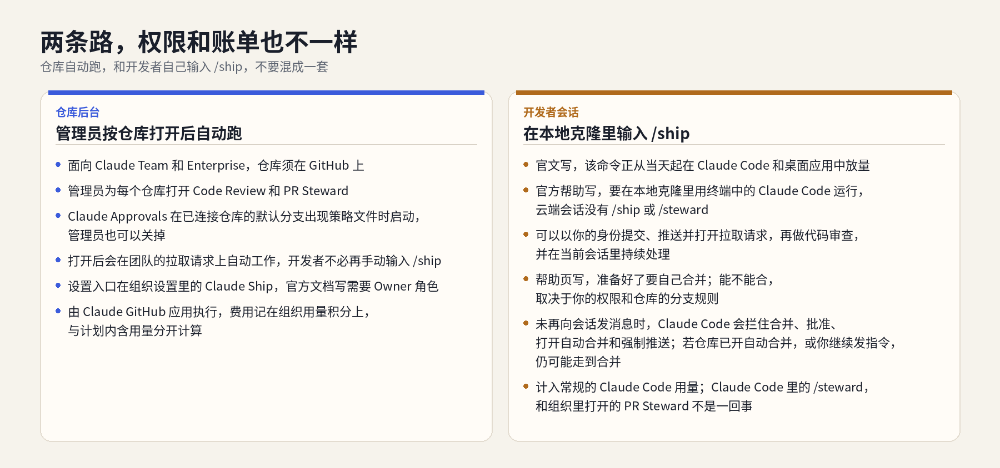
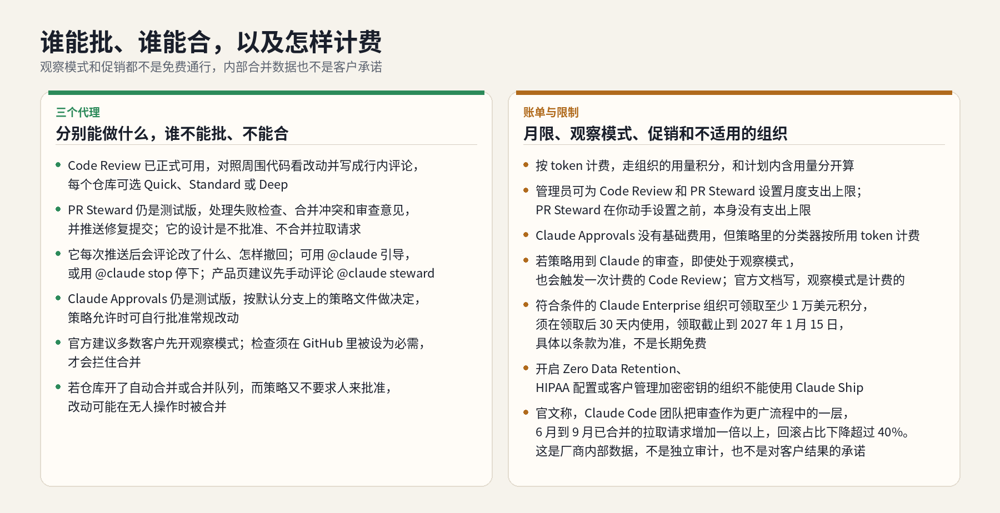

# 开完PR去写下一单？Claude Ship有两条路，谁能合并也不一样

PR刚开，检查红了，意见又回来，手里那单新活往往得先停。

11月23日，Anthropic在[介绍Claude Ship的官文](https://claude.com/resources/articles/introducing-claude-ship)里推出这套面向GitHub拉取请求的代理组合，并在[产品页](https://claude.com/product/claude-ship)说明，它面向Claude Team和Enterprise计划、且仓库在GitHub上的组织。Code Review已经正式可用，PR Steward和Claude Approvals仍是测试版。

## 仓库里自动跑，和你在Claude Code里输入/ship，不是同一套权限

一条路是管理员按仓库打开Claude Ship。官文写，管理员为每个仓库打开Code Review和PR Steward；Claude Approvals则在已连接仓库的默认分支上出现策略文件时启动，管理员也可以关掉。打开后，它会在团队的拉取请求上自动工作，开发者不必再手动输入`/ship`。设置入口在组织设置里的Claude Ship，官方文档写需要Owner角色。

另一条路是开发者对自己的改动运行`/ship`。官文说，这个命令正从当天起在Claude Code和桌面应用中放量。[官方帮助](https://code.claude.com/docs/en/ship-command)写得更具体：要在本地克隆里、用终端中的Claude Code来运行，云端会话没有/ship和/steward。`/ship`可以以你的身份提交、推送并打开拉取请求，再做代码审查，然后在当前会话里持续处理失败检查、合并冲突和审查意见。帮助页写，准备好了要自己合并；能不能合，取决于你的权限和仓库的分支规则。这段工作计入常规的Claude Code用量，不是组织后台那套代理账单。

帮助页还区分：Claude Code里的`/steward`，和组织里打开的PR Steward不是一回事。后者由Claude GitHub应用执行，费用记在组织上。

## 三个代理分别能做什么，尤其谁不能批准、不能合并

[官方文档](https://code.claude.com/docs/en/claude-ship)把三个代理拆开。Code Review对照周围代码看改动，把发现写成行内评论。官文和产品页都写，每个仓库可选Quick、Standard或Deep审查级别，并可设定审查何时运行。

PR Steward处理失败的持续集成检查、合并冲突，以及来自Code Review、其他审查工具或同事的意见，并推送修复提交。官文和文档都写，它的设计是不批准、不合并拉取请求；产品页也建议用分支保护来要求你想要的批准。官文还写，它每次推送后会评论改了什么、怎样撤回；开发者可用`@claude`加指令来引导，或用`@claude stop`让它停下。产品页和设置说明建议先用手动模式，由开发者评论`@claude steward`再启动。

Claude Approvals按仓库里的策略文件做决定。官文说，策略允许时，它可以自行批准常规改动，也可以要求人对某些情形做更进一步的签字。对多数客户，官方建议先开只观察模式，确认后再把分支保护配成必须得到它的放行。文档补充：检查只有在GitHub里被设为必需时才会拦住合并，观察模式下通常不会拦；但若仓库开了自动合并或合并队列，而策略又不要求人来批准，改动可能在无人操作时被合并。

## 按token计费，观察模式和促销都不是免费通行

Claude Ship按token计费，费用走组织的用量积分，和计划内含用量分开算。打开它可能增加组织成本，多少取决于覆盖的拉取请求数量和规模、审查级别、审查运行频率，以及PR Steward做了多少工作。管理员可为Code Review和PR Steward设置月度支出上限；官方文档写，PR Steward在你动手设置之前，本身没有支出上限。

Claude Approvals没有基础费用，但策略里的分类器按所用token计费；若策略用到Claude的审查，即使处于观察模式，也会触发一次计费的Code Review。文档写，观察模式是计费的。

官文还写，符合条件的Claude Enterprise组织可领取至少1万美元的Claude Ship积分，须在领取后30天内使用，领取截止到2027年1月15日，具体以条款为准。这不是长期免费。开启Zero Data Retention、HIPAA配置或客户管理加密密钥的组织不能使用Claude Ship。

官文提到，Claude Code团队把Claude的审查作为更广流程中的一层，6月到9月已合并的拉取请求增加一倍以上，回滚占比下降超过40%。这是厂商公布的内部数据，不是独立审计，也不是对客户结果的承诺。

若要在团队里试用，可以先选一个仓库：PR Steward用手动模式启动，Approvals先观察，Code Review和PR Steward先设好月度上限。再拿团队熟悉的几类改动，核对它修了什么、漏了什么、花了多少。官方也提醒，它可能漏掉缺陷和安全漏洞；是否让它的判断成为合并条件，应等团队看过这些结果再决定。
