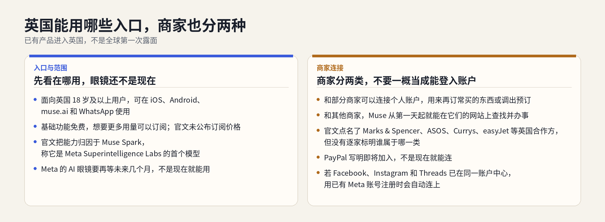
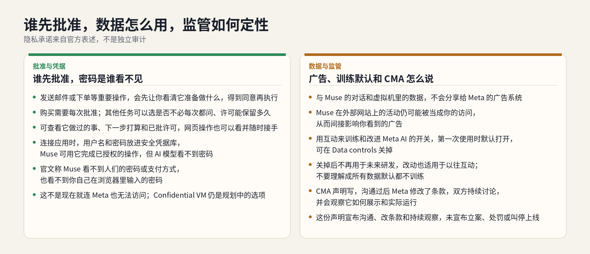

# Muse进入英国：每次购买都要批准，训练开关却默认打开

圣诞采购、比电价、整理学校日历，这类活现在可以交给Muse。英国竞争与市场管理局在[11月24日的声明](https://competitionandmarkets.blog.gov.uk/2026/11/24/cma-statement-on-uk-launch-of-meta-muse/)里确认，Meta的个人AI代理已在英国推出。这不是这个产品第一次露面：Meta今年9月就公布了Muse，之后已在新加坡、澳大利亚等地开放。

[介绍文](https://about.fb.com/news/2026/11/introducing-muse-in-the-uk-a-personal-ai-agent-you-control/)写，面向英国18岁及以上用户，可在iOS、Android、muse.ai和WhatsApp使用。基础功能免费，想要更多用量可以订阅。官文把能力归因于Muse Spark，称它是Meta Superintelligence Labs的首个模型，面向真实世界的代理工作。Meta的AI眼镜要再等未来几个月，不是现在就能用。

## 有的商家能连你的账户，有的只能逛网页

不要把英国合作零售商一概理解成都能登入你的账户。官文写，和部分商家可以连接个人账户，用来再订常买的东西或调出预订；和其他商家，Muse从第一天起就能在它们的网站上查找并办事。点名的英国合作方包括Marks & Spencer、Debenhams Group、ASOS、Currys、easyJet、Jet2，以及Ocado Retail、Trainline、Argos、Sainsbury's等。官文没有逐家标明谁属于哪一类。PayPal写明即将加入。

用已有Meta账号注册时，若Facebook、Instagram和Threads已在同一账户中心，会自动连上。仍可在账户中心管理这些连接。

## 购买每次都要你批，密码和支付方式是模型看不见

[管控说明](https://about.fb.com/news/2026/11/muse-now-available-in-the-uk-muse-does-the-work-you-stay-in-control/)和帮助页都写：发送邮件或下单这类重要操作，会先让你看清它准备做什么，得到同意再执行。购买需要每次批准。其他任务可以选是否不必每次都问、许可能保留多久。Muse会保留它做过的事、下一步打算，以及你批过的许可；它在网页上工作时，你也可以看，并随时接手。

密码和支付方式的主语要分开看。官文说，Muse看不到人们的密码或支付方式，也看不到你自己在浏览器里输入的密码。[官方帮助](https://www.meta.com/help/superintelligence/1047255454427887/)写得更具体：连接应用时，用户名和密码放进安全凭据库，Muse可以用这个库完成你已授权的操作，但AI模型看不到密码。这不是现在就连Meta也无法访问任何数据。官方安全说明写，今天的架构靠运营政策限制Meta人员访问，在需要支持、保障或运营服务时，并不阻止Meta访问；面向未来、连Meta也无法访问的Confidential VM，仍是规划中的选项。

付款方面，介绍文说可用Stripe的Link：面向代理的钱包会生成仅限使用Link的代理可访问的专属数字卡。在支持的店铺也可用Shopify的Shop Pay，沿用你已保存在Shop Pay的支付和配送信息。

每台Muse还有自己的云端虚拟电脑。官文写，你的信息和登录保存在那里，不放在Meta的其他服务里，别人的Muse也进不去。

## 对话不进广告系统，训练默认是开的

官文和帮助页写：你和Muse的对话，以及虚拟机里保存的数据，不会分享给Meta的广告系统。这不等于所有浏览都不会影响广告。官方安全说明补充：Muse在外部网站上的活动可能被当成你的访问，商家或平台可能据此向你展示广告。

是否用你与Muse的互动来训练和改进Meta的AI，由你决定。帮助页写，这个选项在你第一次使用时是打开的，可在设置的Data controls里随时关掉；关掉后，互动不会再用于未来的AI研发，改动也适用于以往的互动。若保持开启，官方称仍会去掉姓名、邮箱、电话等可识别信息，并与账户脱钩。管控说明还写，含私人消息的互动，例如邮件或Instagram私信，不会用于改进AI模型。不要把它理解成所有数据默认都不训练。

你选择连接后，可以查看、编辑它记住的内容，让它忘掉某件事或某个人，也可以重置以删除全部Muse数据。

## CMA推动修改条款，接下来观察实际运行

CMA的声明说，英国消费者保护法适用于个人AI代理，并已与Meta沟通。声明写，经过沟通，Meta修改了条款，使其对消费者更公平；双方仍在持续讨论。随着Muse在英国铺开，CMA会继续观察它如何展示和实际运行，若有担忧会采取行动。这份声明宣布的是沟通、改条款和持续观察，没有宣布立案、处罚或叫停上线。CMA还建议用户仔细看风险和限制，注册时和之后定期检查许可，可以先慢慢用，再逐步增加用量。

这些隐私与控制承诺来自官方表述，不是独立审计。

若你在英国且已满18岁，只想先试试，可以先少连几个账户，到设置里确认训练开关和批准频率，下单前看清它列出的内容。使用同一账户中心的人，还要意识到Facebook、Instagram和Threads可能已经自动连上。可以先从一件容易核对结果的小事开始，等看过它做了什么、漏了什么，再决定要不要给它更大自主权。
