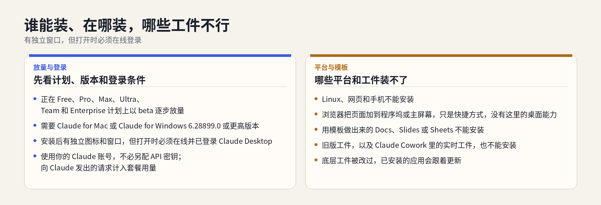
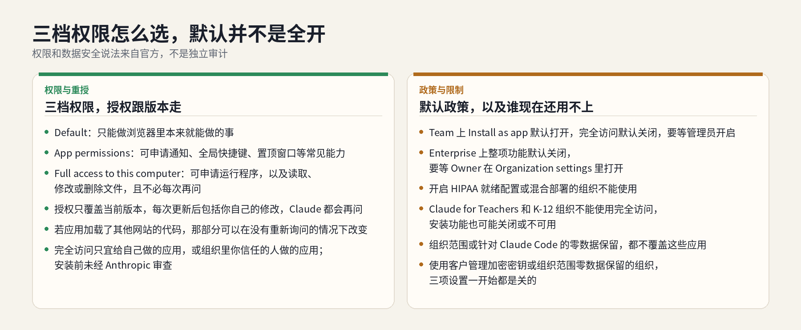

# 常用的Claude工件能装成电脑应用了：有独立窗口，完全访问却不是默认打开

每天要用的会议准备页、待出货跟踪，以前得先打开Claude再找到那个工件。11月24日，Anthropic在[介绍文](https://claude.com/resources/articles/install-as-app)里宣布，可以把这样的工件安装成Mac或Windows应用，有自己的图标和窗口。这项名为Install as app的功能正在beta中逐步放量。

[官方帮助](https://support.claude.com/en/articles/18516354-install-an-artifact-as-an-app)写，它面向Free、Pro、Max、Ultra、Team和Enterprise计划，需要Claude for Mac或Claude for Windows 6.28899.0或更高版本。Linux、网页和手机装不了。用浏览器把页面加到程序坞或主屏幕，只是快捷方式，没有这里说的桌面能力。

## 看起来像普通应用，打开时必须在线登录

安装后，工件会在独立窗口里打开，不再困在Claude主窗口里。底层工件被你或其他编辑改过，应用也会跟着更新。官文举例说，它可以做会议准备页，定期从日历和邮件里取信息，或跟踪当天要发出的订单。

这并不是装完就能离线用的本地软件。帮助页写，打开应用时必须在线，并已登录Claude Desktop。它使用你的Claude账号，不必另配API密钥或单独登录。应用向Claude发出的请求，以及搭建应用本身，都计入套餐用量。应用也可以像原来的工件一样使用你的连接器。

不是所有工件都能装。帮助页写，用模板做出来的Docs、Slides或Sheets装不了，旧版工件和Claude Cowork里的实时工件也装不了。介绍文同样写明，Claude Docs、Slides和Sheets不能安装。

## 三档权限，完全访问可以不经逐次确认就改文件

介绍文把权限分成三档。Default只能做浏览器里本来就能做的事。App permissions可申请通知、全局快捷键、置顶窗口等由Claude收紧控制的常见能力。Full computer access可申请运行程序，以及读取、修改或删除你的文件，而且不必每次再问。

帮助页把可申请的能力写得更细，并给出完整名称：Notifications、Keyboard shortcuts、Float over other windows、Menu bar item或system tray icon，以及Full access to this computer。最后这一档也会覆盖前面那些权限，除非你或组织把它们关掉了。应用要先询问，你再选Allow或Don't allow。Don't allow会一直保持，直到你改掉。

这不是默认全部打开。官文和帮助都写，只能把完全访问给自己做的应用；在Team和Enterprise上，也可以给组织里的人做的应用。Anthropic在你安装前不会审查这些应用，只宜交给你信任的作者。帮助还写，若应用有组织外的人参与，或Claude无法确认是谁做的，一般不允许申请完全访问；在Free、Pro、Max和Ultra上，组织外就意味着除你以外的任何用户。

你的授权只覆盖当前版本。每次更新后，包括你自己改过的版本，Claude都会再问一遍。若应用加载了其他网站的代码，那部分可以在没有重新询问的情况下改变。

## Team默认开功能但关完全访问，Enterprise要Owner打开

在Team计划上，Install as app默认打开，但最高一档完全访问默认关闭，要等管理员开启。[管理指南](https://support.claude.com/en/articles/16994751-artifacts-admin-guide-for-team-and-enterprise-plans)还写，Team上的App permissions默认打开。Enterprise上，整项功能默认关闭，要等Owner在Organization settings里的Artifacts中打开。

开启HIPAA就绪配置或混合部署的组织不能使用。教育场景另有限制：帮助页写，Claude for Teachers和K-12组织不能使用完全访问，安装功能也可能关闭或不可用。

零数据保留也不能当成已经覆盖这些应用。管理指南写，使用客户管理加密密钥，或组织范围零数据保留的组织，三项设置一开始都是关的；无论是组织范围还是仅针对Claude Code的零数据保留，都不覆盖这些应用。帮助页补充，仅针对Claude Code开启零数据保留的组织，在Owner打开Artifacts和Install as app后可以安装，但这些应用仍不被零数据保留覆盖。

这些权限范围和数据安全说法来自官方，不是独立审计，也不是已经替你试过的结论。

若只是想把会议准备页单独打开，先确认桌面版本和账号放量资格。需要通知，就在应用请求时单独决定是否允许，不必为此交出文件和程序的完全访问。只有当某项任务确实需要改本地文件、运行程序，而且你信任所有作者时，再考虑更高权限；即便更新会重新询问，也别忽略外站代码可以自行变化的例外。
