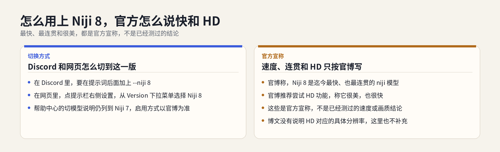
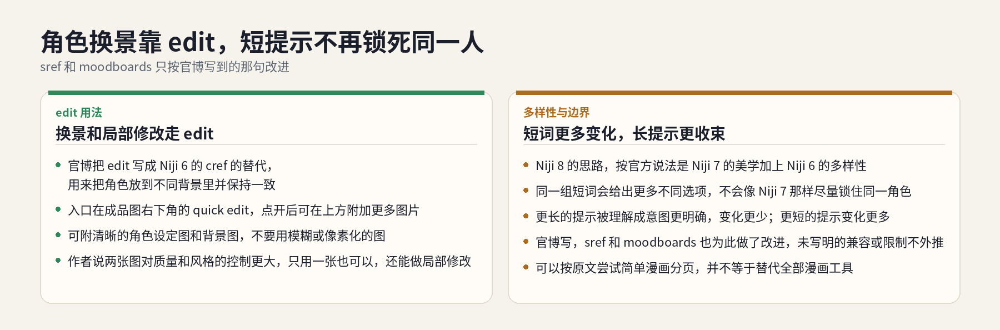

# 同一句短提示会画出更多样子：Niji 8来了，角色换景要改用edit

想让同一个绿头发角色去不同地方，以前不少人用的是Niji 6的cref。11月24日，Niji Journey在[官博](https://nijijourney.com/blog/niji-8)宣布Niji 8上线。官博把edit写成cref的替代，用来把角色放到不同背景里，并尽量保持一致。

在Discord里，要在提示词后面加上`--niji 8`。在网页里，点提示栏右侧设置，从Version下拉菜单里选择Niji 8。

## 官方称它最快、最连贯，但没写出HD是多少分辨率

官方称，Niji 8是迄今最快、也最连贯的niji模型，并推荐尝试HD功能，称它很美，也很快。这些描述尚未经独立实测，博文也未给出HD的具体分辨率。

## 换背景和局部修改，从成品图右下角的quick edit进去

官博写，许多人怀念Niji 6的cref，经过一番工作后，它的替代是edit。用法是把角色设定图和背景图合在一起，例如把女孩放到白船上、蓝海为背景，再给她戴上呼吸镜。也可以只做局部修改，比如在头顶加一个发髻。

入口在成品图右下角的quick edit按钮，点开后上方会出现菜单，用来附加更多图片。作者说，自己更常用两张图，比如把图1里的角色放到图2的场景中躺下；只用一张图也可以，但两张图对最终质量和风格的控制更大。输出质量很大程度上取决于输入，官博提醒不要用模糊或像素化的图。

## 简单漫画页也能画，但同一句短词不再锁住角色

官博写，凭借这一版的提示跟随，可以做简单的漫画分页，并举了上中下三格旅行页的例子。作者还说，将这种分页和edit结合，自己见过很不错的结果。它给出了简单漫画页的起点，并不等于从分镜到排版的整套流程都有了保证。

为了让角色还能通过其他方式复现，官方表示推迟了发布，直到edit等手段可用。官博只补了一句：sref和moodboards等其他一致性功能，也为此做了改进。博文没有展开具体兼容范围和限制。

## 美学按官方的说法，是Niji 7的质感加上Niji 6的多样性

官博把Niji 8的设计思路写成：Niji 7的美学，加上Niji 6的多样性。它明确写，Niji 7擅长你只要输入相同的词，就尽量保持同一个角色；Niji 8不会这样做，而会像Niji 6那样，给同一组词提供更多不同选项。

对这一版，官方把提示词的长度理解成意图：更长的提示变化更少，更短的提示变化更多。原因是，写得越长，通常表示你越清楚自己要什么。博文还用同一位角色、详略不同的两组提示做对比，说明写得更具体的那一组变化明显更少。

若你一直拿同一句短提示反复出图，这次先分清自己要的是新角色，还是老角色的新场景。前者可以比较短提示给出的不同样子；后者则用清晰的角色图和背景图走edit，先核对脸、衣服和姿态有没有被改掉，再决定是否继续做漫画页。
