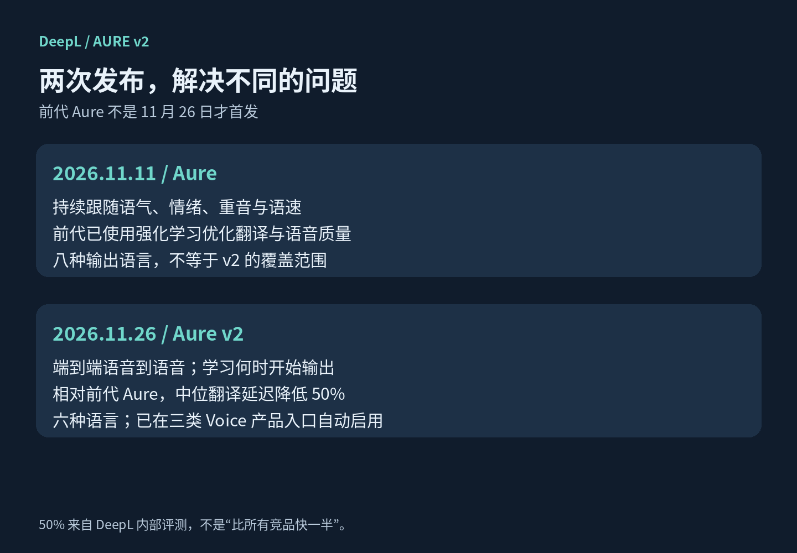
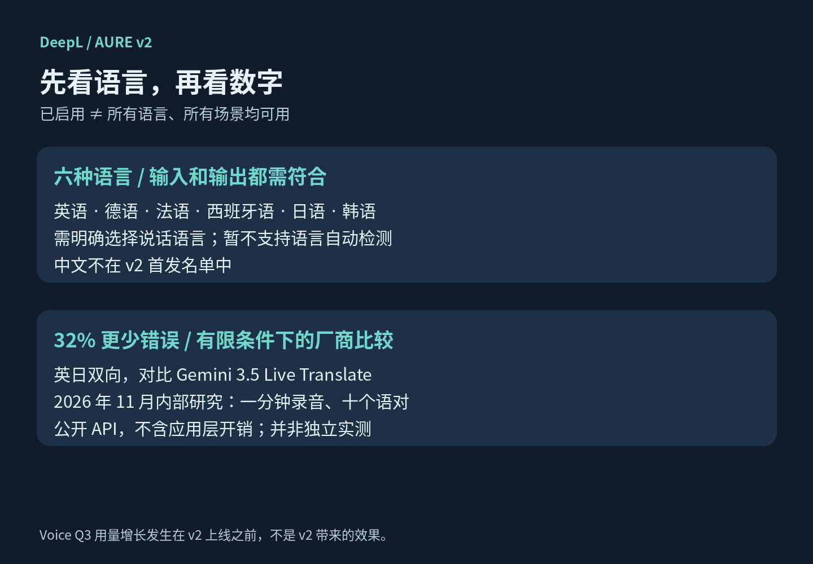

# DeepL Aure v2 已上线：相对前代少等一半，中文还不在名单里

跨语言聊天，最怕的不是声音不够像，而是你已经准备接话，翻译还没追上来。

DeepL 在 11 月 26 日东京 Unmute 活动上发布了 Aure v2。这不是 11 月 11 日 Aure 首发的重报，而是两周后的一次更新。官方给出的核心变化很直接：相较前代 Aure，翻译的中位延迟降低了 50%。

但别把它读成“比所有竞品快一半”。比较对象是自家前代，数字来自 DeepL 内部评测，不是实测出来的会议体验。

## 从“像你说话”，到“知道什么时候开口”

11 月 11 日发布的 Aure，重点是让译出的声音持续跟随说话人的语气、重音、情绪和语速，而不是只在开头采一段声音，后面一直照着念。两周后的 v2，则把等待时间摆到了更显眼的位置。

按 DeepL 的解释，传统语音翻译通常要经过语音转文字、文字翻译、再生成语音。v2 换成端到端语音到语音架构，将这几个环节整合，直接从语音翻到语音。

不过，处理得快还不够。模型还得决定：现在听到的上下文，够不够开始翻？

开口太早，可能漏掉后面的关键信息；等得太久，又会拖慢对话。德语、日语等语言的重要信息可能出现在句尾，这种取舍尤其明显。DeepL 说，v2 用强化学习同时奖励翻译准确、开始输出够快，让模型逐渐学会判断什么时候已经听够。

这不是说强化学习直到 v2 才出现。前代 Aure 的官文就介绍过用它优化准确性和语音质量；这次披露的重点，是用它处理实时翻译的输出时机。

## 50% 和 32%，都要带着条件看

DeepL 称，在内部评测覆盖的语对中，Aure v2 的翻译质量高于所测六套竞品；英日双向翻译错误比 Google Gemini 3.5 Live Translate 少 32%。

这组结果有几条前提不能省：评测由 DeepL 在 2026 年 11 月完成，使用一分钟真实语音录音，覆盖十个语对，转写经过人工校验；所有模型通过公开 API 测试，不含应用层开销。

产品页进一步说明，错误数使用 DeepL 自家的 TQE 指标，由 AI 评审对照人工转写来计数。它也注明，ElevenLabs 只测试了十个语对中的八个，Gradium 测了六个。因此，“六套竞品”不能理解为每家都完成了全部十个语对的测试，更不能外推为所有语言、所有场景都领先。

产品页还给出一个更有体感的数：在这套测试里，一半译出词语能在 3.3 秒内被听到。它不是整场会议的端到端体验保证，真实对话结果可能不同。

对要开跨国会议、做外语客服的人，少等几秒当然有价值。但更值得验证的是，插话、长句和关键语义出现得很晚时，系统能不能既跟得上，又不抢跑。这些还需要真实场景测试，不能靠厂商榜单替代。

## 已经启用，但不是所有语言都能用

Aure v2 不是预告。官方称，它已在 DeepL Voice 在线会议、当面交谈和 Voice API 中，对支持的语言自动启用，无需额外配置。

首发六种语言是英语、德语、法语、西班牙语、日语和韩语。产品页明确要求，输入与输出都必须属于这六种语言，而且说话语言需要手动明确选择，暂不支持语言自动检测。

中文不在这张 v2 名单里。前代 Aure 支持八种输出语言，其中还有意大利语和葡萄牙语，不能把前代名单直接套到 v2，更不能拿整个 DeepL Voice 的覆盖范围来替它扩容。

还有一组很容易误读的数据：DeepL 说，2026 年第三季度 Voice 总语音分钟数同比增至八倍以上，会议翻译分钟数约为七倍。这说的是 Voice 在 v2 发布之前的业务用量，不是新模型上线一天带来的效果。

这次更新值得关注的，不只是翻译又快了一些，而是“什么时候开口”正在成为语音 AI 的核心能力。但对中文用户，最实际的结论仍然是：先确认语言组合和产品可用条件，不要看到“自动启用”，就以为自己的会议已经切到了 v2。

原文链接：
- [Aure v2 发布公告，2026-11-26](https://www.deepl.com/en/press-release/aure-v2)
- [Aure 产品页与评测说明](https://www.deepl.com/en/products/voice/aure)
- [前代 Aure 发布公告，2026-11-11](https://www.deepl.com/en/press-release/aure-voice-ai-model)
- [Unmute Tokyo 活动页](https://deepl-unmute.com/)
