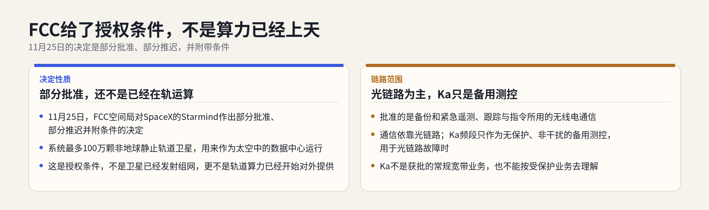
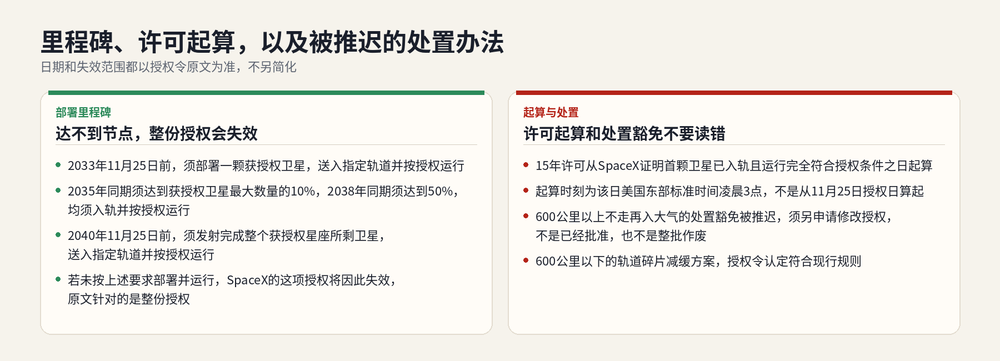

# FCC部分批准最多100万颗Starmind卫星：这是授权条件，不是轨道算力已经开张

把数据中心送到轨道上，听起来像算力不用再跟地面机房抢电、抢地。11月25日，美国联邦通信委员会空间局对SpaceX的Starmind轨道数据中心系统作出决定：部分批准、部分推迟，并附带条件。这份[授权令](https://docs.fcc.gov/public/attachments/DA-26-1273A1.txt)和[同日公文页](https://www.fcc.gov/document/fcc-authorizes-1-million-satellites-data-centers-space-0)写得很清楚，这还不是卫星已经发射组网，更不是轨道算力已经开始对外提供。

授权对象是Space Exploration Holdings, LLC，呼号S00798，申请档号SAT-LOA-20260108-00016。系统被写成最多100万颗非地球静止轨道卫星，分布在约500到1002公里的若干轨道层，用来作为太空中的数据中心运行。

## 现在批下来的，主要是光链路之外的备用紧急测控

授权范围是：为这个最多100万颗卫星的星座，批准备份和紧急遥测、跟踪与指令所用的无线电通信。授权令写明，Starmind的通信将依靠光链路；Ka频段只作为无保护、非干扰的备用测控，用于光链路出现故障时，频段为下行18.8-19.3吉赫、上行28.6-29.1吉赫。它不是获批的常规宽带业务，也不能按受保护业务去理解。

SpaceX还被要求：使用这些Ka频段前须完成相关地球站许可，不得主张保护，也不得对其他系统造成有害干扰。

## 首颗须在2033年11月25日前入轨并按授权运行，达不到节点整份授权会失效

授权令把部署里程碑写得很具体。SpaceX必须在2033年11月25日前，部署一颗获授权空间站，送入指定轨道，并按照站台授权运行。2035年11月25日前，须把获授权空间站最大数量的10%送入指定轨道并按授权运行。2038年同期须达到50%。2040年11月25日前，须发射完成整个获授权星座所剩卫星，送入指定轨道，并让每颗都按这份授权运行。

授权令接着写：若未按上述要求部署并运行获授权空间站，SpaceX的这项授权将因此失效。原文针对的是整份授权，而不是只让未发射的那一部分失效。

## 15年许可从首颗卫星的合规证明起算，不是从授权日算起

许可期限是15年。起算日是SpaceX向委员会证明：第一颗Starmind卫星已成功入轨，且运行完全符合这份授权的条款和条件。起算时刻为该日美国东部标准时间凌晨3点。SpaceX须在把首颗卫星投入运行后的五个工作日内提交这份证明。

因此，许可不是从11月25日授权日开始，也不是从某个尚未写进授权令的发射窗口开始。

## 600公里以上不走再入大气的处置办法被推迟，要另申请修改授权

SpaceX曾请求豁免，以便对运行在600公里以上的卫星，灵活采用地球弃置轨道或日心轨道等处置方式。授权令把这项豁免请求推迟了，理由是材料还不足以判断是否符合委员会要求。在部署并运行任何不会经由大气再入处置的Starmind卫星之前，SpaceX必须申请修改这份授权，并充分说明理由。讨论部分还写明，在部署任何将在600公里以上运行的Starmind卫星之前，须提交包含最终轨道碎片减缓方案的修改申请。

这不是整批授权作废，也不是已经批准这些替代处置办法。授权令认定，600公里以下卫星的轨道碎片减缓方案符合现行规则。

## 天文和散热等担忧写在评论里，FCC认为许多事项不在射频管辖范围内

申请记录中，美国天文学会等提出过对光学和红外观测的担忧，包括卫星废热可能抬高天空红外背景；也有评论提到反光等问题。FCC的处理是：认为光学天文方面的担忧，已由SpaceX在申请和补充材料里承诺与美国国家科学基金会协调而得到充分回应，因此不再附加额外条件；并指出委员会规则并不处理光学天文保护。对美国天文学会提出的废热和红外问题，FCC认为属于与频谱无关的潜在影响，超出这次轨道数据中心射频运行的审查范围。

FCC还写明，许多与射频运行无关的担忧，并不显然属于国会赋予它监管无线电通信的有限职责。这些是官方对管辖范围的看法，并不等于已经裁定天上不会有光污染或废热，也不等于散热或地面电价问题已经解决。

若有人把这次决定说成轨道算力已经开张，或把尚未写进授权令的发射预期当成官方时间表，可以对着授权令核对两件事：首颗获授权卫星必须在2033年11月25日前入轨并按授权运行；15年许可从SpaceX证明首颗卫星入轨且运行完全符合条件之日起算，而不是从这次授权日算起。
