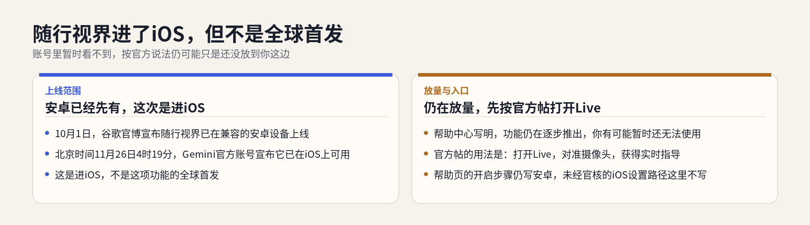
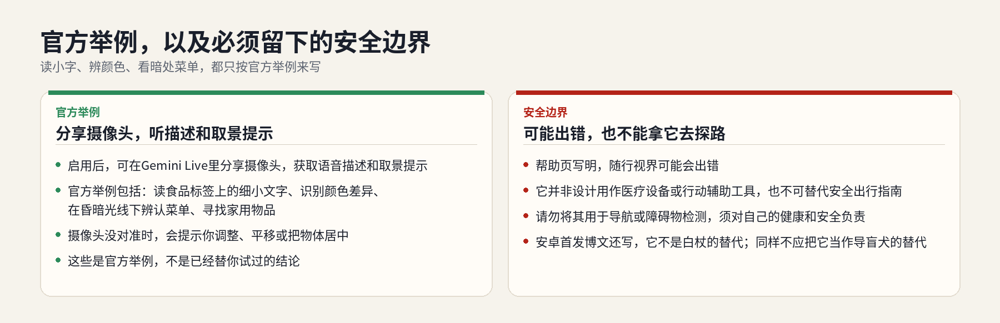

# 食品袋上的小字可以让它读：随行视界进了iOS，但不是全球首发

在光线发暗的餐厅对着菜单，或是拎起食品袋找配料表，眼睛不够用的时候，有人会把摄像头交给Gemini Live，让它边看边说。北京时间11月26日4时19分，[Gemini官方账号](https://x.com/GeminiApp/status/2125685936344236471)宣布，Guided Vision已经在iOS上可用。谷歌帮助中心把这一功能称作“随行视界”。

这不是它第一次出现。10月1日，谷歌在[官方博客](https://blog.google/innovation-and-ai/products/gemini-app/guided-vision-gemini-live/)里写明，随行视界已在兼容的安卓设备上线。这次是进iOS，不是全球首发。

## 仍在逐步放量，账号里也可能暂时看不到

官方帖的说法是：打开Live，对准摄像头，就能在屏幕上得到实时指导。帮助中心则提醒，这项功能正在逐步推出，你有可能暂时还无法使用。

功能已经宣布登陆iOS，并不等于每个账号都已经能打开。暂时看不到，按官方说法，仍可能只是还没放到你这边。

## 它做的是分享摄像头，再用语音描述并提示怎么取景

按[帮助页](https://support.google.com/gemini/answer/18365638)的说明，启用后，你可以在Gemini Live里分享摄像头，获取语音指导。官方举过的例子包括：读食品标签上的细小文字、识别颜色差异、在昏暗光线下辨认菜单，以及寻找家用物品。

如果摄像头没对准，它会立刻给出语音反馈，提醒你调整摄像头、在空间里平移，或把物体放到画面中间。帮助页还写到，可以让它朗读或翻译周围的文字，帮忙在调料柜里找胡椒粉，询问衣服颜色或图案是否相配，或寻找掉落的耳机、了解房间布局。这些只是官方举过的例子，不是已经实测的效果。

## 帮助页仍按安卓写开启步骤

帮助中心关于如何打开随行视界的步骤，仍写的是在安卓设备上打开Gemini应用，点顶部头像进入设置，再开关“在Live模式下使用随行视界”。安卓上的无障碍快捷方式和TalkBack入口，也只出现在这些官方安卓说明里。

官方帖没有另写一条已经核对过的iOS设置路径。对iPhone，目前能直接引用的官方说法，仍是打开Live并对准摄像头。

## 可能出错，也不能拿它去探路

帮助页写明：随行视界可能会出错；它并非设计用作医疗设备或行动辅助工具，也不可替代安全出行指南；请勿将其用于导航或障碍物检测；你须对自己的健康和安全承担全部责任。安卓首发博文还写，它不是白杖的替代，使用时仍应依靠既有的行动辅具和安全出行做法。

官方已经把这些限制写清楚了：它不是白杖的替代，也不应用来独自导航，同样不应把它当作导盲犬的替代。

若你用的是iPhone上的Gemini应用，可以先打开Live，看自己的账号里是否已经出现这项功能。暂时没有，按帮助页的说法，它仍在逐步推出。若已经出现，按官方举例去听标签、颜色或菜单时，把“可能出错、不能用来导航或检测障碍”当作使用前提。
