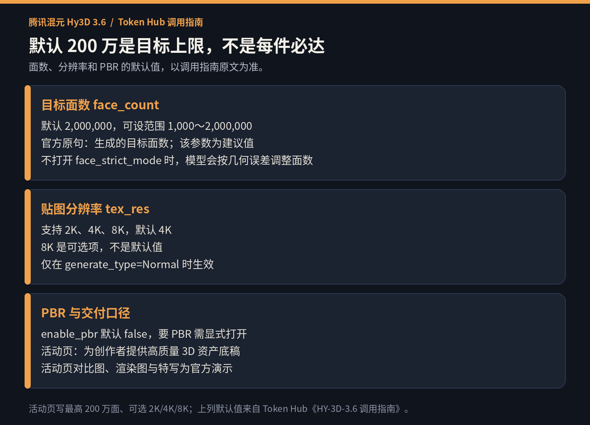
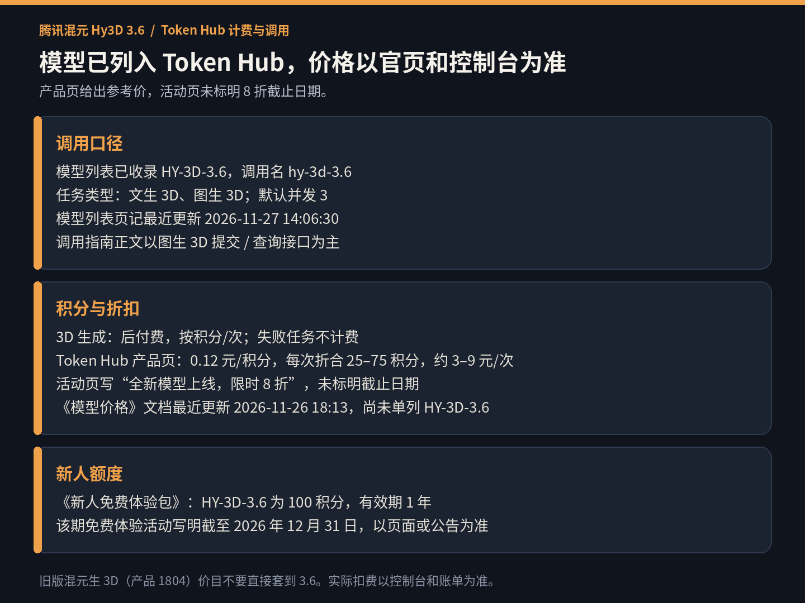

# 混元 Hy3D 3.6 上线 Token Hub：200 万面是目标上限，先当底稿用

做游戏、手办、电商展示的人，真正卡的往往不是“能不能出一只模型”，而是交出来的网格能不能进自己的生产流程：面数是否可控，贴图能不能重打光，结构清不清晰，还要不要拆件、布线、绑骨。

11 月 27 日，腾讯混元发布 Hy3D 3.6。腾讯云活动页把它写成：把文本或图片转化为生产级 3D 资产；紧接着又写，为创作者提供高质量 3D 资产底稿。两句话要一起看：它给的是可以进入专业生产流程的底稿，不是交出去就能用的成品。

它不是 Token Hub 上的 Tripo 3D 模型，也不是混元的语言模型 Hy4。Hy3D 3.6 是混元自己的 3D 生成模型，调用名是 `hy-3d-3.6`。

## 200 万面和 8K，先看成可调上限

活动页把 3.6 的升级写得很醒目：最高模型面数从 150 万提到 200 万，纹理贴图分辨率从 4K 提到 8K，并写明可生成水密网格，PBR 可附带金属度、粗糙度和法线贴图。

更精确的默认值，在腾讯云 Token Hub 的《HY-3D-3.6 调用指南》里：

`face_count` 是“生成的目标面数”，默认 2,000,000，范围 1000 到 2,000,000，而且官方写的是“建议值”。同一页还有 `face_strict_mode`：不按目标面数强制生成时，模型会根据几何误差调整面数。所以 200 万是可设定的上限和默认目标，不是每件都会长到 200 万面。

贴图也一样。活动页写可选 2K、4K、8K；调用指南写 `tex_res` 支持 2k、4k、8k，默认 4k。8K 是可选项，不是默认值；这项设置只在 `generate_type=Normal` 时支持。

还有一个容易被宣传带过去的开关：`enable_pbr` 默认是 false。要 PBR 结果，需要显式打开，而且只在 `generate_type=Normal` 时生效。活动页把水密网格和 PBR 列为能力，页面上的对比图、渲染图和特写也写明来自 Hy3D 3.6 生成模型，那是官方演示。

活动页自己也留了后路。讲几何升级时，它写“近看更容易发现哪些地方需要再修”；讲结构时，写“容易判断哪个部位需要单独调整”。这就是底稿逻辑：先拿到结构清楚、细节够用的起点，再进你自己的修模、布线、贴图和引擎流程。

## 各环节可以拆开接，不要默认一次调用包办

对要接进管线的人，活动页里更有用的是这句话：从输入到交付，各环节可通过独立 API 调用或组合，也可单独处理已有模型。

输入方面，活动页写明：文字描述最多 1024 个中文字符；单图支持 JPG/PNG/WebP，也可以走 4/8 视图；还可以输入已有 3D 模型或参考图。Token Hub 模型列表把 `hy-3d-3.6` 的任务类型写成文生 3D、图生 3D。需要注意的是，这份调用指南的正文标题是“提交图生 3D 任务 / 查询图生 3D 任务”，提交时 `image_url` 或 `image_base64` 必填其一。文生 3D 在模型列表和活动页里有写，但该指南页没有给出一份完整的文本提交参数表。

后面的工序，活动页是分开写的：PartGen 2.0 可拆分 50+ 部件，PolyGen 2.0 重新布线并以四边面为主，也可以绑骨，用文本或模板驱动动作。导出默认同时给 OBJ 和 GLB，另外可选 STL、USDZ、FBX。这些不要理解成一次 `hy-3d-3.6` 调用就会自动做完拆件、拓扑和绑骨——活动页的口径是各环节可以独立调用或组合。

## Token Hub 已经给出调用说明，价格先对官页

Hy3D 3.6 不是只停留在活动页上的预告。Token Hub《模型列表》已收录 HY-3D-3.6，调用参数为 `hy-3d-3.6`，默认并发数为 3；该页显示最近更新时间为 2026-11-27 14:06:30。调用指南给出了提交和查询接口，默认接入地址按地域区分，广州为 `tokenhub.tencentmaas.com`，新加坡为 `tokenhub-intl.tencentmaas.com`，并写明不支持跨地域、跨站点调用。

每经在 11 月 27 日 11:17 报道，IT之家在 11:44 报道，都写：Hy3D 3.6 已经上线腾讯云 Token Hub，对外提供 API 服务。两家还转述腾讯称，腾讯 AI 创意智能体 Miora、腾讯游戏旗下专业资产生成平台 LAP、专业影视 AI 平台 WorkRally 等也已接入。这几家产品名没有出现在活动页正文里，目前只能看作每经、IT之家对腾讯的转述。

计费不要去抄社区文章，也不要拿旧版混元生 3D 的价目直接套到 3.6 上。

《计费方式》页（最近更新 2026-11-27 11:16:15）写：3D 生成按后付费、积分/次计费；模型复杂度（面数、精度等）可能影响计费；未成功返回可用结果的任务不计费。Token Hub 产品页给出 Hy3D 3.6 的参考口径：0.12 元/积分，每次折合 25–75 积分，约 3–9 元/次。活动页顶部写着“全新模型上线，限时 8 折”，但活动页和《模型价格》文档都没有写明这笔折扣的截止日期。《模型价格》文档最近更新时间仍是 2026-11-26 18:13:00，表内列了 HY-3D-3.0、HY-3D-3.1 等，尚未单列 HY-3D-3.6。所以 3.6 的单价和折扣，最终以控制台展示和账单为准。

新用户额度倒是写进了同一天更新的《新人免费体验包》：HY-3D-3.6 为 100 积分，有效期 1 年；该期免费体验活动写明截至 2026 年 12 月 31 日，具体以页面展示或平台公告为准。

Hy3D 3.6 这次把上限拉到了 200 万面和 8K 贴图，但真正决定能不能省事的，还是默认参数与实际管线之间的落差：默认 200 万面是建议目标、贴图默认 4K、PBR 默认关闭，价格和 8 折也要以控制台与账单为准。与其盯着“生产级”三个字，不如先把第一次生成结果当成底稿，看它在自己的修模、拓扑、贴图和引擎流程里能接走多少工序。

原文链接：
- [腾讯云 Hy3D 3.6 活动页](https://cloud.tencent.com/act/pro/hy3d-3.6)
- [Token Hub 产品页](https://cloud.tencent.com/product/tokenhub)
- [Token Hub 模型列表，页记最近更新 2026-11-27 14:06:30](https://cloud.tencent.com/document/product/1823/130051)
- [HY-3D-3.6 调用指南](https://cloud.tencent.com/document/product/1823/141364)
- [Token Hub 计费方式，页记最近更新 2026-11-27 11:16:15](https://cloud.tencent.com/document/product/1823/130054)
- [Token Hub 模型价格，页记最近更新 2026-11-26 18:13:00](https://cloud.tencent.com/document/product/1823/130055/)
- [Token Hub 新人免费体验包，页记最近更新 2026-11-27 14:06:30](https://cloud.tencent.com/document/product/1823/130053)
- [Token Hub API 使用说明](https://cloud.tencent.com/document/product/1823/130078)
- [每经报道，2026-11-27 11:17:38](https://www.nbd.com.cn/articles/2026-11-27/4660768.html)
- [IT之家报道，2026-11-27 11:44:56](https://www.ithome.com/0/1033/282.htm)
